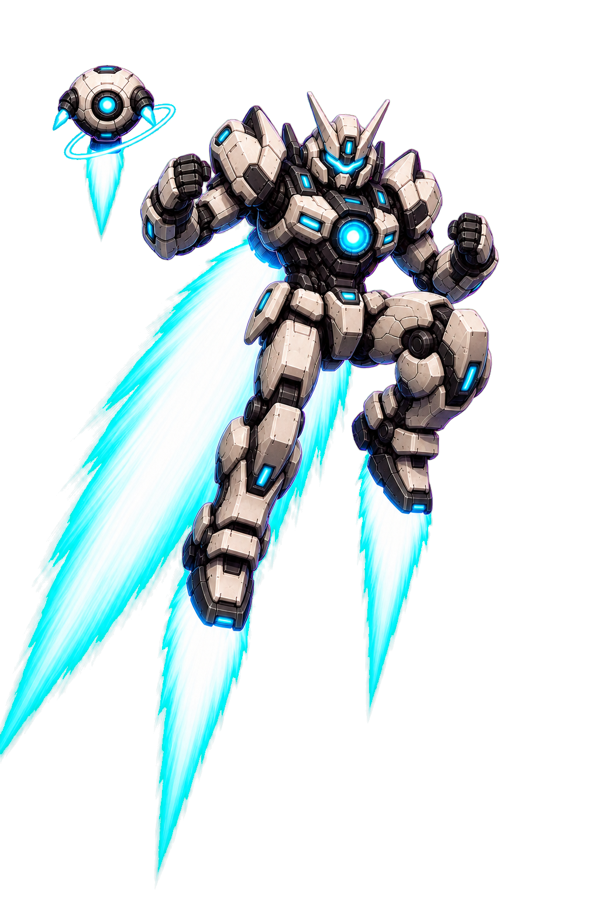

# Commander (codex-commander)

This directory is the maintainable source package for the Commander Codex pet.



## Layout

- `reference/` — high-resolution pose references (`standing.png` is the original character cutout).
- `source/` — composite PNG frames for the nine standard animation rows and all 16 look directions. Each animation folder includes matching `robot/` and `drone/` layers plus a `combine.json` composition definition.
- `output/` — Codex install artifacts: `pet.json` and `spritesheet.webp`.
- `src/` — atlas assembly, compositing, validation, and preview server.
- `scripts/cli.ts` — `combine`, `build`, `install-pet`, and `preview` commands.
- `preview/` — browser preview for robot, drone, and combined layers.

Run `npm install` once in this directory before the commands below.

## Preview animations

```powershell
npm run preview
```

This starts a local server, opens the preview in your default browser, and loads frame lists from each animation's `combine.json`. No build or install step is required to inspect timing and layers.

## Modify and rebuild

Edit or replace frame PNGs under `source/<state>/`. Frame names and counts come from that state's `combine.json`.

When changing isolated robot or drone artwork, rebuild the matching combined frames first:

```powershell
npm run combine
```

Use `npm run combine -- --animation <state>` to rebuild one state and `npm run combine -- --check` to validate every configuration without replacing PNGs. Compositing is separate from `npm run build`, which only assembles already-combined frames into the pet atlas.

## Composition configuration

Each animation folder owns a `combine.json`. `layerOrder` is painted back-to-front, and each named layer points at its frame template. Transforms retain the original `192x208` registration: they scale around an anchor, rotate, translate, adjust opacity, then composite. Coordinates are pixels; positive rotation and path angles are clockwise in screen coordinates.

```json
{
  "version": 1,
  "canvas": [192, 208],
  "frames": ["00", "01"],
  "layerOrder": ["drone", "robot"],
  "layers": {
    "drone": {
      "source": "drone/{frame}.png",
      "transform": {
        "anchor": "content-center",
        "position": {"type": "linear", "start": [-8, 0], "end": [8, 0], "easing": "ease-in-out"},
        "rotation": {"type": "keyframes", "keyframes": [{"frame": "00", "value": 0}, {"frame": "01", "value": 12}]}
      },
      "frameOverrides": {"01": {"opacity": 0.8}}
    },
    "robot": {"source": "robot/{frame}.png"}
  }
}
```

`position`, `scale`, `rotation`, and `opacity` accept constants, a `frames` map, `linear` start/end values, or keyed values with `linear`, `ease-in`, `ease-out`, `ease-in-out`, and `step` easing. `position` additionally supports `ellipse` (`center`, `radii`, `startAngle`, `endAngle`) and circular `arc` (`center`, `radius`, `startAngle`, `endAngle`). `frameOverrides` wins over the base transform for its named frame. `anchor` may be `content-center`, `canvas-center`, or an `[x, y]` coordinate; nearest-neighbor resampling is the default for pixel art.

Run `npm run build`, then inspect `output/spritesheet.webp`. Run `npm run install-pet` to copy the built pet to `%USERPROFILE%\.codex\pets\commander`. Restart Codex or reselect the pet after installation.
