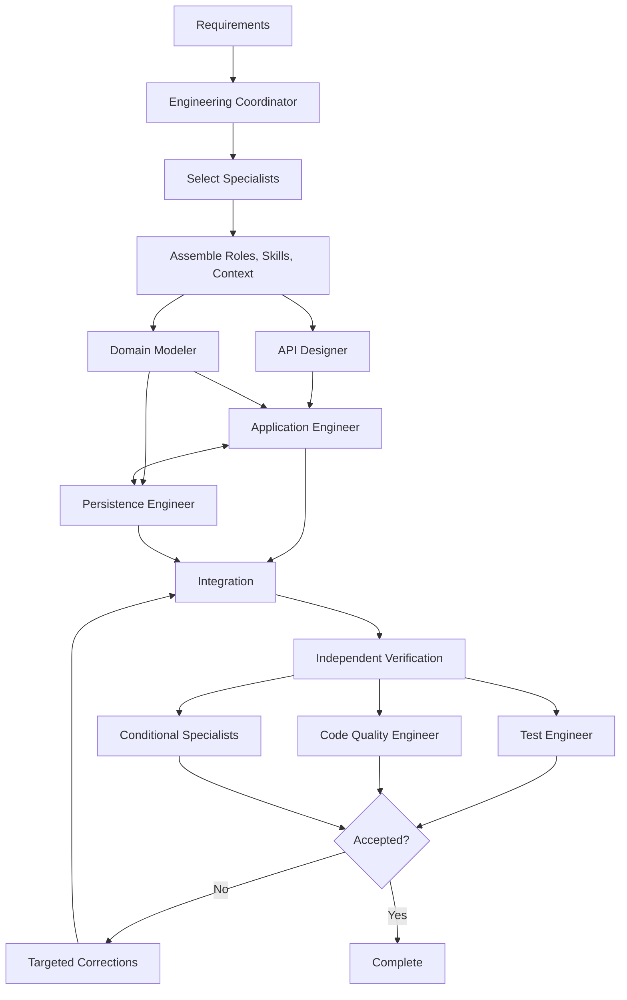
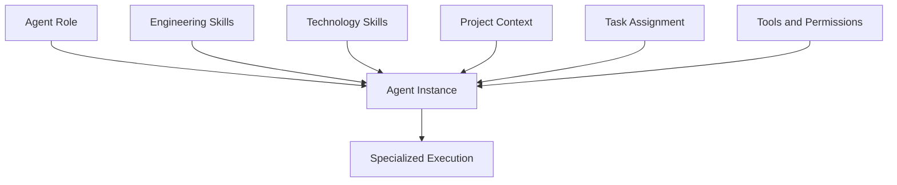
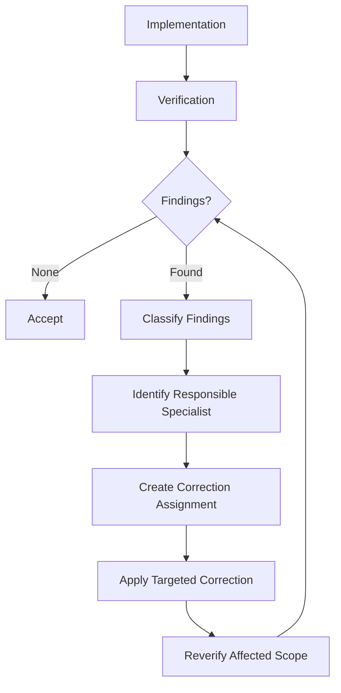

# Specialist Software Engineering Agent Framework

## Overview

A framework for assembling teams of specialized AI software engineering agents to collaboratively design, implement, optimize, and validate software.

Rather than modeling agents after conventional developer job titles, agents specialize in distinct engineering concerns such as API design, domain modeling, application logic, persistence, performance, security, and correctness.

An orchestrator dynamically assembles teams based on the requirements of a particular change, assigns responsibilities, coordinates dependencies, and verifies the resulting implementation.

The system should support multiple projects, programming languages, technology stacks, and architectural styles without requiring project-specific agent definitions.

## Goals

1. **Specialized expertise** — Each agent approaches software engineering from a distinct technical perspective with well-defined priorities.
2. **Dynamic team composition** — Instantiate only the specialists relevant to a given task.
3. **Composable capabilities** — Separate reusable technical skills from agent roles and project context.
4. **Clear responsibilities** — Explicitly define each agent's authority, deliverables, and boundaries.
5. **Structured collaboration** — Coordinate agents through artifacts, contracts, and dependencies rather than relying exclusively on conversational context.
6. **Independent verification** — Separate implementation responsibilities from validation and quality assessment.
7. **Minimal coordination overhead** — Avoid unnecessary agents, duplicated work, and excessive handoffs.
8. **Project independence** — Reuse specialist definitions across projects, languages, frameworks, and platforms.
9. **Incremental evolution** — Improve skills, roles, and orchestration strategies independently.
10. **Autonomous correction** — Detect problems and delegate targeted corrections to the appropriate specialists.

---

## 1. Core Concepts

The framework distinguishes five concepts.

### Role

Defines an agent's engineering responsibility, perspective, priorities, and authority.

Examples:
- API Designer
- Domain Modeler
- Application Engineer
- Persistence Engineer
- Performance Engineer

A role describes *what aspect of software engineering the agent specializes in*.

### Skill

Defines reusable knowledge, instructions, techniques, tools, and procedures that an agent can apply.

Examples:
- Domain-driven design
- Transaction management
- REST API versioning
- SQL query optimization
- Property-based testing
- Kotlin development

A skill describes *what an agent knows how to do*.

Skills can be shared across multiple roles and composed dynamically.

### Context

Defines the project-specific information needed to perform an assignment.

Examples:
- Existing architecture
- Repository structure
- Coding conventions
- Technology stack
- Domain terminology
- Relevant source code
- Requirements and design documents

Context should be assembled independently of the agent's role and skills.

### Assignment

Defines the specific work an instantiated agent is responsible for.

An assignment includes:
- Objective
- Scope
- Inputs
- Expected deliverables
- Acceptance criteria
- Constraints
- Dependencies
- Authority and allowed modifications

### Artifact

A structured output used to communicate decisions and results between agents.

Examples:
- API contracts
- Domain models
- Implementation plans
- Source code changes
- Schema definitions
- Test cases
- Performance findings
- Review reports

Artifacts should be durable, inspectable, versionable, and independently understandable.

### Agent Composition

An agent instance is dynamically assembled from:

```text
Agent Instance
  = Role
  + Skills
  + Project Context
  + Assignment
  + Tools and Permissions
```

For example:

```yaml
agent:
  role: persistence-engineer

  skills:
    - kotlin
    - postgresql
    - transaction-design
    - schema-migrations

  context:
    - project-architecture
    - coding-conventions
    - persistence-module

  assignment:
    objective: Implement booking persistence
    scope:
      - booking repository
      - database schema
    constraints:
      - preserve existing contracts
      - maintain transactional consistency

  permissions:
    write:
      - src/persistence/**
    review:
      - src/domain/**
```

---

## 2. Specialist Catalog

The following represents a library of possible engineering specializations, not a requirement to instantiate every role.

### 2.1 Architecture and Modeling

| Specialist | Primary Responsibility |
|---|---|
| System Architect | Component boundaries, dependencies, architectural evolution, tradeoffs |
| Domain Modeler | Entities, value objects, aggregates, invariants, domain semantics |
| API Designer | Interfaces, contracts, versioning, consistency, usability |
| Application Engineer | Use cases, business workflows, application services, orchestration |
| Integration Engineer | External systems, adapters, protocols, service communication |
| Distributed Systems Engineer | Messaging, consistency, concurrency, retries, idempotency |
| Data Architect | Data ownership, schemas, information models, data lifecycle |

### 2.2 Implementation

| Specialist | Primary Responsibility |
|---|---|
| Algorithm Engineer | Algorithms, data structures, computational complexity |
| Persistence Engineer | Repositories, queries, transactions, storage, migrations |
| Concurrency Engineer | Synchronization, parallelism, asynchronous execution |
| State Management Engineer | State transitions, state machines, lifecycle management |
| Serialization Engineer | Encoding, decoding, data formats, schema compatibility |
| Protocol Engineer | Transport protocols, wire formats, communication semantics |
| UI Engineer | Components, rendering, interactions, interface implementation |
| Developer Experience Engineer | SDKs, CLIs, configuration, developer ergonomics |

### 2.3 Quality and Correctness

| Specialist | Primary Responsibility |
|---|---|
| Test Engineer | Test strategies, test implementation, behavioral verification |
| Formal Methods Engineer | Invariants, property-based testing, formal verification |
| Code Quality Engineer | Maintainability, readability, cohesion, coupling |
| Security Engineer | Authentication, authorization, trust boundaries, vulnerabilities |
| Reliability Engineer | Fault tolerance, resilience, recovery, availability |
| Compatibility Engineer | Backward compatibility, schema evolution, regression prevention |
| Accessibility Engineer | Accessible interfaces and interaction patterns |
| Observability Engineer | Logging, metrics, tracing, diagnostics |

### 2.4 Optimization

| Specialist | Primary Responsibility |
|---|---|
| Performance Engineer | Profiling, latency, throughput, computational efficiency |
| Memory Engineer | Allocation, memory layout, garbage collection, leaks |
| Scalability Engineer | Capacity, load distribution, horizontal scaling |
| Database Optimization Engineer | Query optimization, indexing, contention, execution plans |
| Build Engineer | Build systems, dependency resolution, compilation efficiency |
| Cost Optimization Engineer | Infrastructure and resource cost efficiency |
| Runtime Engineer | Runtime behavior, scheduling, execution models |

### 2.5 Delivery and Evolution

| Specialist | Primary Responsibility |
|---|---|
| Refactoring Engineer | Structural improvements while preserving behavior |
| Migration Engineer | Schema migrations, framework upgrades, system transitions |
| Deployment Engineer | Packaging, rollout strategies, rollback safety |
| Configuration Engineer | Configuration models, environments, feature flags |
| Dependency Engineer | Dependency versions, compatibility, supply-chain concerns |
| Legacy Systems Engineer | Understanding and safely modifying existing undocumented systems |
| Documentation Engineer | Technical documentation, examples, architectural explanations |

---

## 3. Agent Categories

Agents can be classified by how they participate in development.

### Builders

Builders own implementation deliverables.

Examples:
- API Designer
- Domain Modeler
- Application Engineer
- Persistence Engineer
- UI Engineer

Typical responsibilities:
- Create design artifacts
- Implement source code
- Maintain assigned components
- Satisfy requirements
- Resolve defects assigned to them

Builders should have clearly defined write scopes to minimize conflicting changes.

### Advisors

Advisors contribute expertise across implementation boundaries.

Examples:
- Performance Engineer
- Security Engineer
- Reliability Engineer
- Distributed Systems Engineer
- Scalability Engineer

Typical responsibilities:
- Analyze proposed approaches
- Identify risks
- Recommend improvements
- Evaluate technical tradeoffs
- Define relevant constraints

Advisors should not automatically modify code outside an explicitly delegated assignment.

### Verifiers

Verifiers independently assess deliverables.

Examples:
- Test Engineer
- Code Quality Engineer
- Compatibility Engineer
- Security Engineer
- Performance Engineer

Typical responsibilities:
- Validate requirements
- Discover defects
- Identify regressions
- Verify architectural constraints
- Produce actionable findings
- Recommend acceptance or correction

A specialist may act in different categories for different assignments.

For example, a Performance Engineer may act as an advisor during implementation, a verifier during review, or a builder when explicitly assigned an optimization.

---

## 4. Engineering Philosophies

Each specialist should have a distinct engineering philosophy that influences its decisions.

These philosophies are more important than simply assigning different task descriptions.

| Specialist | Guiding Question |
|---|---|
| System Architect | Does this change preserve a coherent, evolvable architecture? |
| API Designer | Is this interface intuitive, consistent, and safe to evolve? |
| Domain Modeler | Does the implementation faithfully represent the domain? |
| Application Engineer | Does this correctly coordinate the intended use case? |
| Persistence Engineer | Is data accessed and modified correctly, safely, and efficiently? |
| Algorithm Engineer | Is the solution correct and computationally appropriate? |
| Performance Engineer | Where are resources wasted or bottlenecks introduced? |
| Security Engineer | What trust assumptions or boundaries could be violated? |
| Reliability Engineer | What happens when operations or dependencies fail? |
| Compatibility Engineer | Will existing users and systems continue working? |
| Code Quality Engineer | Will future developers understand and maintain this code? |
| Test Engineer | What evidence demonstrates that the behavior is correct? |

An agent's role definition should include:

```yaml
role:
  id: domain-modeler
  name: Domain Modeler

  mission: >
    Preserve correct, expressive domain semantics
    independently of infrastructure concerns.

  priorities:
    - Model business concepts explicitly
    - Enforce domain invariants
    - Preserve valid state transitions
    - Prefer meaningful domain types
    - Minimize infrastructure coupling

  responsibilities:
    - Define domain entities
    - Define value objects
    - Identify aggregates
    - Implement domain operations
    - Define and validate invariants

  authority:
    owns:
      - domain-model
    reviews:
      - application-logic
      - persistence-mapping
      - api-domain-semantics

  boundaries:
    - Do not own transport-specific API formats
    - Do not own database schemas
    - Do not introduce infrastructure dependencies into domain logic

  deliverables:
    - domain-model
    - domain-invariants
    - domain-implementation
    - domain-tests
```

Agent instructions should explicitly describe:

1. Mission
2. Engineering priorities
3. Responsibilities
4. Decision authority
5. Ownership boundaries
6. Expected inputs
7. Required outputs
8. Quality standards
9. Collaboration expectations
10. Escalation conditions

---

## 5. Team Composition

The system should use a small default set of general-purpose engineering specialists, supplemented by dynamically selected experts.

### Suggested Core Team

| Role | Responsibility |
|---|---|
| API Designer | Interface contracts and external behavior |
| Domain Modeler | Domain concepts and business invariants |
| Application Engineer | Use cases and application behavior |
| Persistence Engineer | Data access and storage |
| Test Engineer | Behavioral verification |
| Code Quality Engineer | Implementation quality and maintainability |

A System Architect may participate when structural or cross-component decisions are necessary.

### Conditional Specialists

Additional specialists are selected based on the requirements and risks of the assignment.

Examples:

**New API endpoint**
- API Designer
- Domain Modeler
- Application Engineer
- Test Engineer
- Optional: Persistence Engineer, Security Engineer

**Database performance optimization**
- Persistence Engineer
- Performance Engineer
- Test Engineer
- Optional: Database Optimization Engineer

**Distributed workflow**
- Application Engineer
- Distributed Systems Engineer
- Reliability Engineer
- Test Engineer
- Optional: Observability Engineer, Compatibility Engineer

**Refactoring**
- Refactoring Engineer
- Code Quality Engineer
- Test Engineer
- Optional: Domain Modeler, Performance Engineer

**Database schema migration**
- Persistence Engineer
- Migration Engineer
- Compatibility Engineer
- Test Engineer
- Optional: Deployment Engineer, Reliability Engineer

The coordinator should select the smallest team capable of completing the assignment with sufficient quality.

Specialization should be justified by the actual engineering concerns involved.

---

## 6. Orchestration Model

An Engineering Coordinator manages the overall workflow.

### Responsibilities

1. Interpret requirements and constraints.
2. Identify affected components and engineering concerns.
3. Select appropriate specialist roles.
4. Assemble relevant skills and project context.
5. Decompose work into assignments.
6. Define dependencies and handoff contracts.
7. Schedule independent or parallel work.
8. Coordinate shared artifacts and design decisions.
9. Integrate implementation results.
10. Delegate independent verification.
11. Route findings to appropriate specialists.
12. Determine when acceptance criteria are satisfied.
13. Produce a final implementation summary.

### Example Workflow



This illustrates dependencies, not a mandatory sequential pipeline.

Independent work should execute concurrently whenever practical.

### Collaboration Principles

- Assignments should have explicit ownership.
- Dependencies should be represented as structured data.
- Agents should exchange durable artifacts.
- Shared contracts should be established before dependent implementation.
- Parallel work should minimize overlapping write scopes.
- Review findings should be routed to the responsible builder.
- Failed verification should trigger targeted correction rather than restarting the entire workflow.
- Design conflicts should be resolved by the coordinator or designated architectural authority.
- Human intervention should be reserved for decisions outside delegated authority.

---

## 7. Structured Artifacts and Handoffs

Agent collaboration should be artifact-driven rather than dependent on long conversational transcripts.

Each artifact should have:

- Stable identifier
- Artifact type
- Version
- Owner
- Source requirements
- Dependencies
- Content or file references
- Validation status
- Relevant decisions

### Example API Contract Artifact

```yaml
artifact:
  id: booking-create-api
  type: api-contract
  version: 1

  owner: api-designer

  requirements:
    - REQ-BOOKING-001
    - REQ-BOOKING-002

  operations:
    - name: createBooking
      input: CreateBookingRequest
      output: BookingResponse

      preconditions:
        - request-is-valid

      postconditions:
        - booking-is-created
        - booking-has-unique-identifier

      errors:
        - invalid-request
        - inventory-unavailable
        - booking-conflict

  consumers:
    - application-engineer
    - test-engineer
```

The Application Engineer implements the operation against this contract.

The Test Engineer can independently derive contract tests from the same artifact.

This reduces ambiguity and allows artifacts to serve as shared sources of truth.

### Contract Evolution

Changes to an artifact should identify downstream consumers.

When an API contract changes, the coordinator can determine which agents need to revisit their assignments.

This allows incremental updates instead of rerunning the entire development process.

---

## 8. Skills Architecture

Technical knowledge should be independent of agent roles.

A Persistence Engineer should understand persistence concerns without being inherently tied to PostgreSQL, SQLite, Kotlin, or any particular framework.

Technology-specific skills are composed into the agent when needed.

### Proposed Directory Structure

```text
agents/
  coordinator.md
  system-architect.md
  api-designer.md
  domain-modeler.md
  application-engineer.md
  persistence-engineer.md
  test-engineer.md
  code-quality-engineer.md
  performance-engineer.md
  security-engineer.md

skills/
  engineering/
    api-design/
    domain-driven-design/
    transaction-design/
    persistence-patterns/
    performance-profiling/
    property-based-testing/
    distributed-consistency/
    secure-coding/

  languages/
    kotlin/
    typescript/
    csharp/
    rust/

  frameworks/
    ktor/
    spring/
    dotnet/

  databases/
    postgres/
    sqlite/

projects/
  example-project/
    architecture/
    conventions/
    domain/
    agent-overrides/
```

### Skill Composition



Skills should be:

- Composable
- Reusable
- Independently versioned
- Technology-specific where appropriate
- Explicit about prerequisites
- Small enough to be selectively loaded
- Compatible with multiple roles where possible

The coordinator should load only the skills and context relevant to the current assignment.

---

## 9. Ownership and Authority

Specialist agents should not be treated as permanent code owners.

Instead, the system distinguishes:

### Component Ownership

Long-lived ownership of modules, interfaces, or architectural components.

This belongs to the project's architecture and governance model.

### Assignment Ownership

Temporary responsibility for a particular change or deliverable.

This belongs to an instantiated agent.

### Review Authority

The ability to evaluate a deliverable against specific technical constraints.

For example:
- API Designer evaluates API compatibility.
- Domain Modeler evaluates domain invariants.
- Security Engineer evaluates trust boundaries.
- Test Engineer evaluates behavioral correctness.

### Integration Authority

The ability to accept, integrate, or reject changes.

This belongs to the coordinator or a designated integration agent, subject to defined quality gates.

Separating these concepts avoids conflating expertise with permanent ownership of source files.

---

## 10. Verification and Self-Correction

Verification should be independent from implementation wherever meaningful.

A builder should validate its own work, but independent verification provides a different perspective.

### Verification Categories

**Functional**
- Requirements satisfied
- Expected behavior implemented
- Error conditions handled

**Structural**
- Architectural boundaries preserved
- Components appropriately separated
- Maintainability standards satisfied

**Technical**
- Security constraints satisfied
- Performance requirements satisfied
- Compatibility preserved
- Reliability expectations satisfied

**Integration**
- Contracts respected
- Dependencies compatible
- Components work together

### Correction Workflow



Each finding should include:

```yaml
finding:
  id: FINDING-001
  category: correctness
  severity: high

  artifact: booking-service
  requirement: REQ-BOOKING-003

  description: >
    Concurrent requests can create duplicate bookings.

  evidence:
    - concurrent-booking-test

  recommended_owner: application-engineer

  suggested_action: >
    Introduce an idempotency guard and verify
    transaction behavior.

  status: open
```

Corrections should be scoped to the affected components and requirements.

The system should detect repeated failures, unresolved conflicts, and stalled correction loops, escalating when necessary.

---

## 11. Design Principles

### Specialize by Engineering Concern

Prefer specialization around distinct engineering responsibilities rather than arbitrary divisions of source files.

### Separate Expertise from Technology

Roles define engineering perspectives. Skills provide techniques and technology knowledge.

### Prefer Small Teams

Additional agents introduce coordination costs.

Instantiate specialists only when they provide meaningful value.

### Minimize Conflicting Writes

Assignments should have well-defined modification scopes.

Cross-cutting specialists should generally advise or verify unless explicitly assigned implementation work.

### Use Artifacts as Contracts

Important decisions and interface definitions should be preserved in structured artifacts.

Avoid relying on conversational memory as the only source of truth.

### Preserve Independent Verification

Do not rely exclusively on the agent that implemented a change to determine whether it is acceptable.

### Support Incremental Replanning

Changes to requirements or contracts should invalidate only affected artifacts and assignments where possible.

### Make Context Deliberate

Each agent should receive enough context to perform its assignment without overwhelming it with irrelevant repository details.

### Separate Planning from Execution

Team composition, dependency planning, and assignment creation should be independent of the agents executing the work.

### Preserve Human Oversight

The framework should support explicit approval gates for significant architectural decisions, destructive changes, security-sensitive modifications, or other high-risk operations.

---

## 12. Potential Initial Implementation

Start with a small collection of specialist roles:

1. Engineering Coordinator
2. API Designer
3. Domain Modeler
4. Application Engineer
5. Persistence Engineer
6. Test Engineer
7. Code Quality Engineer
8. System Architect

Implement a reusable skill library containing common engineering practices and technology-specific guidance.

Initially, the coordinator could use predefined specialist selection rules rather than sophisticated autonomous planning.

The first version should support:

- Loading role definitions
- Composing skills dynamically
- Assembling relevant project context
- Creating structured assignments
- Tracking dependencies
- Executing independent assignments concurrently
- Persisting artifacts
- Performing independent verification
- Routing corrections to responsible agents
- Reporting final outcomes

Additional specialists can be introduced as actual development tasks demonstrate a need for them.

---

## 13. Questions for Future Exploration

### Specialization Granularity

- How narrow should a specialist role be?
- When is a skill sufficient without creating a separate agent?
- Should specialists have hierarchical parent roles?
- Can a role inherit behaviors from another role?

### Dynamic Team Selection

- How should the coordinator identify relevant specializations?
- Can specialist selection be based on repository structure and change impact?
- Should certain specialists always participate in specific categories of changes?
- Can historical results improve team selection?

### Collaboration

- How should agents negotiate conflicting design decisions?
- Can agents request assistance from other specialists directly?
- Should specialists communicate through the coordinator or through shared artifacts?
- How should concurrent modifications to related components be coordinated?

### Authority

- Can a specialist block an implementation?
- Who resolves disagreements between specialists?
- Should authority depend on the component, concern, or change type?
- How can approvals be deterministic rather than based on subjective agent confidence?

### Skill Management

- How should skills declare prerequisites and conflicts?
- Can skills be assembled automatically from task requirements?
- How should project-specific conventions override general guidance?
- How can skills evolve without introducing behavioral regressions?

### Verification

- How can independent review avoid simply repeating the builder's assumptions?
- Can tests be derived directly from requirements and contracts?
- How can findings be tied to specific code, requirements, and artifacts?
- When should a failed correction escalate to architectural reconsideration?

### Learning and Evolution

- Can successful implementations improve future role instructions?
- Can recurring review findings reveal missing skills?
- Can the system identify when a specialist adds little value?
- How can team composition be optimized using outcomes, cost, and execution time?
- Can agent behavior be evaluated against historical tasks and known-good solutions?

### Execution Architecture

- Should agents work in isolated worktrees or shared workspaces?
- How are partial results merged?
- How are artifacts and assignments versioned?
- How should interrupted workflows resume?
- Can different agent runtimes execute the same role and skill definitions?

---

## 14. Long-Term Vision

A software engineering system in which an orchestrator assembles the appropriate specialist team for each change.

Roles provide distinct engineering perspectives.

Skills provide reusable capabilities.

Project context provides local knowledge.

Assignments establish responsibility.

Structured artifacts establish contracts between agents.

Independent verification ensures quality.

The system can evolve its specialist catalog, skill library, orchestration strategies, and verification methods independently.

Ultimately, the goal is not to reproduce a conventional engineering organization with AI agents.

It is to create a flexible engineering system that combines specialized expertise where useful while minimizing coordination overhead.

**Core principle:**

> Roles define responsibility. Skills define expertise. Assignments define scope. Artifacts define collaboration.
