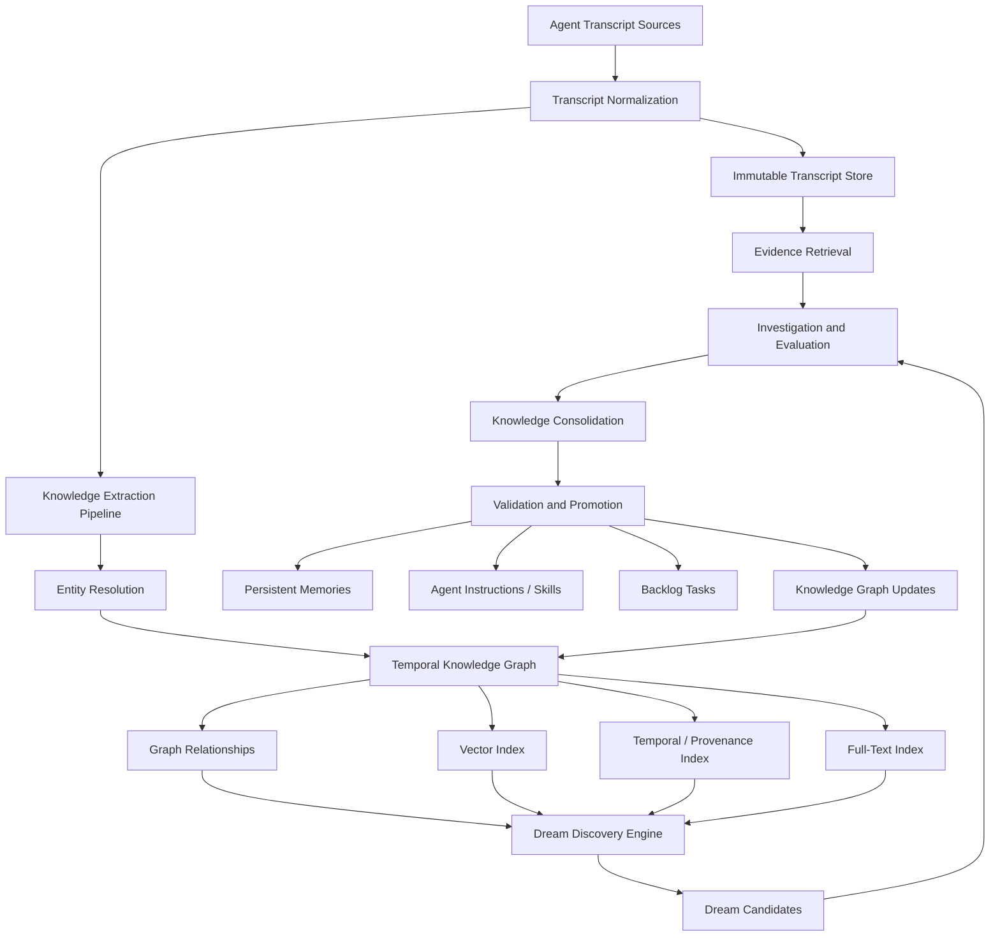
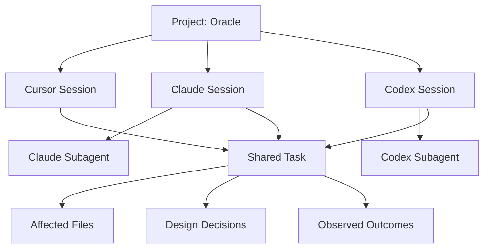
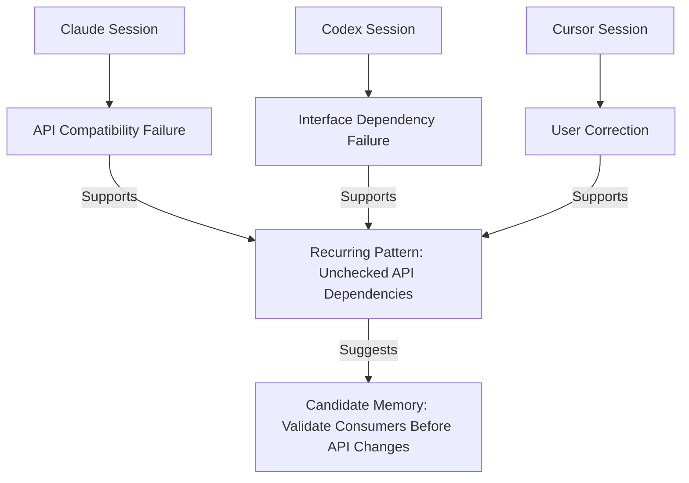
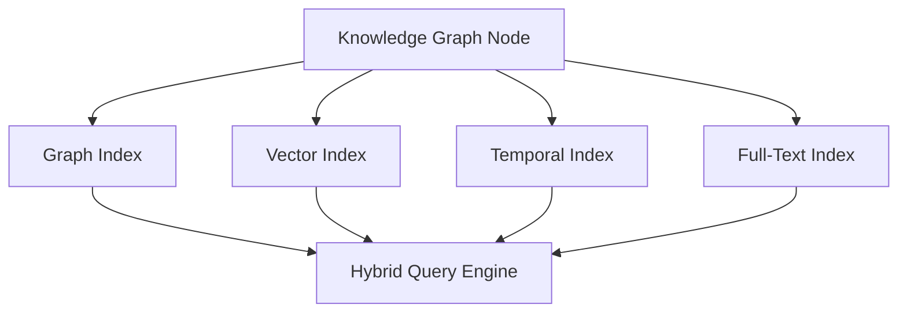
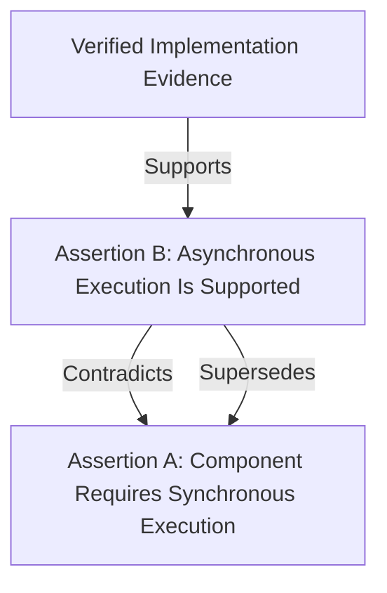
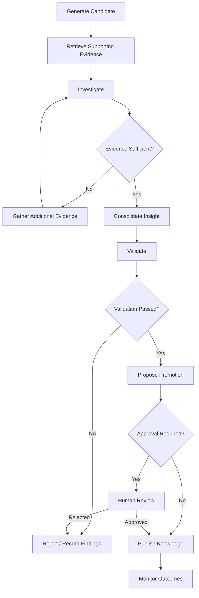
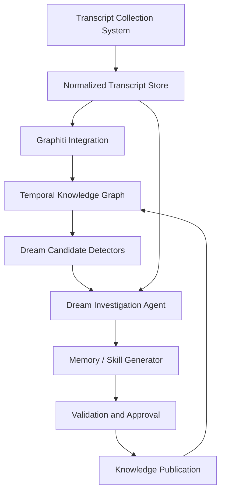
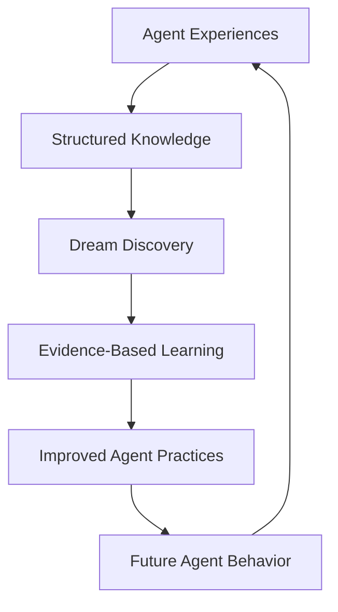

# Dream System: Temporal Knowledge Graph and Semantic Memory

**Status:** Idea / Future Exploration  
**Category:** Agentic Systems, Knowledge Graphs, AI Memory, Autonomous Learning  
**Related Concepts:** Agent Dreaming, GraphRAG, Vector Search, Knowledge Consolidation, Agent Experience Analysis

---

## 1. Overview

Build a knowledge and memory system that continuously learns from historical AI agent transcripts.

The system combines a **temporal knowledge graph** with **vector similarity search** to discover patterns, contradictions, recurring failures, successful techniques, and opportunities to improve agent behavior.

Rather than simply storing transcripts for retrieval, the system should analyze accumulated agent experiences and identify **dreamworthy discoveries**: insights that warrant deeper investigation and potentially consolidation into persistent memories, coding practices, agent skills, or actionable tasks.

The long-term vision is an autonomous learning system that enables agents to improve through their collective experience across multiple projects, tools, and sessions.

### Primary Goals

1. Build a persistent knowledge graph from agent conversation histories.
2. Combine explicit graph relationships with semantic similarity.
3. Correlate experiences across Cursor, Claude, Codex, and subagents.
4. Discover meaningful patterns across independent sessions.
5. Identify contradictions, outdated assumptions, and knowledge gaps.
6. Evaluate candidate insights against historical evidence and actual outcomes.
7. Consolidate validated knowledge into reusable artifacts.
8. Improve future agent behavior through accumulated experience.
9. Preserve provenance and support correcting or retracting learned knowledge.
10. Allow the system to evolve its understanding without continually reprocessing all historical transcripts.

### Non-Goals

- Replacing the original transcript store.
- Storing every transcript token directly in the graph.
- Treating every agent assertion as verified knowledge.
- Automatically converting every repeated observation into an agent instruction.
- Building a custom graph database before validating the higher-level concept.

---

## 2. Core Concept

A traditional graph database represents explicit relationships between entities.

A vector database identifies implicit semantic relationships through similarity between embeddings.

Combining them enables the system to reason over both:

- **Explicit knowledge:** Known dependencies, decisions, corrections, outcomes, and relationships.
- **Implicit knowledge:** Semantically similar experiences, related concepts, recurring patterns, and potentially transferable techniques.

### Example

Three independent agent sessions encounter similar problems:

| Session | Agent | Experience |
|---|---|---|
| 1 | Claude | Changes an API without examining consumers, causing test failures |
| 2 | Codex | Changes an interface without updating dependent components |
| 3 | Cursor | Receives user correction for modifying a public API without checking compatibility |

The transcripts use different language and contain different entities.

Vector similarity can identify the conceptual relationship between these experiences.

Graph traversal can establish that:

- All three involved public API changes.
- Each resulted in a correction or failure.
- The underlying issue involved downstream dependencies.
- The experiences occurred in independent sessions.
- Similar failures may be occurring across agents.

The dream system could propose:

> Before modifying a public interface, identify its consumers and evaluate compatibility impact.

This becomes a **candidate coding practice** supported by historical evidence, not an immediately accepted instruction.

---

## 3. High-Level Architecture



### Architectural Layers

| Layer | Responsibility |
|---|---|
| Transcript collection | Capture historical and ongoing agent activity |
| Normalization | Convert agent-specific transcripts into a common representation |
| Transcript storage | Preserve complete, immutable evidence |
| Knowledge extraction | Identify entities, assertions, decisions, corrections, and outcomes |
| Knowledge reconciliation | Resolve identities, duplicate information, and contradictions |
| Temporal knowledge graph | Maintain evolving knowledge and relationships |
| Vector search | Discover semantically related information |
| Dream discovery | Identify potentially valuable patterns |
| Investigation | Examine candidate insights and their evidence |
| Consolidation | Produce reusable knowledge |
| Validation | Evaluate correctness, applicability, and usefulness |
| Promotion | Publish approved memories, skills, instructions, or tasks |

---

## 4. Transcript Collection and Normalization

The system should consume transcripts collected from multiple agent platforms.

Initial sources:

- Cursor
- Claude Code
- Codex
- Subagents spawned by any supported platform

Future sources could include additional coding agents, orchestration frameworks, and custom agents.

### Normalized Transcript Model

Each transcript should preserve:

- Agent platform and model
- Session identifier
- Parent session identifier, if applicable
- Project and repository association
- Working directory and branch, when available
- Timestamps
- User and assistant messages
- Tool calls and results
- File modifications
- Commands executed
- Test and validation results
- Errors and corrections
- Task outcomes
- Links to related sessions

### Cross-Agent Relationships

Different agents may work on the same project or contribute to the same task.

The normalized representation should support linking related sessions even when they originate from different platforms.



The transcript store should remain independent from the knowledge graph.

This separation allows extraction logic, embedding models, and knowledge schemas to evolve without losing the underlying evidence.

### Ingestion Properties

- Incremental processing of new transcript data.
- Historical backfill.
- Idempotent processing.
- Support for partially completed sessions.
- Reprocessing when extraction models or schemas change.
- Precise source references for every extracted fact.
- Separation of observed facts from model-generated interpretations.

---

## 5. Knowledge Graph Model

The graph should represent not only software entities but also **agent experiences and their outcomes**.

### Proposed Node Types

| Node | Description |
|---|---|
| Project | A software project or repository |
| Session | An agent conversation or execution session |
| Agent | Agent identity, role, or platform |
| Task | Work attempted by one or more agents |
| Activity | A tool call, edit, test, command, or other action |
| Entity | File, symbol, component, service, library, or concept |
| Assertion | A statement or inferred fact |
| Decision | An architectural or implementation choice |
| Correction | An identified mistake and its correction |
| Outcome | Result of an activity or task |
| Pattern | A recurring behavior or observation |
| Question | An unresolved question or uncertainty |
| Memory | Consolidated reusable knowledge |
| Skill | A reusable agent procedure or practice |
| Evidence | A reference to supporting source material |

### Proposed Relationship Types

| Relationship | Meaning |
|---|---|
| `BELONGS_TO` | Associates a session, task, or entity with a project |
| `SPAWNED_BY` | Links subagents to parent sessions |
| `CONTRIBUTED_TO` | Associates agents or sessions with tasks |
| `MENTIONS` | References an entity or concept |
| `AFFECTS` | Identifies impacted components |
| `DEPENDS_ON` | Represents a technical dependency |
| `IMPLEMENTS` | Connects implementation to design |
| `SUPPORTS` | Provides evidence for an assertion |
| `CONTRADICTS` | Identifies conflicting information |
| `SUPERSEDES` | Replaces an older assertion or decision |
| `CORRECTS` | Identifies a correction to previous behavior |
| `VALIDATED_BY` | Connects an assertion to validation evidence |
| `RESULTED_IN` | Connects an activity to its outcome |
| `SIMILAR_TO` | Represents semantic similarity |
| `DERIVED_FROM` | Preserves knowledge provenance |
| `APPLIES_TO` | Describes the scope of a practice or memory |

### Example Graph



### Assertions as First-Class Objects

Important knowledge should be represented as assertions with supporting evidence rather than being stored only as direct graph edges.

For example:

```text
Assertion:
  subject: BookingService
  predicate: depends_on
  object: PaymentService

  confidence: 0.92
  status: verified
  observed_at: <timestamp>
  valid_from: <timestamp>
  valid_until: null

  evidence:
    - transcript/session-123/message-42
    - repository/path/to/file
```

This supports multiple claims about the same entities, conflicting observations, temporal evolution, and evidence-based resolution.

Confidence should distinguish model certainty from the strength of actual supporting evidence.

---

## 6. Combining Graph and Vector Search

Each meaningful node can optionally have one or more embeddings.

Embeddings may represent:

- The semantic meaning of a document.
- A technical problem.
- An architectural decision.
- A correction.
- A task outcome.
- A consolidated pattern.
- A reusable technique.

The database maintains separate but coordinated indexes over shared entity identifiers.



### Hybrid Retrieval Strategies

| Strategy | Description | Example |
|---|---|---|
| Vector → Graph | Find semantically similar nodes, then traverse their relationships | Find related failures and examine affected components |
| Graph → Vector | Restrict candidates by graph relationships, then rank by similarity | Find relevant decisions within one project |
| Iterative Search | Alternate between similarity retrieval and graph traversal | Discover connections across several sessions |
| Joint Ranking | Combine semantic relevance with graph characteristics | Rank recurring problems by similarity and impact |
| Temporal Analysis | Compare related assertions across time | Detect outdated knowledge |
| Cross-Project Discovery | Find semantically similar patterns across project boundaries | Transfer techniques between repositories |

### Example Hybrid Query

Conceptually:

```cypher
CALL db.index.vector.queryNodes(
  'correction_embeddings',
  20,
  $queryEmbedding
)
YIELD node AS correction, score

MATCH (correction)-[:OCCURRED_IN]->(session)
MATCH (session)-[:BELONGS_TO]->(project)

RETURN correction, session, project, score
ORDER BY score DESC
```

This retrieves semantically relevant corrections and uses graph traversal to obtain their surrounding context.

Actual syntax will depend on the selected database.

---

## 7. Semantic Relationships as Virtual Graph Edges

A more ambitious design would treat semantic similarity as a first-class graph relationship.

Traditional graph edges are explicitly stored:

```text
(BookingService)-[:DEPENDS_ON]->(PaymentService)
```

Semantic relationships could instead be evaluated dynamically:

```text
(DecisionA)-[:SIMILAR_TO {score: 0.94}]->(DecisionB)
```

Rather than permanently storing every similarity edge, the graph engine could generate neighboring nodes using vector search.

Conceptually:

```python
def neighbors(node, relationship_type):
    if relationship_type == "SIMILAR_TO":
        return vector_index.nearest(
            node.embedding,
            top_k=20
        )

    return graph_index.neighbors(
        node.id,
        relationship_type
    )
```

### Potential Benefits

- Traverse explicit and implicit relationships through one abstraction.
- Discover connections that were never manually modeled.
- Mix semantic exploration with deterministic graph constraints.
- Support discovery of previously unknown relationships.
- Enable new graph algorithms incorporating semantic proximity.

### Technical Challenges

- Similarity relationships may produce many neighbors.
- Similarity is not necessarily a meaningful domain relationship.
- Multi-hop semantic traversal can become computationally expensive.
- Embedding models and versions affect relationship stability.
- Similarity thresholds and top-K limits affect results.
- Approximate nearest-neighbor search complicates query planning.
- Combining similarity scores across multiple hops requires a defined ranking model.

HNSW already uses a navigable proximity graph for vector search, but that structure serves a different purpose from the knowledge graph.

An initial implementation should use separate graph and vector indexes. A unified semantic traversal model can be explored later.

---

## 8. Temporal Knowledge and Provenance

Knowledge should evolve as new information is discovered.

An agent may initially believe something is true, later encounter contradictory evidence, and eventually establish a revised understanding.

The graph should retain that history rather than overwriting it.

### Example



### Important Properties

- Preserve when an assertion was observed.
- Preserve when it was believed to be valid.
- Track whether knowledge remains current.
- Allow contradictory assertions to coexist while unresolved.
- Link conclusions to their supporting evidence.
- Support correction and retraction.
- Distinguish historical facts from current facts.
- Track the source and version of generated knowledge.
- Avoid treating repeated copies of the same evidence as independent confirmation.

Ideally, the graph supports both **valid time** (when an assertion was true in the domain) and **observation time** (when the system learned or recorded it).

---

## 9. Dreamworthy Discovery

Dreaming should not simply summarize recent conversations.

The system should proactively search its accumulated knowledge for information that deserves further investigation.

A dream is an opportunity to discover, refine, validate, or consolidate knowledge.

### Dream Candidate Categories

| Category | Discovery Goal | Example |
|---|---|---|
| Recurring failures | Identify repeated mistakes | Multiple agents repeatedly break API compatibility |
| Recurring corrections | Discover practices agents frequently need to relearn | Repeated user guidance about testing |
| Contradictions | Identify conflicting assertions | Two sessions reach incompatible architectural conclusions |
| Knowledge drift | Detect outdated information | An implementation invalidates an earlier design assumption |
| Successful techniques | Discover reusable approaches | An agent finds a reliable way to generate integration tests |
| Cross-project insights | Transfer relevant lessons | A solution from Overmind could benefit Oracle |
| Knowledge gaps | Identify unresolved questions | Agents repeatedly investigate an undocumented subsystem |
| Inefficient workflows | Find avoidable repeated effort | Agents repeatedly rediscover the same build commands |
| Emerging conventions | Detect patterns becoming common practice | Several implementations independently adopt the same structure |
| Failed assumptions | Identify systematic misunderstanding | Agents regularly misinterpret the same interface contract |
| Skill opportunities | Identify procedures suitable for automation | A repeatable debugging technique appears across sessions |

### Discovery Techniques

Candidate generation should combine ordinary algorithms with semantic analysis.

Possible techniques include:

- Vector similarity and clustering.
- Graph motif detection.
- Connected-component and neighborhood analysis.
- Frequency and recurrence analysis.
- Temporal comparison.
- Contradiction detection.
- Change-point detection.
- Outcome correlation.
- Cross-project similarity search.
- LLM-based hypothesis generation.

Not every detector needs to be an autonomous agent.

Deterministic queries should perform cheap candidate discovery wherever possible. More expensive model-based reasoning should be reserved for promising discoveries.

---

## 10. Dream Candidate Scoring

Dream candidates should be prioritized before investigation.

An initial scoring model could consider:

| Factor | Meaning |
|---|---|
| Recurrence | How frequently the pattern appears |
| Impact | Potential benefit of learning from it |
| Novelty | Whether the discovery adds new information |
| Evidence Quality | Strength and independence of supporting evidence |
| Applicability | Number and relevance of situations where it could help |
| Recency | Whether the knowledge is currently relevant |
| Uncertainty | How much important ambiguity remains |
| Investigation Cost | Estimated effort to validate the candidate |

An illustrative priority score:

```text
Priority =
    0.30 × Recurrence
  + 0.30 × Impact
  + 0.15 × Novelty
  + 0.25 × EvidenceQuality
```

Weights are provisional and should be tuned against actual outcomes.

### Important Distinction

**Priority is not confidence.**

A high-priority candidate is worth investigating.

A high-confidence candidate has strong supporting evidence.

A candidate can be important precisely because the evidence is contradictory or uncertain.

The system should avoid promoting insights simply because they appear frequently. Multiple sessions repeating an incorrect assumption do not make it true.

---

## 11. Dream Evaluation Pipeline

The dream engine should use a structured lifecycle.



### Candidate Investigation

An investigation agent should:

1. Examine supporting observations.
2. Retrieve relevant original transcript spans.
3. Determine whether apparently similar experiences share a real underlying cause.
4. Identify contradictory evidence.
5. Evaluate independence of supporting observations.
6. Examine current project code or documentation when needed.
7. Propose a precise, scoped conclusion.
8. Assign an evidence-backed confidence level.
9. Recommend an appropriate output artifact.
10. Record the investigation and its result.

An investigation should be reproducible and auditable.

### Candidate Lifecycle

```text
DISCOVERED
    ↓
QUEUED
    ↓
INVESTIGATING
    ↓
EVALUATED
    ↓
VALIDATED
    ↓
PROMOTED
    ↓
MONITORED
```

Alternative terminal or deferred states:

```text
REJECTED
DUPLICATE
INSUFFICIENT_EVIDENCE
SUPERSEDED
DEFERRED
```

Rejected candidates and their explanations should be retained to prevent repeated investigation of the same unproductive ideas.

---

## 12. Knowledge Consolidation and Promotion

The graph should not be treated as identical to the agent's operational memory.

**The graph represents evidence-backed knowledge. Memories and skills are curated artifacts derived from that knowledge.**

Potential outputs include:

| Output | Purpose |
|---|---|
| Project memory | Preserve project-specific context and conventions |
| Global memory | Capture general knowledge applicable across projects |
| Agent instructions | Modify expected agent behavior |
| Agent skills | Define reusable procedures and workflows |
| Architecture documentation | Document discovered system behavior and design decisions |
| Backlog tasks | Track needed improvements or investigations |
| Knowledge graph updates | Revise or consolidate existing assertions |
| Research questions | Record unresolved issues requiring further evidence |

### Memory Artifact Example

```yaml
id: memory-api-compatibility
type: coding_practice
status: proposed

title: Validate consumers before public API changes

scope:
  projects:
    - oracle
  components:
    - public-interfaces

recommendation: >
  Before modifying a public interface, identify
  its consumers and evaluate compatibility impact.

evidence:
  - session-123
  - session-456
  - session-789

confidence: 0.91

validation:
  status: pending

created_at: "<timestamp>"
```

### Promotion Principles

- Scope instructions to applicable projects and technologies.
- Preserve references to their supporting evidence.
- Version promoted knowledge.
- Avoid duplicate or contradictory instructions.
- Support rollback and supersession.
- Require approval for consequential behavioral changes.
- Measure whether promoted knowledge improves future outcomes.
- Retire or revise instructions when subsequent evidence invalidates them.

---

## 13. Evaluating the Dream System

Two different capabilities need to be evaluated:

1. Whether the knowledge graph accurately represents historical experience.
2. Whether dreaming produces useful improvements.

### Knowledge Extraction Evaluation

| Metric | Purpose |
|---|---|
| Extraction precision | Fraction of extracted assertions that are correct |
| Extraction recall | Fraction of relevant assertions successfully extracted |
| Entity resolution accuracy | Whether references to the same entity are correctly merged |
| Relationship accuracy | Whether graph relationships are supported by evidence |
| Temporal accuracy | Whether assertions have correct validity information |
| Provenance completeness | Whether knowledge can be traced to source evidence |
| Contradiction detection | Whether conflicting assertions are correctly identified |

### Dream Evaluation

| Metric | Purpose |
|---|---|
| Useful discovery rate | Percentage of investigated candidates yielding validated insights |
| Novelty | Whether discoveries provide new information |
| Evidence accuracy | Whether cited evidence supports the conclusion |
| False promotion rate | Frequency of incorrect knowledge being promoted |
| Behavioral improvement | Measurable improvement in future agent outcomes |
| Repeated failure reduction | Whether previously discovered mistakes become less frequent |
| Knowledge reuse | How often consolidated knowledge helps future tasks |
| Investigation efficiency | Cost of discovering and validating a useful insight |

### Behavioral Validation

Prescriptive memories and skills should ideally be tested against representative tasks.

For example:

1. Identify a recurring agent failure.
2. Generate a candidate coding practice.
3. Select comparable tasks not used to derive the practice.
4. Run evaluations with and without the proposed guidance.
5. Compare errors, validation success, and agent effort.
6. Promote the practice only when the evidence supports its usefulness.

Comparisons should account for nondeterministic agent behavior and avoid using the same examples for both discovery and validation.

---

## 14. Existing Technologies to Investigate

### Graphiti

**Repository:** https://github.com/getzep/graphiti

An open-source framework for incremental temporal knowledge graphs.

Relevant capabilities:

- Episode-based ingestion.
- Entity and relationship extraction.
- Temporal knowledge management.
- Entity resolution and deduplication.
- Hybrid semantic and graph retrieval.
- Source provenance.
- Custom entity and relationship types.

**Potential role:** Primary foundation for constructing and querying the knowledge graph.

**Questions to investigate:**

- How customizable is the extraction schema?
- Can assertions, decisions, corrections, and outcomes be modeled directly?
- Can original transcript identifiers and precise provenance be preserved?
- How effectively can it process large historical backfills?
- Can it reconcile knowledge across independent agents and projects?
- Can graph queries efficiently generate dream candidates?
- What storage backends and deployment modes are supported?

### Cognee

**Repository:** https://github.com/topoteretes/cognee

An AI memory and knowledge management framework combining graph and vector retrieval.

Its memory enrichment and `memify` concepts are particularly relevant.

**Potential role:** Alternative knowledge processing framework or source of ideas for memory consolidation.

**Questions to investigate:**

- How does `memify` modify or enrich existing knowledge?
- How does it identify relationships and patterns?
- Can its refinement behavior be customized?
- How does it track provenance and contradictory knowledge?
- What aspects of its memory lifecycle overlap with dreaming?

### LadybugDB

**Repository:** https://github.com/LadybugDB/ladybug

An embedded graph database with vector search capabilities.

**Potential role:** Lightweight foundation for a custom graph and vector engine.

Advantages to explore:

- Embedded architecture.
- Cypher-style graph queries.
- Native graph storage.
- Vector indexes.
- Local deployment without a separate database service.

Using a database directly would require implementing extraction, entity resolution, temporal reconciliation, and knowledge consolidation independently.

### Other Databases

| Database | Potential Strength |
|---|---|
| Neo4j | Mature property graph, Cypher, native vector search |
| SurrealDB | Unified graph, document, and vector data model |
| Memgraph | Real-time graph processing and vector search |
| FalkorDB | Low-latency graph workloads and vector indexing |
| ArangoDB | Multimodel document, graph, and vector workloads |
| SQLite + sqlite-vec | Lightweight, customizable local prototype |

### Selection Criteria

- Local, self-hosted deployment.
- Support for incremental ingestion.
- Vector and graph queries in a common interface.
- Efficient cross-session and cross-project searches.
- Temporal knowledge support.
- Provenance and evidence tracking.
- Extensible node and relationship schemas.
- Query performance on large transcript collections.
- Ability to inspect and debug knowledge extraction.
- Operational simplicity.

These projects are candidates for further technical evaluation; their precise capabilities and compatibility should be verified before implementation.

---

## 15. Recommended Initial Architecture

Start with an existing temporal knowledge graph framework rather than developing a database engine from scratch.

Graphiti is the leading candidate for the initial prototype.



### Design Principles

**Keep transcripts immutable.** The original evidence should remain available even when the knowledge model changes.

**Make provenance mandatory.** Every important assertion and promoted insight should trace to source material.

**Distinguish observations from interpretations.** Agent-generated conclusions are hypotheses until supported by adequate evidence.

**Preserve historical knowledge.** Contradictions and superseded assertions are useful information.

**Separate discovery from evaluation.** Cheap queries should identify opportunities; deeper reasoning should investigate them.

**Make promotion deliberate.** Discovering a pattern does not automatically justify changing agent instructions.

**Avoid framework lock-in.** Keep domain models and dream evaluation logic independent of the selected database framework.

**Prefer incremental computation.** New transcripts should update relevant portions of the graph rather than trigger complete reconstruction.

**Treat shared evidence carefully.** Multiple agents repeating the same source or assumption should not count as independent confirmation.

**Design for feedback.** Monitor how promoted knowledge affects later agent behavior and use that evidence to refine or retract it.

---

## 16. Potential Implementation Phases

### Phase 1: Transcript Knowledge Graph

**Objective:** Demonstrate that useful structured knowledge can be extracted from agent transcripts.

- Import normalized transcripts.
- Preserve project and session associations.
- Extract key entities, decisions, failures, corrections, and outcomes.
- Store extracted knowledge in a temporal graph.
- Generate semantic embeddings.
- Support hybrid queries.
- Preserve links to original transcript evidence.

**Success criterion:** A user can query accumulated agent history and retrieve relevant, correctly linked knowledge with supporting evidence.

### Phase 2: Dream Candidate Discovery

**Objective:** Automatically identify promising cross-session patterns.

- Implement semantic similarity searches across corrections and outcomes.
- Group related experiences.
- Identify independent supporting sessions.
- Detect repeated failures.
- Generate candidate hypotheses.
- Prioritize candidates for investigation.

**Success criterion:** The system identifies recurring problems that were not explicitly linked in the original transcripts.

### Phase 3: Investigation and Consolidation

**Objective:** Convert candidate discoveries into evidence-backed knowledge.

- Retrieve supporting transcript spans.
- Analyze common root causes.
- Examine contradictory evidence.
- Validate against relevant code or tests when possible.
- Consolidate recurring observations.
- Generate proposed memories and coding practices.
- Retain rejected discoveries.

**Success criterion:** The system proposes useful, specific practices supported by verifiable evidence.

### Phase 4: Knowledge Promotion

**Objective:** Improve future agent behavior.

- Generate project and global memories.
- Produce agent skill or instruction changes.
- Introduce approval workflows.
- Version promoted knowledge.
- Evaluate candidate instructions against representative tasks.
- Monitor subsequent outcomes.
- Support knowledge retraction and replacement.

**Success criterion:** Promoted knowledge measurably improves agent effectiveness.

### Phase 5: Advanced Dreaming

Explore more sophisticated discovery mechanisms:

- Contradiction and knowledge drift detection.
- Cross-project learning.
- Automated identification of documentation gaps.
- Discovery of inefficient agent workflows.
- Temporal pattern analysis.
- Semantic graph traversal.
- Self-evaluation of agent practices.
- Adaptive dream scheduling.
- Automated hypothesis testing.
- Knowledge decay and consolidation policies.

---

## 17. Open Design Questions

### Knowledge Representation

- What should qualify as an entity versus an assertion or activity?
- How granular should extracted knowledge be?
- Should agent reasoning be represented directly or only through observed decisions and outcomes?
- How should uncertainty and conflicting evidence be modeled?
- Should semantic relationships be stored, generated dynamically, or both?

### Extraction

- Should extraction happen continuously or after sessions complete?
- How should partially completed or interrupted sessions be handled?
- How much extraction can be deterministic?
- How can the system avoid extracting speculative agent statements as facts?
- How should changes in extraction models trigger reprocessing?
- How should embeddings be updated when the embedding model changes?

### Discovery

- What constitutes a genuinely dreamworthy observation?
- How should recurrence be distinguished from duplicated evidence?
- How should novelty be measured?
- Should dreams focus on one project, span multiple projects, or both?
- How should the system balance exploration against repeated investigation of known problems?
- Should candidate detectors be configurable as agent skills?

### Evaluation

- Can hypotheses be validated automatically against code and tests?
- How should the system evaluate the effectiveness of behavioral instructions?
- What evidence is sufficient to promote a memory?
- How should false conclusions be detected and corrected?
- Can the system estimate whether a proposed practice would have prevented historical failures?

### Operational Concerns

- How large might the graph become?
- How much of the transcript history needs embeddings?
- Can historical data be summarized without losing important evidence?
- What is the expected cost of ingestion and dream evaluation?
- Should dreaming run on a schedule, after significant events, or when specific graph conditions are met?
- How should sensitive transcript content be filtered before knowledge publication?
- How should the system handle multiple projects with conflicting conventions?

---

## 18. Longer-Term Vision: A Semantic Experience Graph

The ultimate goal could extend beyond a conventional knowledge graph.

Instead of storing only static knowledge, the system could represent an interconnected history of agent experiences:

- What agents attempted.
- Why they made certain decisions.
- What they believed.
- What evidence they used.
- What succeeded or failed.
- What corrections were necessary.
- What new knowledge emerged.
- How that knowledge influenced later work.

The graph would support both explicit relationships and dynamically discovered semantic connections.

Over time, it could identify behavioral patterns, compare alternative problem-solving approaches, identify where knowledge is incomplete, and recommend improvements to the agents themselves.

A feedback loop would emerge:



The system would not merely retrieve historical context.

It would use accumulated experience to continuously refine the knowledge, procedures, and assumptions that guide future agent activity.

**Central idea:** Build an evidence-backed, evolving semantic knowledge graph of agent experiences, then use autonomous dream cycles to discover, validate, and consolidate knowledge that makes future agents more effective.

---

## 19. Suggested First Experiment

**Research question:**

Can a temporal knowledge graph with vector similarity identify recurring agent failures across independent sessions and generate useful coding practices?

### Experiment

1. Select a representative historical transcript collection from several projects and agents.
2. Ingest the transcripts into Graphiti or a comparable framework.
3. Extract corrections, failures, decisions, and verified outcomes.
4. Generate embeddings for those observations.
5. Discover semantically similar experiences across sessions.
6. Traverse their graph relationships to identify common projects, components, and causes.
7. Generate a small set of candidate coding practices.
8. Manually review their evidence, correctness, novelty, and usefulness.
9. Compare the results against simpler transcript summarization and vector-only retrieval.

### Expected Output

A ranked collection of discoveries containing:

- A concise description of the observed pattern.
- Supporting and contradicting evidence.
- Links to original transcripts.
- Involved projects, agents, and components.
- Estimated recurrence and impact.
- A proposed reusable lesson or practice.
- An assessment of uncertainty.
- A recommendation for further investigation or promotion.

### Decision Point

If the prototype consistently discovers useful patterns that simple summarization or vector search misses, expand toward autonomous evaluation and memory promotion.

If not, improve extraction quality, evidence modeling, and candidate discovery before introducing additional agent autonomy.

**Guiding principle:** The value of the system is not how much knowledge it stores, but how effectively it transforms historical experience into better future decisions.