# Living Requirements Specification and Traceability System

## Overview

A repository-native specification management system designed for both human and agentic software development workflows.

The system maintains a living requirements specification describing the expected behavior of a software system. Proposed changes are represented as structured change specifications that can be projected, validated, implemented, verified, and deterministically merged into the living specification.

Requirements are connected to implementation and verification elements through a traceability graph. Stable identifiers embedded in source code allow agents to discover the behavioral requirements they must preserve when modifying code.

Human-readable documentation, Mermaid diagrams, impact reports, and agent context are generated from the same underlying model.

The specification becomes a persistent, queryable representation of system behavior that evolves alongside the software.

## Goals

- Maintain a living specification of expected system behavior.
- Support incremental, declarative change specifications.
- Deterministically apply and merge specification changes.
- Maintain traceability between requirements, implementation, and verification.
- Enable bidirectional discovery between requirements and source code.
- Automatically provide agents with relevant behavioral constraints.
- Support concurrent development and semantic conflict detection.
- Generate human-readable documentation and Mermaid diagrams.
- Minimize specification maintenance during ordinary refactoring.
- Support multiple programming languages and agent harnesses.
- Keep specifications version-controlled alongside the software.
- Avoid independently maintained representations of the same information.

## Non-Goals

- Replace source code as the authoritative implementation.
- Model every class, method, or internal implementation detail.
- Replace architectural design documentation.
- Replace project management or task tracking systems.
- Automatically prove that an implementation satisfies a requirement.
- Require a centralized service or database.
- Depend on a particular AI agent or development workflow.

## Core Concepts

| Concept | Description |
|---|---|
| Living Specification | The current authoritative description of expected system behavior. |
| Change Specification | A declarative set of proposed mutations to the living specification. |
| Projected Specification | The computed specification resulting from applying a proposed change. |
| Requirement | An identifiable statement of expected behavior or constraint. |
| Element | An identifiable implementation, verification, design, or external artifact. |
| Relationship | A typed connection between requirements and elements. |
| Source Annotation | A stable identifier connecting a source code element to the specification graph. |
| Verification Evidence | Observed results demonstrating whether verification activities succeeded. |
| Specification Engine | Deterministic tooling for querying, validating, projecting, merging, and rendering specifications. |

## Design Principles

### Single Source of Truth

Each piece of information has one authoritative source.

| Information | Authoritative Source |
|---|---|
| Expected behavior | Living specification |
| Proposed behavior | Change specification |
| Requirement identity | Specification |
| Element identity | Specification |
| Requirement relationships | Specification |
| Physical source location | Source code annotations |
| Actual implementation | Source code |
| Verification results | Test execution |
| Historical rationale | Archived change specifications |
| Diagrams and reports | Generated projections |

Generated representations must never require independent maintenance.

### Deterministic Operations

Specification operations must produce identical results when given identical inputs.

Agents may propose specification changes, but deterministic tooling is responsible for:

- Parsing.
- Schema validation.
- Relationship validation.
- Change projection.
- Conflict detection.
- Change application.
- Canonical serialization.
- Traceability resolution.
- Report generation.

The engine must not depend on an LLM for these operations.

### Stable Identity

Requirements and elements have stable, globally unique identifiers within the repository.

Identifiers must not depend on:

- File locations.
- Class names.
- Method names.
- Requirement titles.
- Directory structure.
- Line numbers.

Renaming or moving an artifact should not invalidate its identity.

### Sparse Declarative Graph

The specification should capture behaviorally and architecturally significant elements rather than duplicate the entire structure of the codebase.

Additional relationships and implementation details should be discovered through source analysis where possible.

### Separation of Intent and Evidence

A declared relationship represents intent or a claim about the system.

A `satisfies` relationship does not prove that an implementation is correct.

A `verifies` relationship does not prove that a test has passed or adequately verifies a requirement.

Verification evidence must be evaluated separately.

## High-Level Architecture

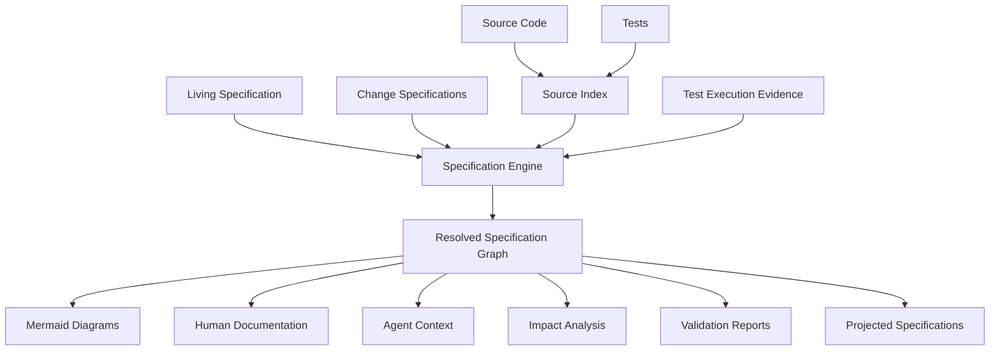

## Specification Layers

The resolved specification graph consists of three complementary layers.

### Layer 1: Declarative Specification

Persisted and version-controlled.

Contains:

- Requirements.
- Capabilities.
- Acceptance criteria.
- Element identities.
- Explicit relationships.
- Verification expectations.
- Change specifications.

This layer represents intended system behavior.

### Layer 2: Discovered Implementation

Derived from the repository and rebuildable.

Contains:

- Source annotations.
- Symbol locations.
- Source file locations.
- Code dependencies.
- Call graphs.
- Test discovery.
- Implementation resolution.

This layer represents what actually exists in the repository.

### Layer 3: Observed Verification

Derived from execution and associated with a particular repository revision.

Contains:

- Test execution results.
- Verification evidence.
- Coverage information.
- Validation outcomes.
- Execution timestamps.
- Repository revision identifiers.

This layer represents observed evidence about system correctness.

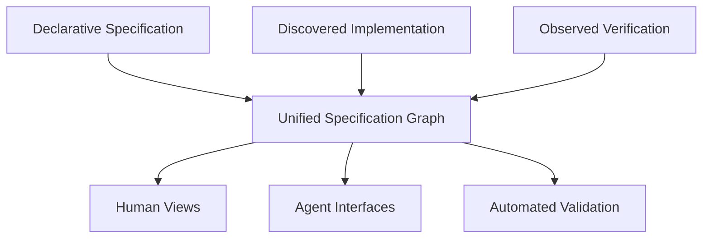

## Repository Structure

```text
repository/
├── src/
├── tests/
├── AGENTS.md
└── specs/
    ├── config.yaml
    ├── schemas/
    │   ├── requirement.schema.json
    │   ├── element.schema.json
    │   ├── relationship.schema.json
    │   └── change.schema.json
    ├── living/
    │   ├── booking/
    │   │   ├── creation.yaml
    │   │   ├── cancellation.yaml
    │   │   └── modification.yaml
    │   └── payments/
    │       ├── authorization.yaml
    │       └── refunds.yaml
    └── changes/
        ├── active/
        │   └── add-idempotency/
        │       ├── proposal.md
        │       ├── delta.yaml
        │       ├── design.md
        │       └── tasks.md
        └── archive/
```

Living specifications should be organized by capability or bounded context rather than by the physical structure of the implementation.

The logical specification graph is independent of its physical file organization.

Generated indexes, diagrams, and reports may be cached locally but should be reproducible and disposable.

## Canonical Specification Format

Use structured YAML backed by JSON Schema.

YAML provides a balance between:

- Human readability.
- Agent readability.
- Deterministic parsing.
- Straightforward editing.
- Schema validation.
- Meaningful Git diffs.
- Support for structured relationships.

Mermaid is a generated visualization format rather than the canonical specification format.

## Living Specification

Example:

```yaml
capability: booking.creation
title: Booking Creation

requirements:
  - id: BOOK-001
    type: functional
    title: Create a booking
    description: >
      The system shall allow customers to
      create a booking for an available room.
    risk: high
    verification: test

    acceptance:
      - id: BOOK-001-A
        given: A room is available
        when: A valid booking request is submitted
        then: A confirmed booking is returned

  - id: BOOK-002
    type: functional
    title: Validate availability
    description: >
      Room availability must be confirmed
      before creating a booking.
    risk: high
    verification: test

elements:
  - id: IMPL-001
    type: implementation
    name: Booking Handler

  - id: TEST-001
    type: test
    name: Successful Booking Test

relationships:
  - source: BOOK-001
    type: contains
    target: BOOK-002

  - source: IMPL-001
    type: satisfies
    target: BOOK-001

  - source: TEST-001
    type: verifies
    target: BOOK-001
```

## Requirement Types

Requirement types should initially align with the concepts supported by SysML and Mermaid, with extensibility for additional types.

| Type | Purpose |
|---|---|
| General | General system requirements. |
| Functional | Expected system behavior. |
| Performance | Performance and scalability expectations. |
| Interface | API and integration requirements. |
| Physical | Physical or infrastructure constraints. |
| Design Constraint | Restrictions on implementation or architecture. |
| Security | Security-related requirements. |
| Operational | Availability, reliability, and operational requirements. |
| Compliance | Regulatory or organizational obligations. |

Custom requirement types may be defined through repository configuration.

## Requirement Acceptance Criteria

Requirements may contain individually identifiable acceptance criteria.

```yaml
requirements:
  - id: BOOK-003
    type: functional
    title: Idempotent booking creation

    description: >
      Repeated requests using the same idempotency
      key must not create duplicate bookings.

    acceptance:
      - id: BOOK-003-A
        given: A successful booking request
        when: The same request is repeated
        then: The original booking is returned

      - id: BOOK-003-B
        given: Two concurrent requests with the same key
        when: Both requests are processed
        then: Only one booking is created
```

Acceptance criteria should have stable identifiers so verification can be associated with specific behaviors rather than only broad requirements.

## Elements

Elements represent significant artifacts associated with requirements.

| Element Type | Examples |
|---|---|
| Implementation | Domain service, business policy, algorithm. |
| Interface | API endpoint, event contract, public interface. |
| Test | Acceptance test, integration test, behavioral test. |
| Design | Architectural design or decision record. |
| Configuration | Deployment or runtime configuration. |
| Infrastructure | Database, queue, external service. |
| Documentation | User documentation or operational procedure. |
| External | Artifact outside the current repository. |

Elements are independently identifiable and may participate in multiple relationships.

## Relationships

Relationships are directed, typed graph edges.

The initial relationship vocabulary should align with Mermaid requirement diagrams.

| Relationship | Meaning |
|---|---|
| `contains` | A requirement contains a subordinate requirement. |
| `derives` | A requirement is derived from another requirement. |
| `refines` | An artifact or requirement provides a more precise description. |
| `satisfies` | An implementation element fulfills a requirement. |
| `verifies` | A verification element evaluates a requirement. |
| `traces` | A general traceability relationship. |
| `copies` | A requirement represents a copy of another requirement. |

Additional relationship types may be supported.

| Extended Relationship | Meaning |
|---|---|
| `depends_on` | An explicit dependency between graph nodes. |
| `contributes_to` | An element contributes to satisfying a requirement without independently fulfilling it. |
| `conflicts_with` | Requirements or constraints may be incompatible. |
| `supersedes` | A requirement replaces an earlier requirement. |
| `introduced_by` | A requirement or element originated from a change specification. |

Relationship types should define:

- Permitted source node types.
- Permitted target node types.
- Directionality.
- Cardinality constraints, if applicable.
- Cycle restrictions, if applicable.
- Impact traversal behavior.

## Mermaid Requirement Diagrams

Generate Mermaid requirement diagrams directly from the specification graph.

```mermaid
requirementDiagram
    functionalRequirement idempotency {
        id: BOOK-003
        text: Prevent duplicate bookings
        risk: high
        verifymethod: test
    }

    element handler {
        type: implementation
        docref: IMPL-001
    }

    element duplicate_test {
        type: test
        docref: TEST-001
    }

    handler - satisfies -> idempotency
    duplicate_test - verifies -> idempotency
```

The rendering engine should support:

- Capability-level diagrams.
- Requirement hierarchies.
- Implementation traceability.
- Verification traceability.
- Change visualizations.
- Impact analysis.
- Dependency graphs.
- Coverage reports.

Extended relationship types that cannot be represented by Mermaid requirement diagrams may be rendered using Mermaid flowcharts or other graph visualization formats.

## Change Specifications

A change specification represents a proposed set of mutations to the living specification.

Changes are declarative and machine-readable.

Agents should not be responsible for manually reconciling change documents into living specifications.

### Example Change Specification

```yaml
id: CHG-042
title: Idempotent Booking Creation

operations:
  - op: modify
    kind: requirement
    target: BOOK-001

    set:
      description: >
        The system shall allow customers to
        create bookings without creating duplicates.

  - op: add
    kind: requirement
    capability: booking.creation

    value:
      id: BOOK-003
      type: functional
      title: Idempotent booking requests
      description: >
        Repeated requests with the same
        idempotency key must return the
        original booking.
      risk: high
      verification: test

      acceptance:
        - id: BOOK-003-A
          given: A successful booking request
          when: The same request is repeated
          then: The original booking is returned

  - op: add
    kind: element
    capability: booking.creation

    value:
      id: IMPL-003
      type: implementation
      name: Idempotency Handler

  - op: add
    kind: element
    capability: booking.creation

    value:
      id: TEST-003
      type: test
      name: Duplicate Booking Request Test

  - op: relate
    source: BOOK-001
    type: contains
    target: BOOK-003

  - op: relate
    source: IMPL-003
    type: satisfies
    target: BOOK-003

  - op: relate
    source: TEST-003
    type: verifies
    target: BOOK-003
```

### Change Operations

| Operation | Purpose |
|---|---|
| `add` | Introduce a requirement or element. |
| `modify` | Modify properties of an existing node. |
| `remove` | Remove a requirement or element. |
| `move` | Move a node between capabilities. |
| `relate` | Introduce a relationship. |
| `unrelate` | Remove a relationship. |

Operations should address nodes by stable identifiers rather than physical file locations or array indexes.

Collection mutations, including acceptance criteria changes, should also address members by stable identifiers.

## Projected Specifications

A projected specification represents the expected future state of the living specification after applying a change.

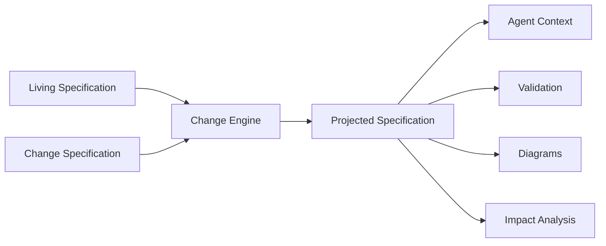

The projected specification is computed on demand and is not independently maintained.

Conceptually:

```typescript
function apply(
    baseline: Specification,
    delta: ChangeSpecification
): Specification;
```

Agents implementing a change should query the projected specification rather than only the change specification.

This allows them to understand the complete expected behavior of the system after the change.

Projection must not modify the living specification.

## Change Lifecycle

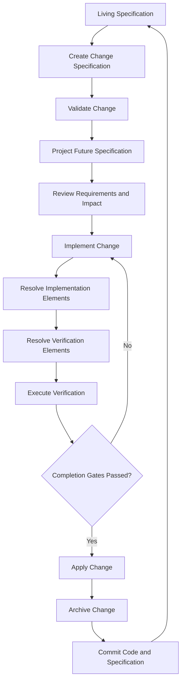

### Lifecycle Stages

| Stage | Responsibility |
|---|---|
| Proposal | Identify desired behavior and affected capabilities. |
| Specification | Define requirement, element, and relationship mutations. |
| Projection | Compute the future specification. |
| Review | Evaluate behavior, consistency, and impact. |
| Implementation | Implement the projected requirements. |
| Verification | Evaluate acceptance criteria and preserved behavior. |
| Completion | Validate the projected specification against the working tree. |
| Application | Deterministically merge the change into the living specification. |
| Archival | Preserve change rationale and history. |

The code, living specification updates, and archived change should ideally be merged through the same pull request.

Applying a change must be atomic at the specification model level.

## Source Code Traceability

### Problem

Source code changes more frequently than requirements.

Physical references such as file paths, symbol names, and line numbers become stale when code is reorganized.

Ordinary refactoring should not require unnecessary specification updates.

### Stable Source Annotations

Source annotations associate implementation and verification artifacts with stable specification element identifiers.

Example implementation:

```typescript
/**
 * Handles idempotent booking requests.
 *
 * @spec-element IMPL-003
 */
export class IdempotencyHandler {
    // Implementation
}
```

Example verification:

```typescript
/**
 * @spec-element TEST-003
 */
test("returns the original booking", async () => {
    // Verification
});
```

The specification engine discovers these annotations and resolves them to their current source locations.

The YAML specification does not need to maintain the physical location.

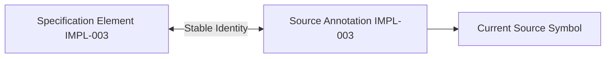

Renaming or moving the source artifact does not invalidate the relationship as long as its annotation is preserved.

### Alternative Locators

Not every language or artifact supports source annotations.

The system should also support explicit locators.

```yaml
elements:
  - id: IMPL-003
    type: implementation
    name: Idempotency Handler

    locator:
      path: src/booking/IdempotencyHandler.ts
      symbol: IdempotencyHandler
```

| Locator | Precision | Refactoring Resilience |
|---|---|---|
| Directory | Low | High |
| File path | Medium | Medium |
| Qualified symbol | High | Medium |
| Stable annotation | High | High |
| Line number | High | Very low |
| Semantic search | Variable | Variable and nondeterministic |

Stable annotations should be preferred.

Semantic search may assist discovery but should not be authoritative.

## Planned and Resolved Elements

Change specifications may declare elements before those elements exist in the repository.

This allows planning agents to define expected implementation and verification structures.

During execution, the source index progressively resolves those elements.

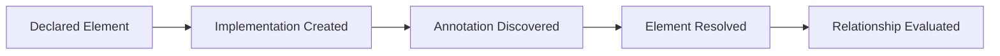

Element resolution status should be computed rather than manually maintained.

| Status | Meaning |
|---|---|
| Planned | Declared in an active change but not yet expected to exist. |
| Unresolved | No corresponding source artifact was discovered. |
| Resolved | A corresponding source artifact was discovered. |
| Ambiguous | Multiple artifacts claim the same element identity. |
| Orphaned | A source annotation has no corresponding declared element. |
| Verified | Associated verification evidence satisfies the configured policy. |

Resolution and verification should be modeled as separate dimensions internally.

A resolved implementation is not necessarily a correct implementation.

## Bidirectional Requirement Discovery

One of the primary benefits of the system is the ability to discover requirements from source code and source code from requirements.

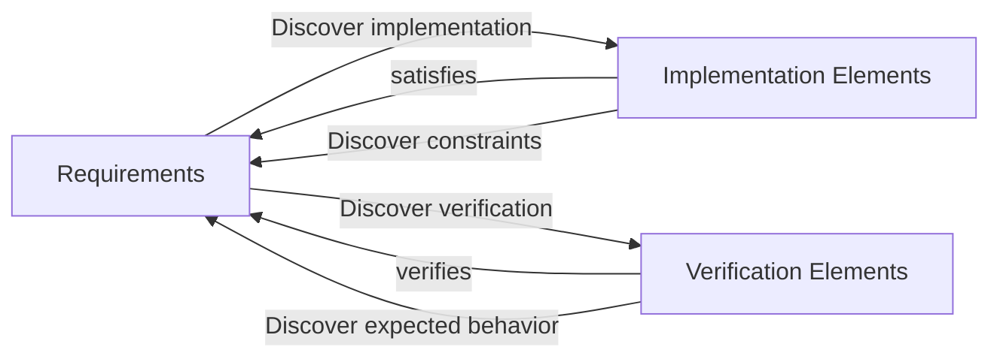

### Supported Discovery Workflows

| Starting Point | Discovery |
|---|---|
| Requirement change | Affected implementation and verification elements. |
| Code modification | Requirements whose behavior must be preserved. |
| Test modification | Requirements whose verification must be preserved. |
| Code deletion | Requirements potentially losing implementation coverage. |
| Test deletion | Requirements potentially losing verification coverage. |
| Requirement deletion | Implementation and tests potentially becoming unnecessary. |
| New implementation | Requirements that justify its existence. |

## Requirement-Aware Agent Context

Source annotations serve as local behavioral contracts for agents.

When an agent encounters an annotated element, it can query the specification engine for the relevant requirements.

```bash
spec context IMPL-003 --format yaml
```

Example response:

```yaml
element: IMPL-003

location:
  path: src/booking/IdempotencyHandler.ts
  symbol: IdempotencyHandler

requirements:
  - id: BOOK-003
    title: Idempotent booking creation
    disposition: preserve
    description: >
      Repeated requests with the same idempotency
      key must return the original booking.

  - id: BOOK-004
    title: Expire idempotency keys
    disposition: modify
    description: >
      Idempotency keys shall expire after 24 hours.

verification:
  - id: TEST-003
    path: tests/booking/idempotency.test.ts

  - id: TEST-004
    path: tests/booking/expiration.test.ts
```

The agent receives focused behavioral context without loading the entire repository specification.

### Requirement Dispositions

The context resolver should understand the active change specification.

| Disposition | Agent Responsibility |
|---|---|
| Preserve | Maintain the existing expected behavior. |
| Modify | Implement the projected behavior. |
| Add | Implement newly introduced behavior. |
| Remove | Evaluate removal of behavior that is no longer required. |

A removed requirement does not necessarily imply that all associated code should be deleted.

Other requirements or consumers may still depend on that implementation.

### Context Discovery Inputs

Agents should be able to request context using:

- Requirement identifiers.
- Element identifiers.
- Source file paths.
- Qualified symbols.
- Source ranges.
- Git diffs.
- Change specification identifiers.
- Capability identifiers.

## Agent Harness Integration

Where supported, agent harnesses could automatically invoke requirement discovery before code modifications.

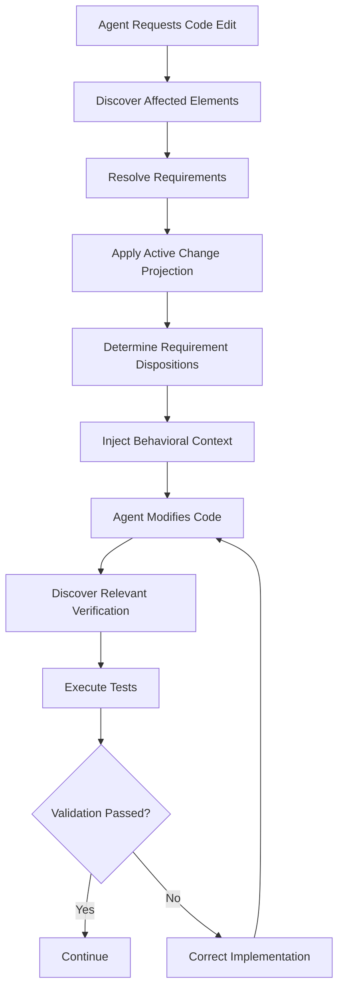

Possible integration mechanisms:

- Agent skills.
- Pre-edit hooks.
- Post-edit hooks.
- MCP tools.
- CLI commands.
- Context providers.
- IDE extensions.
- Pull request automation.

The core specification engine should remain independent of these integrations.

Context resolution should be a standalone capability that can be invoked by any agent harness.

## Transitive Requirement Discovery

Not every implementation detail should require an annotation.

Static analysis and language tooling can discover relationships between unannotated code and annotated elements.

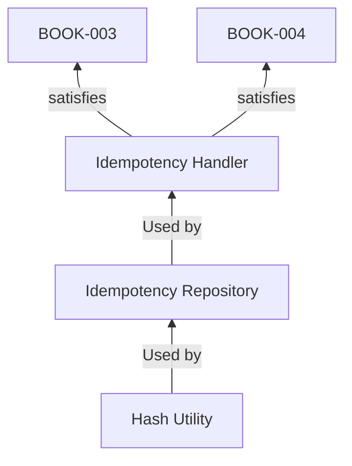

When an agent modifies the hash utility, the specification engine can discover that the change potentially affects the idempotency requirements.

### Relationship Discovery Categories

| Category | Meaning |
|---|---|
| Direct | Explicitly declared requirement relationship. |
| Indirect | Discovered through source dependency traversal. |
| Related | Discovered through requirement graph traversal. |
| Inferred | Suggested by semantic analysis or an agent. |

Direct relationships are authoritative declarations.

Indirect relationships represent potential impact.

Inferred relationships should remain suggestions until explicitly accepted.

### Discovery Mechanisms

- Language Server Protocol.
- Abstract syntax tree analysis.
- Compiler APIs.
- Symbol indexes.
- Call graph analysis.
- Import dependency graphs.
- Test coverage data.
- Runtime execution traces.

The engine should expose traversal depth and relationship filters to prevent excessive context expansion.

Static analysis limitations must be surfaced rather than interpreted as proof that no impact exists.

## Requirement Impact Analysis

The specification graph should support deterministic impact analysis.

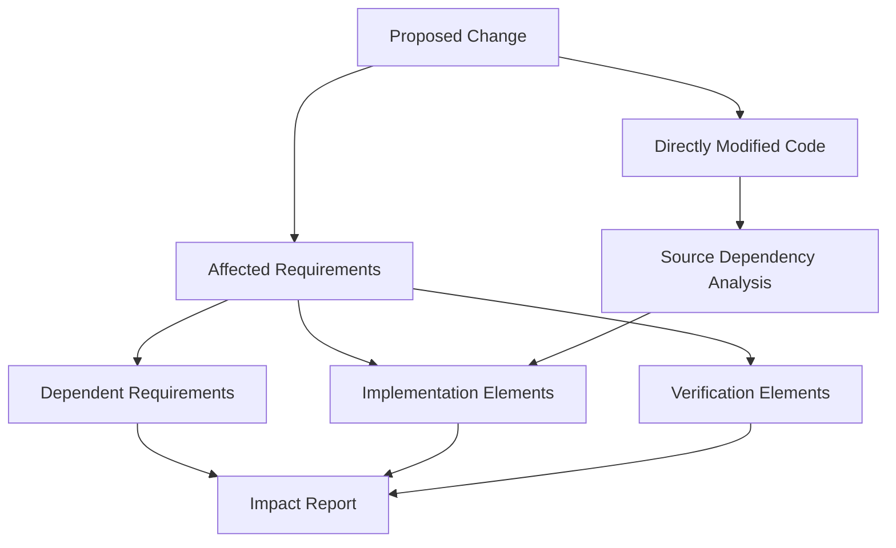

Impact analysis should identify:

- Added requirements.
- Modified requirements.
- Removed requirements.
- Dependent requirements.
- Affected implementation elements.
- Affected verification elements.
- Potential transitive code dependencies.
- Relevant tests.
- Overlapping active changes.
- Requirements with missing implementation coverage.
- Requirements with missing verification coverage.

Impact reports should distinguish confirmed relationships from potential impacts.

## Refactoring Support

Refactoring may change implementation structure without changing system behavior.

Moving or renaming an annotated element should require no specification change.

More substantial refactoring may require changes to elements or relationships while preserving requirements.

Example:

```yaml
id: CHG-044
title: Refactor Idempotency Handler

operations:
  - op: unrelate
    source: IMPL-003
    type: satisfies
    target: BOOK-003

  - op: remove
    kind: element
    target: IMPL-003

  - op: add
    kind: element
    capability: booking.creation
    value:
      id: IMPL-004
      type: implementation
      name: Idempotency Validator

  - op: add
    kind: element
    capability: booking.creation
    value:
      id: IMPL-005
      type: implementation
      name: Idempotency Executor

  - op: relate
    source: IMPL-004
    type: contributes_to
    target: BOOK-003

  - op: relate
    source: IMPL-005
    type: contributes_to
    target: BOOK-003
```

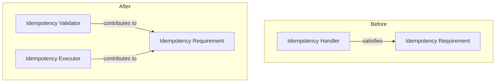

The system should distinguish between:

- Behavioral changes.
- Architectural changes.
- Implementation traceability changes.
- Verification changes.
- Documentation-only changes.

## Concurrent Changes and Conflict Detection

Multiple agents or developers may independently create change specifications against the same baseline.

The engine should support semantic conflict detection using stable identities and operation preconditions.

```yaml
id: CHG-045
base_revision: abc123

operations:
  - op: modify
    kind: requirement
    target: BOOK-003

    expect:
      risk: medium

    set:
      risk: high
```

The `expect` clause defines a precondition for applying the mutation.

The baseline revision identifies the state against which the change was originally authored.

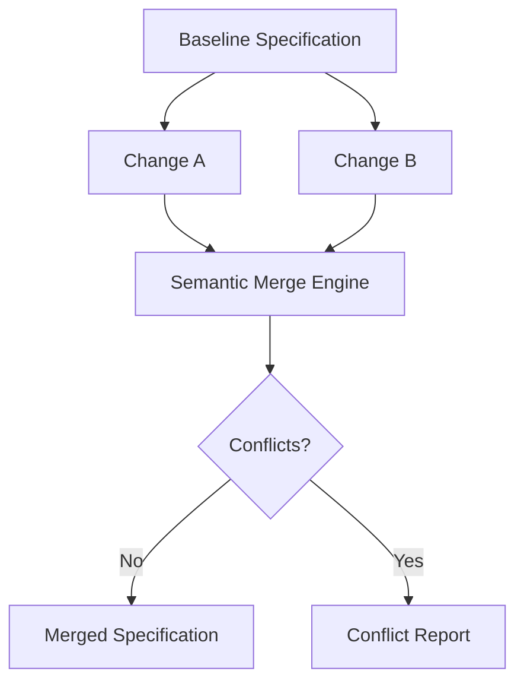

### Conflict Resolution Rules

| Concurrent Change | Resolution |
|---|---|
| Different independent requirements | Merge automatically. |
| Different independent properties | Merge automatically if valid. |
| Same property and same desired value | Treat as already applied. |
| Same property and different desired values | Report conflict. |
| Modify a removed requirement | Report conflict. |
| Relate to a removed element | Report conflict. |
| Introduce duplicate identifiers | Report conflict. |
| Introduce invalid graph structure | Reject change. |
| Remove an already removed relationship | Treat as already applied when safe. |

Structural independence does not guarantee semantic independence.

Agents or humans may still need to review logically incompatible requirements even when the engine can merge them structurally.

The engine must not silently resolve ambiguous semantic conflicts.

## Validation

Validation should operate at multiple levels.

### Structural Validation

- Valid YAML.
- Valid schema.
- Unique identifiers.
- Valid requirement types.
- Valid element types.
- Valid relationship types.
- Valid relationship endpoints.
- Valid operation definitions.

### Graph Validation

- No dangling relationships.
- No prohibited cycles.
- Valid relationship cardinality.
- Valid capability references.
- Valid containment hierarchies.
- No references to removed nodes.

### Change Validation

- Operation preconditions hold.
- Baseline compatibility.
- No conflicting operations.
- Valid projected specification.
- No duplicate application.
- No unresolved semantic merge conflicts.

### Implementation Validation

- Required elements resolve.
- Source annotations are unique.
- No orphaned source annotations.
- Required source artifacts exist.
- Implementation coverage satisfies configured policies.

### Verification Validation

- Required verification elements resolve.
- Required acceptance criteria have verification mappings.
- Verification evidence corresponds to the current revision.
- Required tests were executed.
- Required verification activities passed.

### Lifecycle-Specific Policies

| Validation | Planning | Completion |
|---|---|---|
| Valid schema | Required | Required |
| Unique identifiers | Required | Required |
| Valid relationships | Required | Required |
| Valid projected specification | Required | Required |
| Implementation elements resolve | Optional | Required by policy |
| Verification elements resolve | Optional | Required by policy |
| Verification coverage | Optional | Required by policy |
| Verification execution passes | Optional | Required by policy |

Policies should be configurable by repository, capability, requirement type, and risk level.

## Reconciliation

The specification engine should compare declared specifications against the actual repository.

```bash
spec reconcile --format json
```

Reconciliation should detect:

- Missing implementation elements.
- Missing verification elements.
- Duplicate source annotations.
- Orphaned source annotations.
- Invalid external locators.
- Unresolved symbols.
- Requirements without implementation mappings.
- Requirements without verification mappings.
- Stale verification evidence.
- Changed source locations.

The deterministic engine identifies inconsistencies.

Agents may investigate and propose repairs.

The engine should not automatically invent requirements or relationships to make validation pass.

## Requirements-Aware CI

The specification engine should integrate with CI and pull request workflows.

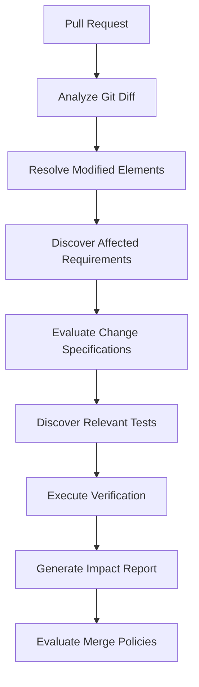

### Example Pull Request Report

| Requirement | Disposition | Verification |
|---|---|---|
| BOOK-001 | Preserve | Passed |
| BOOK-002 | Preserve | Passed |
| BOOK-003 | Modify | Passed |
| BOOK-004 | Add | Not executed |

The report should highlight:

- Undeclared potential behavioral changes.
- Modified requirements.
- Unverified requirements.
- Failed verification.
- Removed implementation mappings.
- Removed verification mappings.
- Unresolved elements.
- Specification conflicts.

CI may enforce configured completion policies.

A failed test associated with an unchanged requirement is a potential regression.

A passing test does not prove that all required behavior has been preserved.

## Verification Evidence

Verification results should be associated with a specific repository revision and execution environment.

Example:

```yaml
revision: abc123
execution_id: run-842

results:
  - element: TEST-003
    status: passed

    verifies:
      - BOOK-003-A

  - element: TEST-004
    status: failed

    verifies:
      - BOOK-003-B
```

Evidence should generally be stored as execution artifacts or in an external evidence store rather than continuously committed to the living specification.

The engine should distinguish:

- Verification declared.
- Verification artifact resolved.
- Verification executed.
- Verification passed.
- Verification failed.
- Verification evidence stale.
- Verification adequacy reviewed.

## Coverage Reporting

The specification engine should provide coverage reports based on explicit relationships and execution evidence.

| Metric | Meaning |
|---|---|
| Implementation Mapping Coverage | Requirements associated with implementation elements. |
| Implementation Resolution Coverage | Requirements with resolvable implementation elements. |
| Verification Mapping Coverage | Requirements associated with verification elements. |
| Acceptance Criteria Coverage | Acceptance criteria associated with verification elements. |
| Verification Resolution Coverage | Requirements with resolvable verification artifacts. |
| Verification Execution Coverage | Requirements whose associated verification was executed. |
| Verification Pass Coverage | Requirements meeting configured verification success policies. |

These metrics should not be confused with traditional code coverage or treated as formal proof of correctness.

## Human-Readable Views

All views should be generated from the same specification graph.

| View | Purpose |
|---|---|
| Requirements Catalog | Searchable requirements and acceptance criteria. |
| Requirement Diagram | Requirement hierarchy and relationships. |
| Traceability Diagram | Requirements connected to implementation and tests. |
| Capability View | Requirements grouped by system capability. |
| Change View | Proposed requirement and element mutations. |
| Projected View | Complete expected future specification. |
| Visual Diff | Added, modified, removed, and unchanged nodes. |
| Impact Diagram | Potential effects of a proposed change. |
| Coverage Matrix | Implementation and verification coverage. |
| Verification Report | Current verification evidence. |
| Source View | Requirements associated with source artifacts. |
| Historical View | Requirement evolution across repository revisions. |

Large repositories should support scoped views rather than attempting to render the entire graph in one diagram.

### Visual Change Conventions

| Color | Meaning |
|---|---|
| Green | Added |
| Amber | Modified |
| Red | Removed |
| Gray | Unchanged |
| Blue | Discovered or informational |

Visual indicators should also use labels or other non-color distinctions.

## CLI Interface

The CLI should provide deterministic, scriptable access to the specification engine.

### Requirement Queries

```bash
spec list
spec get BOOK-003
spec search "idempotency"
spec graph BOOK-003 --depth 2
spec context IMPL-003
spec context --file src/booking/Handler.ts
spec context --symbol IdempotencyHandler
```

### Change Management

```bash
spec change new
spec change list
spec change validate CHG-042
spec change project CHG-042
spec change diff CHG-042
spec change impact CHG-042
spec change apply CHG-042
spec change archive CHG-042
```

### Validation and Reporting

```bash
spec validate
spec reconcile
spec coverage
spec verify
spec impact BOOK-003
spec impact --git-diff
```

### Rendering

```bash
spec render --format mermaid
spec render --format markdown
spec render --format html
spec render --capability booking.creation
spec render --change CHG-042 --view diff
```

### Structured Output

All applicable commands should support machine-readable output.

```bash
spec graph BOOK-003 \
    --depth 2 \
    --change CHG-042 \
    --format json
```

Supported output formats may include:

- JSON.
- YAML.
- Markdown.
- Mermaid.
- HTML.
- Plain text.

Machine-readable output should use documented, versioned schemas.

## MCP Interface

An optional MCP server could expose the same capabilities directly to agents.

Potential tools:

| Tool | Purpose |
|---|---|
| `get_requirement` | Retrieve a requirement by identifier. |
| `search_requirements` | Search the specification. |
| `get_element` | Retrieve an element and its resolved location. |
| `get_context` | Resolve behavioral context for source code. |
| `get_projected_spec` | Query a projected specification. |
| `get_change_impact` | Evaluate proposed change impact. |
| `validate_change` | Validate a change specification. |
| `get_verification` | Retrieve associated verification information. |
| `traverse_graph` | Explore related specification nodes. |
| `reconcile` | Discover specification inconsistencies. |

The MCP interface should be an adapter around the same deterministic engine used by the CLI.

## Integration with Agentic Development Workflows

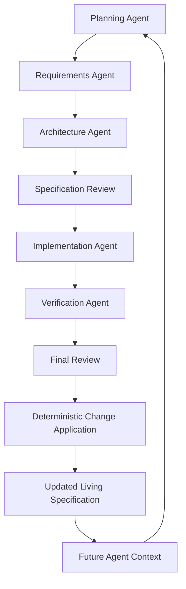

| Role | Responsibility |
|---|---|
| Planning Agent | Identify affected capabilities and desired changes. |
| Requirements Agent | Define structured requirement mutations. |
| Architecture Agent | Derive constraints and significant implementation elements. |
| Reviewer Agent | Evaluate completeness, consistency, and impact. |
| Implementation Agent | Implement projected behavior and resolve elements. |
| Verification Agent | Verify acceptance criteria and preserved requirements. |
| Completion Engine | Validate and deterministically apply specification changes. |

Agents are responsible for semantic reasoning.

The specification engine is responsible for deterministic operations and structural correctness.

## Relationship to Repository Knowledge

The specification complements other forms of repository documentation.

| Knowledge Mechanism | Question Answered |
|---|---|
| AGENTS.md | How should an agent work in this repository? |
| Architecture Documentation | How is the system structured? |
| Living Specification | What behavior must the system maintain? |
| Change Specification | What behavior should change? |
| Source Annotations | Which requirements apply to this code? |
| Verification Evidence | What behavior has been evaluated? |
| Archived Changes | Why did the system evolve this way? |

The specification should not duplicate broad development guidance or architectural rationale unnecessarily.

## Maintainability and Granularity

Only behaviorally or architecturally significant elements should generally be explicitly tracked.

| Artifact | Explicitly Track |
|---|---|
| Public API endpoints | Yes |
| Event contracts | Yes |
| Major domain components | Yes |
| Business policies | Yes |
| Significant algorithms | Yes |
| Security boundaries | Yes |
| Acceptance tests | Yes |
| Behavioral integration tests | Yes |
| Individual helper functions | Generally no |
| Internal utility classes | Generally no |
| Every unit test | Generally no |
| Individual lines of code | No |

The system should favor stable semantic boundaries over incidental implementation details.

Annotations should be preserved when source artifacts are moved or renamed.

When implementation structure changes substantially, the associated element relationships should be updated as part of the change.

## Architectural Modules

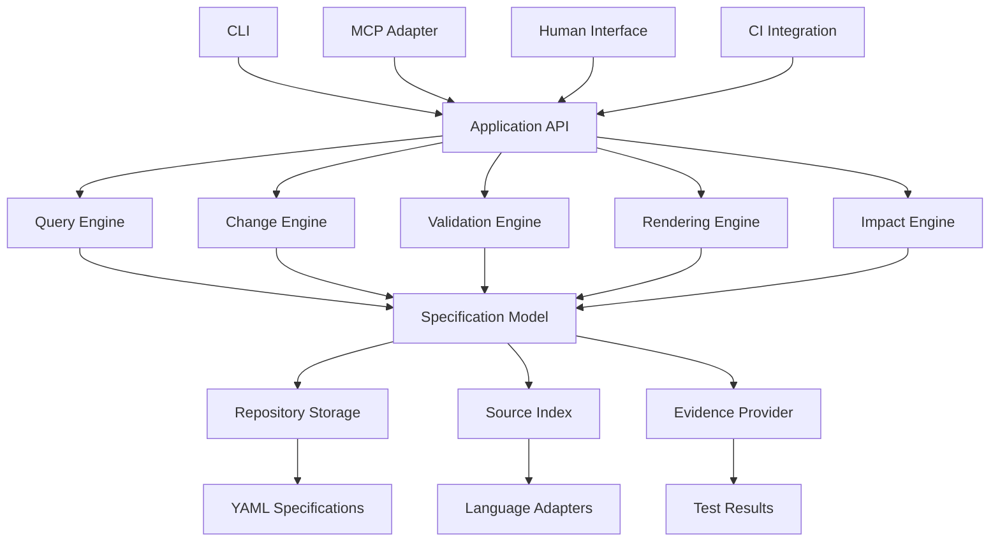

| Module | Responsibility |
|---|---|
| Specification Model | Typed nodes, relationships, identities, and invariants. |
| Repository Storage | Parsing, serialization, and file organization. |
| Change Engine | Projection, conflict detection, and application. |
| Query Engine | Search, graph traversal, and context resolution. |
| Validation Engine | Structural, graph, and lifecycle validation. |
| Source Index | Annotation discovery and symbol resolution. |
| Language Adapters | Language-specific source and dependency analysis. |
| Impact Engine | Requirement and implementation impact analysis. |
| Evidence Provider | Verification execution evidence. |
| Rendering Engine | Mermaid, Markdown, HTML, and reports. |
| Integration Adapters | CLI, MCP, IDE, CI, and agent harness integration. |

The core model should remain independent of YAML, Git, Mermaid, programming languages, and AI agent frameworks.

## Extensibility

Repository configuration should allow customization of:

- Requirement types.
- Element types.
- Relationship types.
- Validation policies.
- Capability organization.
- Identifier conventions.
- Source annotation conventions.
- Language adapters.
- Verification providers.
- Rendering templates.
- Change lifecycle policies.

The specification format should have an explicit schema version and support deterministic migrations between schema versions.

## Comparison with OpenSpec

The design shares concepts with OpenSpec-style living specifications and delta specifications but introduces a more structured, graph-oriented model.

| Capability | OpenSpec-Style Workflow | Proposed System |
|---|---|---|
| Living specification | Markdown documents | Structured YAML graph |
| Change specification | Textual requirement deltas | Typed mutation operations |
| Requirement identity | Document-oriented | Stable identifiers |
| Relationships | Primarily textual | Explicit typed graph edges |
| Code traceability | Can be documented | First-class elements |
| Test traceability | Can be documented | First-class verification relationships |
| Change application | Document incorporation | Deterministic graph mutation |
| Conflict detection | Document and Git level | Semantic operation level |
| Impact analysis | Primarily agent reasoning | Graph traversal and source analysis |
| Agent context | Specification documents | Focused requirement resolution |
| Visualization | Document-oriented | Generated graph views |

This system could potentially complement an existing OpenSpec workflow rather than replace its planning and task management capabilities.

## Suggested Implementation Phases

### Phase 1: Specification Foundation

- YAML specification format.
- JSON Schema validation.
- Stable requirement and element identities.
- Typed relationships.
- Repository loading.
- Requirement queries.
- Mermaid rendering.

### Phase 2: Change Management

- Typed change operations.
- Projected specifications.
- Semantic diffs.
- Operation preconditions.
- Conflict detection.
- Atomic change application.
- Change archival.

### Phase 3: Source Traceability

- Source annotations.
- Source indexing.
- Element resolution.
- Reverse requirement lookup.
- Reconciliation.
- Requirement-aware context generation.

### Phase 4: Verification

- Test element discovery.
- Acceptance criteria mappings.
- Verification evidence ingestion.
- Coverage reporting.
- Lifecycle-specific validation.
- CI integration.

### Phase 5: Agent Integration

- MCP server.
- Agent skills.
- Pre-edit and post-edit hooks.
- Automatic behavioral context discovery.
- Change-aware requirement dispositions.
- Relevant test selection.

### Phase 6: Advanced Analysis

- Language server integration.
- Static dependency analysis.
- Transitive requirement discovery.
- Concurrent change analysis.
- Historical requirement evolution.
- Interactive graph exploration.
- Semantic relationship suggestions.

## Open Design Questions

- Should requirements use globally unique identifiers or capability-scoped identifiers?
- Should elements always be explicitly declared before source annotations are introduced?
- Should a lightweight annotation directly referencing requirement identifiers also be supported?
- How should multiple source artifacts jointly satisfy a single requirement?
- How should requirement satisfaction and partial contribution be distinguished?
- Should acceptance criteria be independent graph nodes?
- How should requirements shared across multiple repositories be represented?
- How should external service contracts participate in the graph?
- Should change specifications support dependencies on other active changes?
- How should overlapping projected specifications be composed?
- Should archived changes preserve full deltas, baseline hashes, or both?
- How should verification adequacy be evaluated beyond test execution results?
- How should existing repositories incrementally adopt the system?
- How should unannotated code be treated by validation policies?
- Should deterministic specification migrations be represented as a separate change type?
- How much transitive dependency context is useful before it becomes excessive?
- Can existing SysML tooling or specification standards be leveraged?
- Can this system integrate directly with OpenSpec schemas and workflows?

## Long-Term Vision

The living specification becomes a persistent behavioral knowledge layer embedded within the repository.

Every completed change improves the specification available to future developers and agents.

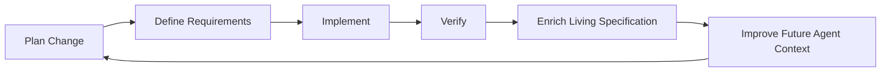

The system enables agents to understand not only how the software is implemented, but why it exists, what behavior it must maintain, and how that behavior can be verified.

Requirements become discoverable at the point where code is modified.

Changes become explicit, reviewable, and deterministically applicable.

Human documentation, visualizations, agent context, impact analysis, and verification reports become different interfaces to the same underlying specification model.

The result is a specification-as-code system that evolves alongside the software and provides a foundation for increasingly autonomous, requirement-aware software development.

## Design Status

This document represents an exploratory architecture rather than a finalized implementation specification.

The YAML schemas, operation vocabulary, annotation syntax, validation policies, and module boundaries are proposed design decisions.

The examples are illustrative and have not been validated against an implemented specification engine.

The primary risks to explore are specification maintenance overhead, traceability granularity, language-specific discovery complexity, semantic conflict detection, and the adequacy of verification evidence.