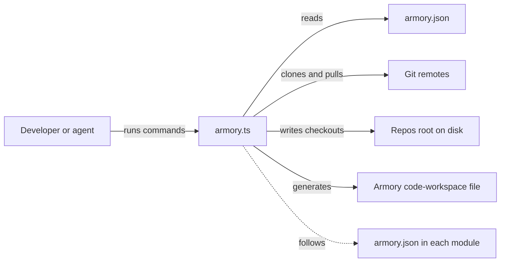

# Armory

Armory is a package manager for modules of source code, built for agentic development. A project lists the Git repositories it depends on, and Armory clones them, keeps them current, and generates a multi-root workspace for VS Code or Cursor so the project and its modules open in one window ([README](https://github.com/StarCruiseStudios/Armory/blob/main/README.md)). Every module stays on disk as a full repository, so an agent can read a module's source and edit it in place ([README](https://github.com/StarCruiseStudios/Armory/blob/main/README.md)).

## Code location

| Repo | Paths | What is there | Source |
| --- | --- | --- | --- |
| `StarCruiseStudios/Armory` | [armory.ts](https://github.com/StarCruiseStudios/Armory/blob/main/armory.ts) | The entire tool as one TypeScript script | [armory.ts](https://github.com/StarCruiseStudios/Armory/blob/main/armory.ts) |
| `StarCruiseStudios/Armory` | [test/](https://github.com/StarCruiseStudios/Armory/tree/main/test) | Node test files for the commands, configuration, graph, and workspace behavior | [test/](https://github.com/StarCruiseStudios/Armory/tree/main/test) |

## Responsibilities and boundary

Armory owns the list of dependency repositories, their checkouts on disk, and the generated workspace file ([README](https://github.com/StarCruiseStudios/Armory/blob/main/README.md)). It does not publish packages or build modules. A module can hold code, agent skills, instructions, or reference material, and the consuming project decides how to use it ([README](https://github.com/StarCruiseStudios/Armory/blob/main/README.md)).

Each consuming project copies the script into its own directory instead of installing a shared package. The `update` command replaces that copy with the latest version from GitHub ([README](https://github.com/StarCruiseStudios/Armory/blob/main/README.md), [armory.ts](https://github.com/StarCruiseStudios/Armory/blob/main/armory.ts)).

## Architecture

Diagram sources:

- Commands run from the directory that holds the configuration: [README](https://github.com/StarCruiseStudios/Armory/blob/main/README.md).
- Clone and pull use Git, and checkouts land under a repos root: [README](https://github.com/StarCruiseStudios/Armory/blob/main/README.md).
- The workspace file is generated beside the configuration: [README](https://github.com/StarCruiseStudios/Armory/blob/main/README.md).
- Armory runs the same command on the `armory.json` of each dependency and skips configurations it has already processed: [README](https://github.com/StarCruiseStudios/Armory/blob/main/README.md), [armory.ts:932-941](https://github.com/StarCruiseStudios/Armory/blob/main/armory.ts#L932-L941).

The system has a single runnable unit, the command line script, so it has no separate container pages.

| Container | Role | Technology | Source |
| --- | --- | --- | --- |
| Armory CLI | Clones, fetches, pulls, and updates modules and writes the workspace | TypeScript run directly by Node.js and Git on the path | [README](https://github.com/StarCruiseStudios/Armory/blob/main/README.md), [package.json](https://github.com/StarCruiseStudios/Armory/blob/main/package.json) |

## Key flows

A sync reads the configuration, clones missing repositories, fetches, pulls with fast-forward only, then repeats the same steps for every dependency that has its own `armory.json` ([README](https://github.com/StarCruiseStudios/Armory/blob/main/README.md)). Armory also keeps the managed blocks of the `.gitignore` file current so local clone paths stay out of a project's history ([README](https://github.com/StarCruiseStudios/Armory/blob/main/README.md)).

## Key entities

- **Configuration.** The `armory.json` file names the workspace, the repositories to include, and optionally where clones live ([README](https://github.com/StarCruiseStudios/Armory/blob/main/README.md)).
- **Module.** A Git repository that a project depends on, which can carry its own configuration and so build a tree of dependencies ([README](https://github.com/StarCruiseStudios/Armory/blob/main/README.md)).
- **Workspace file.** A generated `<workspaceName>.armory.code-workspace` file that lists the project and its modules as folders and adds Armory shell tasks ([README](https://github.com/StarCruiseStudios/Armory/blob/main/README.md)).

## Interfaces and dependencies

Armory is driven from a command line and depends on Node.js with native TypeScript support and on Git ([README](https://github.com/StarCruiseStudios/Armory/blob/main/README.md)). It reaches the network only through Git and, for the `update` command, to download its own script ([armory.ts](https://github.com/StarCruiseStudios/Armory/blob/main/armory.ts)).

## Runtime and deployment

Armory has no build step. A project downloads the script once and runs it with Node.js ([README](https://github.com/StarCruiseStudios/Armory/blob/main/README.md)).

## Design decisions and constraints

The repos root defaults to a directory under the user's home, which lets all projects share one set of checkouts ([README](https://github.com/StarCruiseStudios/Armory/blob/main/README.md)).

## Open questions

- How Armory resolves clone directories for nested groups and for branch-specific clones has only been read in the README, not in the implementation.

## Pages in this system

No pages exist below this overview yet. The [exploration backlog](/wiki/exploration-backlog.md) lists the planned ones.

## Wider scope

- [Agent workspace](/wiki/areas/agent-workspace/overview.md): the area that holds this system.
- [Armory workspace](/wiki/concepts/armory-workspace.md): how the repositories that Armory manages relate to each other.
