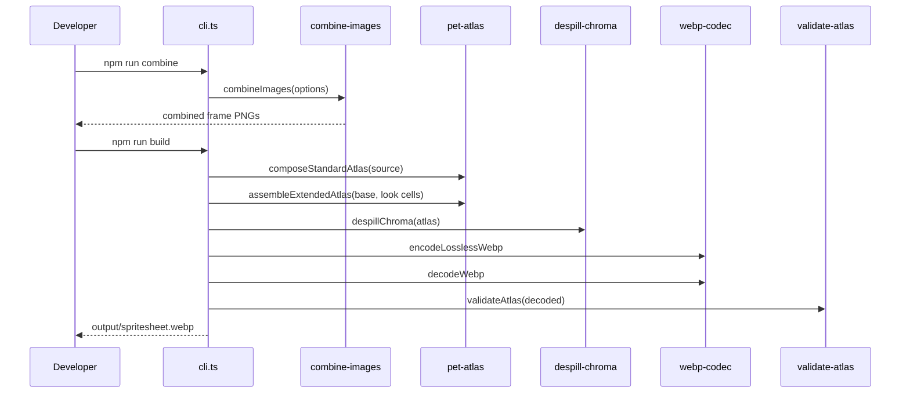

# Sprite Build Pipeline

An artist or developer edits frame images, runs `combine` to composite the robot and drone layers, runs `build` to assemble and validate the sprite sheet, and runs `install-pet` to copy it to Codex.

## Participants

| Participant | Part it plays | Source |
| --- | --- | --- |
| `scripts/cli.ts` | Dispatches the command and runs the build steps | [cli.ts:21-39](https://github.com/StarCruiseStudios/Agent/blob/main/codex-commander/scripts/cli.ts#L21-L39), [cli.ts:58-84](https://github.com/StarCruiseStudios/Agent/blob/main/codex-commander/scripts/cli.ts#L58-L84) |
| `combine-images.ts` | Composites layers into frame PNGs | [combine-images.ts:121-208](https://github.com/StarCruiseStudios/Agent/blob/main/codex-commander/src/combine-images.ts#L121-L208) |
| `pet-atlas.ts` | Pastes frames into the atlas and adds look directions | [pet-atlas.ts:70-146](https://github.com/StarCruiseStudios/Agent/blob/main/codex-commander/src/pet-atlas.ts#L70-L146) |
| `despill-chroma.ts` | Cleans chroma color from edges | [cli.ts:67](https://github.com/StarCruiseStudios/Agent/blob/main/codex-commander/scripts/cli.ts#L67) |
| `webp-codec.ts` | Encodes and decodes lossless WebP | [cli.ts:68-69](https://github.com/StarCruiseStudios/Agent/blob/main/codex-commander/scripts/cli.ts#L68-L69) |
| `validate-atlas.ts` | Rejects an atlas with wrong size, sparse frames, or chroma leaks | [cli.ts:70-78](https://github.com/StarCruiseStudios/Agent/blob/main/codex-commander/scripts/cli.ts#L70-L78) |

## Sequence

Diagram sources:

- `combine` calls `combineImages`: [cli.ts:42-56](https://github.com/StarCruiseStudios/Agent/blob/main/codex-commander/scripts/cli.ts#L42-L56).
- `build` runs the six steps in this order: [cli.ts:58-84](https://github.com/StarCruiseStudios/Agent/blob/main/codex-commander/scripts/cli.ts#L58-L84).

## Steps

1. **Combine.** For each selected animation, the tool reads its `combine.json`. It checks that the canvas has positive integer dimensions, that frames are unique, that `layerOrder` lists every layer exactly once, and that the output pattern contains `{frame}` ([combine-images.ts:124-145](https://github.com/StarCruiseStudios/Agent/blob/main/codex-commander/src/combine-images.ts#L124-L145)). For each frame it renders every layer in order, applying the transform for that frame, and composites the result onto an empty canvas ([combine-images.ts:149-166](https://github.com/StarCruiseStudios/Agent/blob/main/codex-commander/src/combine-images.ts#L149-L166)). It writes each frame to a temporary file ([combine-images.ts:171-176](https://github.com/StarCruiseStudios/Agent/blob/main/codex-commander/src/combine-images.ts#L171-L176)). With `--check`, it renders and discards the pixels ([combine-images.ts:167-170](https://github.com/StarCruiseStudios/Agent/blob/main/codex-commander/src/combine-images.ts#L167-L170)). Only after every animation renders does it replace the real frame files ([combine-images.ts:198-203](https://github.com/StarCruiseStudios/Agent/blob/main/codex-commander/src/combine-images.ts#L198-L203)).
2. **Compose the standard atlas.** For each of the nine animation states, `build` reads the frame names from `combine.json` and pastes each combined frame, centered, into its row and column. The atlas has eight columns of 192 by 208 pixel cells ([pet-atlas.ts:70-80](https://github.com/StarCruiseStudios/Agent/blob/main/codex-commander/src/pet-atlas.ts#L70-L80), [pet-layout.ts:30-40](https://github.com/StarCruiseStudios/Agent/blob/main/codex-commander/src/pet-layout.ts#L30-L40), [pet-atlas.ts:10-25](https://github.com/StarCruiseStudios/Agent/blob/main/codex-commander/src/pet-atlas.ts#L10-L25)).
3. **Add look directions.** The tool removes the chroma background (`#FF00FF`) from the neutral idle cell and the 16 look-direction cells, scales and registers the look cells to the neutral pose, rejects cells that touch the cell border, and pastes them into rows nine and ten. It also places the neutral cell in column six of the idle row ([cli.ts:16](https://github.com/StarCruiseStudios/Agent/blob/main/codex-commander/scripts/cli.ts#L16), [pet-atlas.ts:122-146](https://github.com/StarCruiseStudios/Agent/blob/main/codex-commander/src/pet-atlas.ts#L122-L146)). The result is 1536 by 2288 pixels ([pet-atlas.ts:35-45](https://github.com/StarCruiseStudios/Agent/blob/main/codex-commander/src/pet-atlas.ts#L35-L45)).
4. **Suppress chroma spill.** `despillChroma` changes pixels near sprite edges that are close to the key color, and the CLI prints how many pixels it changed ([cli.ts:67](https://github.com/StarCruiseStudios/Agent/blob/main/codex-commander/scripts/cli.ts#L67), [cli.ts:82](https://github.com/StarCruiseStudios/Agent/blob/main/codex-commander/scripts/cli.ts#L82)).
5. **Encode and re-decode.** The atlas is encoded as lossless WebP and decoded again, so validation sees what the file contains ([webp-codec.ts:37-42](https://github.com/StarCruiseStudios/Agent/blob/main/codex-commander/src/webp-codec.ts#L37-L42), [cli.ts:68-69](https://github.com/StarCruiseStudios/Agent/blob/main/codex-commander/scripts/cli.ts#L68-L69)).
6. **Validate and write.** `validateAtlas` requires the version 2 size, checks that each used cell has at least 50 visible pixels, and checks for opaque chroma leaks and fringes. The CLI throws and writes nothing if any error remains ([cli.ts:70-78](https://github.com/StarCruiseStudios/Agent/blob/main/codex-commander/scripts/cli.ts#L70-L78), [validate-atlas.ts:129-155](https://github.com/StarCruiseStudios/Agent/blob/main/codex-commander/src/validate-atlas.ts#L129-L155)). On success it writes `output/spritesheet.webp` ([cli.ts:79-81](https://github.com/StarCruiseStudios/Agent/blob/main/codex-commander/scripts/cli.ts#L79-L81)).

The expected frame count for each row is fixed in `validate-atlas.ts`. For example, `idle` uses six frames, `running-right` uses eight, and `waving` uses four ([validate-atlas.ts:7-19](https://github.com/StarCruiseStudios/Agent/blob/main/codex-commander/src/validate-atlas.ts#L7-L19)).

## Data and state

The flow reads frame PNGs and `combine.json` files from `source/` and writes combined PNGs back into the same folders. The `build` command reads those PNGs and writes one WebP file to `output/`. No state persists between runs except these files ([README.md:28-36](https://github.com/StarCruiseStudios/Agent/blob/main/codex-commander/README.md#L28-L36), [cli.ts:79-81](https://github.com/StarCruiseStudios/Agent/blob/main/codex-commander/scripts/cli.ts#L79-L81)).

## Failure, retry, and consistency

A configuration problem raises a `ConfigError`, which the CLI prints to stderr before it sets a failing exit code ([cli.ts:116-125](https://github.com/StarCruiseStudios/Agent/blob/main/codex-commander/scripts/cli.ts#L116-L125)). If any frame fails to render during `combine`, the tool deletes the staged temporary files and leaves the existing frames in place ([combine-images.ts:179-182](https://github.com/StarCruiseStudios/Agent/blob/main/codex-commander/src/combine-images.ts#L179-L182), [combine-images.ts:204-207](https://github.com/StarCruiseStudios/Agent/blob/main/codex-commander/src/combine-images.ts#L204-L207)). A failed validation during `build` prints each error and throws "Spritesheet validation failed." ([cli.ts:75-78](https://github.com/StarCruiseStudios/Agent/blob/main/codex-commander/scripts/cli.ts#L75-L78)).

## Variations

- `combine` accepts `--animation <state>` (repeatable), `--source-root`, and `--check` ([cli.ts:43-50](https://github.com/StarCruiseStudios/Agent/blob/main/codex-commander/scripts/cli.ts#L43-L50)).
- The frame output pattern defaults to `{frame}.png` and can be overridden in `combine.json` ([combine-images.ts:142](https://github.com/StarCruiseStudios/Agent/blob/main/codex-commander/src/combine-images.ts#L142)).

## Open questions

- Layer rendering, motion easing, and chroma despill internals are not yet documented.

## Related

- [Codex Commander](/wiki/areas/agent-workspace/systems/codex-commander/overview.md): the system page.
