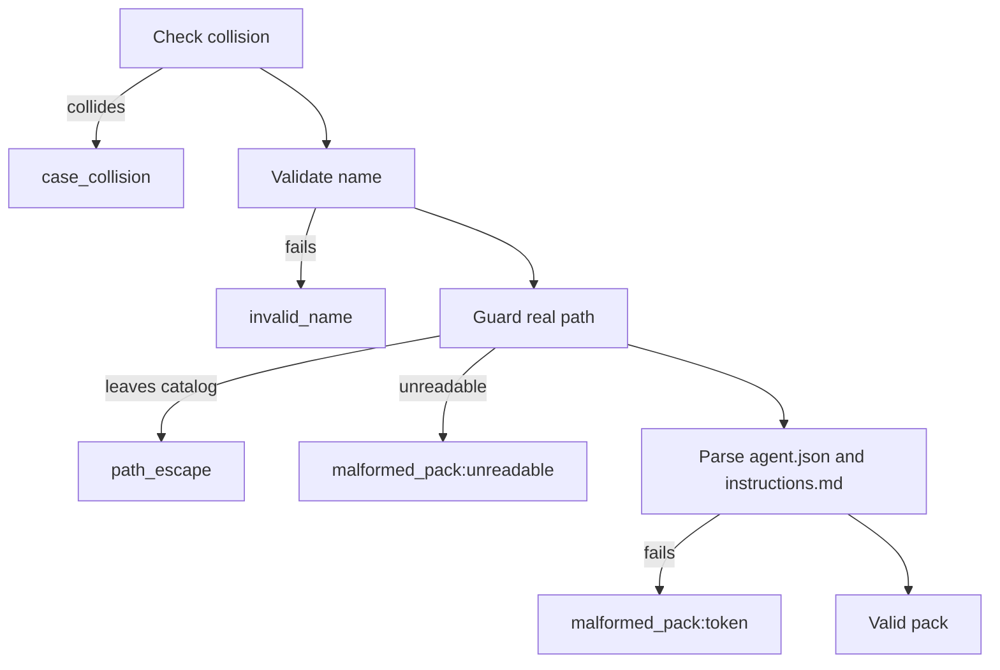

# Catalog

This component belongs to the [Compass Server](/wiki/areas/agent-workspace/systems/compass/containers/compass-server/overview.md) container. It turns a project root into a set of valid instruction packs and skills. It decides which directory owns each pack name, rejects names that collide by case, and reduces every failure to a small closed vocabulary of error codes and problem reasons that the tool layer returns to the caller. [AgentCatalog.ts](https://github.com/StarCruiseStudios/Agent/blob/main/compass/src/catalog/AgentCatalog.ts) is its entry point.

## Code location

| Repo | Paths | What is there | Source |
| --- | --- | --- | --- |
| `StarCruiseStudios/Agent` | [compass/src/catalog/](https://github.com/StarCruiseStudios/Agent/tree/main/compass/src/catalog) | The catalog classes, the error and problem types, and the reference resolver | [AgentCatalog.ts:15-115](https://github.com/StarCruiseStudios/Agent/blob/main/compass/src/catalog/AgentCatalog.ts#L15-L115) |
| `StarCruiseStudios/Agent` | [compass/src/tools/ToolResultFactory.ts](https://github.com/StarCruiseStudios/Agent/blob/main/compass/src/tools/ToolResultFactory.ts) | The tool-side conversion of a thrown error into a result (a neighbour, listed because it ends the error path) | [ToolResultFactory.ts:16-21](https://github.com/StarCruiseStudios/Agent/blob/main/compass/src/tools/ToolResultFactory.ts#L16-L21) |

## Responsibilities

- Resolve the project root and discover every catalog directory for each operation. The catalog keeps no cache and builds a fresh graph per call ([AgentCatalog.ts:14](https://github.com/StarCruiseStudios/Agent/blob/main/compass/src/catalog/AgentCatalog.ts#L14), [AgentCatalog.ts:33-37](https://github.com/StarCruiseStudios/Agent/blob/main/compass/src/catalog/AgentCatalog.ts#L33-L37)).
- Choose which directory owns each pack name, and refuse names that collide by case.
- Load one pack through the path guard and parser, and attach its skills.
- Report invalid packs as data when listing, and as a single error when fetching.

## Structure

| Class | Role | Source |
| --- | --- | --- |
| `AgentCatalog` | Coordinates `list`, `fetch`, and `fetchSkill`; owns the collision and first-wins rules | [AgentCatalog.ts:15-115](https://github.com/StarCruiseStudios/Agent/blob/main/compass/src/catalog/AgentCatalog.ts#L15-L115) |
| `CatalogGraph` | Walks `.compass` and the directories its `config.json` references, and records graph-level problems | [CatalogGraph.ts:12-83](https://github.com/StarCruiseStudios/Agent/blob/main/compass/src/catalog/CatalogGraph.ts#L12-L83) |
| `ProjectRootResolver` | Requires an absolute, accessible directory and returns its real path | [ProjectRootResolver.ts:12-23](https://github.com/StarCruiseStudios/Agent/blob/main/compass/src/catalog/ProjectRootResolver.ts#L12-L23) |
| `CompassPathGuard` | Validates names and requires a pack's real path to be an immediate child of its catalog | [CompassPathGuard.ts:12-32](https://github.com/StarCruiseStudios/Agent/blob/main/compass/src/catalog/CompassPathGuard.ts#L12-L32) |
| `AgentPackParser` | Reads `agent.json` and `instructions.md` and fails with a reason token | [AgentPackParser.ts:14-52](https://github.com/StarCruiseStudios/Agent/blob/main/compass/src/catalog/AgentPackParser.ts#L14-L52) |
| `SkillCatalog` | Lists and reads the skills of a selected pack, with its own collision check | [SkillCatalog.ts:30-33](https://github.com/StarCruiseStudios/Agent/blob/main/compass/src/catalog/SkillCatalog.ts#L30-L33) |
| `CompassError` and `CatalogProblem` | The error code set that is thrown, and the problem record that is returned | [CompassError.ts:4-12](https://github.com/StarCruiseStudios/Agent/blob/main/compass/src/catalog/CompassError.ts#L4-L12), [CatalogProblem.ts:4-21](https://github.com/StarCruiseStudios/Agent/blob/main/compass/src/catalog/CatalogProblem.ts#L4-L21) |

The [Pack discovery and fetch](/wiki/areas/agent-workspace/systems/compass/containers/compass-server/flows/pack-discovery-and-fetch.md) flow describes the order of steps across these classes. This page covers the rules inside the catalog.

## Interfaces and collaborators

The catalog is constructed with a filesystem, a root resolver, a path guard, a parser, and a logger, so each collaborator can be replaced in tests ([AgentCatalog.ts:23-31](https://github.com/StarCruiseStudios/Agent/blob/main/compass/src/catalog/AgentCatalog.ts#L23-L31)). The tool classes call `list`, `fetch`, and `fetchSkill`, and catch every thrown error ([ListAgentsTool.ts:19](https://github.com/StarCruiseStudios/Agent/blob/main/compass/src/tools/ListAgentsTool.ts#L19), [FetchAgentInstructionsTool.ts:22](https://github.com/StarCruiseStudios/Agent/blob/main/compass/src/tools/FetchAgentInstructionsTool.ts#L22)). It reads files only through the `FileSystem` interface ([AgentCatalog.ts:2](https://github.com/StarCruiseStudios/Agent/blob/main/compass/src/catalog/AgentCatalog.ts#L2)).

## Behaviour and design notes

### Which directory owns a name

`definitions` visits directories in graph order and records, for each lower-cased name, the first directory that has it. Later directories that define the same name are ignored, so a project catalog can shadow a referenced one ([AgentCatalog.ts:53-61](https://github.com/StarCruiseStudios/Agent/blob/main/compass/src/catalog/AgentCatalog.ts#L53-L61), [README.md:107](https://github.com/StarCruiseStudios/Agent/blob/main/compass/README.md#L107)). The README states that a winning pack that is invalid does not fall back to a later definition ([README.md:107](https://github.com/StarCruiseStudios/Agent/blob/main/compass/README.md#L107)). The code agrees: `list` skips any name whose winner is another directory, and `select` loads only the winner ([AgentCatalog.ts:70](https://github.com/StarCruiseStudios/Agent/blob/main/compass/src/catalog/AgentCatalog.ts#L70), [AgentCatalog.ts:91-96](https://github.com/StarCruiseStudios/Agent/blob/main/compass/src/catalog/AgentCatalog.ts#L91-L96)).

### Case-collision handling

Two child directories collide when their names are equal after lower-casing. The check runs against the names of one directory only, and it counts every name that matches, so both members of a colliding pair are affected ([AgentCatalog.ts:39-41](https://github.com/StarCruiseStudios/Agent/blob/main/compass/src/catalog/AgentCatalog.ts#L39-L41)). The same name in two different catalog directories is not a collision. That case is resolved by first-definition-wins, and the README says collision checks still apply within each directory ([README.md:107](https://github.com/StarCruiseStudios/Agent/blob/main/compass/README.md#L107)).

| Where | Behaviour | Source |
| --- | --- | --- |
| `load` | The collision check is the first step, so it runs before name validation and before any pack file is read. It throws `case_collision`. | [AgentCatalog.ts:43-47](https://github.com/StarCruiseStudios/Agent/blob/main/compass/src/catalog/AgentCatalog.ts#L43-L47) |
| `list` | Every colliding name becomes a `case_collision` problem, so a pair gives two problems. A test with `Reviewer`, `reviewer`, `BAD`, and `bad` expects four, and fails if any file is opened. | [AgentCatalog.ts:68-79](https://github.com/StarCruiseStudios/Agent/blob/main/compass/src/catalog/AgentCatalog.ts#L68-L79), [catalog.test.ts:85-96](https://github.com/StarCruiseStudios/Agent/blob/main/compass/tests/unit/catalog.test.ts#L85-L96) |
| `select` (fetch) | After choosing the winning directory, it throws `case_collision` if the requested name collides there. Otherwise it throws `unknown_agent` unless the exact, case-sensitive name is present. | [AgentCatalog.ts:91-95](https://github.com/StarCruiseStudios/Agent/blob/main/compass/src/catalog/AgentCatalog.ts#L91-L95) |
| Referenced catalogs | The same checks apply to a directory reached through `config.json`. | [graph.test.ts:110-120](https://github.com/StarCruiseStudios/Agent/blob/main/compass/tests/unit/graph.test.ts#L110-L120) |
| Skills | `SkillCatalog` applies the same rule to skill directory names and throws or records `case_collision` for them. | [SkillCatalog.ts:30-33](https://github.com/StarCruiseStudios/Agent/blob/main/compass/src/catalog/SkillCatalog.ts#L30-L33), [SkillCatalog.ts:110-112](https://github.com/StarCruiseStudios/Agent/blob/main/compass/src/catalog/SkillCatalog.ts#L110-L112) |

A caller-supplied name must match `^[a-z][a-z0-9]*(-[a-z0-9]+)*$` and be at most 64 characters, so it is always lower case ([CompassPathGuard.ts:12-16](https://github.com/StarCruiseStudios/Agent/blob/main/compass/src/catalog/CompassPathGuard.ts#L12-L16)). A directory that has upper-case letters can therefore only be reported by `list`, as `case_collision` when it has a case-folded twin and as `invalid_name` otherwise (inference from the load order above). A sole directory whose name differs from the request only by case yields `unknown_agent`, even on a case-insensitive filesystem, and the case-sensitive `includes` test is what enforces this ([AgentCatalog.ts:95](https://github.com/StarCruiseStudios/Agent/blob/main/compass/src/catalog/AgentCatalog.ts#L95), [catalog.test.ts:98-101](https://github.com/StarCruiseStudios/Agent/blob/main/compass/tests/unit/catalog.test.ts#L98-L101)). The design gives the same ordering: `case_collision`, then `invalid_name`, then `path_escape`, then parse failures ([DESIGN.md:77-83](https://github.com/StarCruiseStudios/Agent/blob/main/compass/DESIGN.md#L77-L83)).

### Error mapping

Failures take two shapes. A fetch throws one `CompassError` with a code. A list returns a `CatalogProblem` for each invalid child and still returns the valid packs.

Diagram sources:

- The step order in `load`: [AgentCatalog.ts:43-51](https://github.com/StarCruiseStudios/Agent/blob/main/compass/src/catalog/AgentCatalog.ts#L43-L51).
- `invalid_name` and `path_escape` come from the guard, and an unreadable real path becomes `malformed_pack` with the token `unreadable`: [CompassPathGuard.ts:12-32](https://github.com/StarCruiseStudios/Agent/blob/main/compass/src/catalog/CompassPathGuard.ts#L12-L32).
- Parse failures carry a reason token: [AgentPackParser.ts:14-16](https://github.com/StarCruiseStudios/Agent/blob/main/compass/src/catalog/AgentPackParser.ts#L14-L16), [AgentPackParser.ts:40-51](https://github.com/StarCruiseStudios/Agent/blob/main/compass/src/catalog/AgentPackParser.ts#L40-L51).

The mapping rules are:

- **Codes thrown by the catalog.** `CompassError` allows nine codes: `invalid_project_root`, `invalid_name`, `path_escape`, `catalog_missing`, `unknown_agent`, `malformed_pack`, `case_collision`, `unknown_skill`, and `malformed_skill` ([CompassError.ts:5-6](https://github.com/StarCruiseStudios/Agent/blob/main/compass/src/catalog/CompassError.ts#L5-L6)).
- **Reason tokens.** The parser encodes its failure in the message text, as `The pack is malformed: <token>.`. The tokens are `missing_metadata`, `invalid_encoding`, `invalid_metadata`, `name_mismatch`, `missing_instructions`, `instructions_too_large`, `empty_instructions`, and `unreadable` ([AgentPackParser.ts:15](https://github.com/StarCruiseStudios/Agent/blob/main/compass/src/catalog/AgentPackParser.ts#L15), [CatalogProblem.ts:19-20](https://github.com/StarCruiseStudios/Agent/blob/main/compass/src/catalog/CatalogProblem.ts#L19-L20)).
- **Code to reason in `list`.** The catch block rethrows anything that is not a `CompassError`. For a `malformed_pack` it extracts the token from the message with a regular expression and builds `malformed_pack:<token>`, falling back to `unreadable` if no token is found. Any other code becomes the reason as it is. The result is cast to the reason type and is not checked against it at runtime ([AgentCatalog.ts:72-78](https://github.com/StarCruiseStudios/Agent/blob/main/compass/src/catalog/AgentCatalog.ts#L72-L78)). The problem record stores the original directory name and the lexical child path, and the catalog logs a warning ([AgentCatalog.ts:76-77](https://github.com/StarCruiseStudios/Agent/blob/main/compass/src/catalog/AgentCatalog.ts#L76-L77)).
- **Graph problems.** `CatalogGraph` adds its own reasons (`invalid_config`, `invalid_reference`, `catalog_unreadable`, `catalog_cycle`) and `list` starts its problem list from them ([CatalogGraph.ts:38](https://github.com/StarCruiseStudios/Agent/blob/main/compass/src/catalog/CatalogGraph.ts#L38), [AgentCatalog.ts:66](https://github.com/StarCruiseStudios/Agent/blob/main/compass/src/catalog/AgentCatalog.ts#L66)). The flow page tabulates them.
- **At the tool boundary.** `ToolResultFactory.failure` returns a `CompassError` as `{ error: code, message }` with `isError` set. Any other thrown value becomes `malformed_pack` with the message `The catalog is malformed: unreadable.` ([ToolResultFactory.ts:16-21](https://github.com/StarCruiseStudios/Agent/blob/main/compass/src/tools/ToolResultFactory.ts#L16-L21)). A top-level catalog directory that exists but cannot be read is thrown as `malformed_pack` ([CatalogGraph.ts:30-36](https://github.com/StarCruiseStudios/Agent/blob/main/compass/src/catalog/CatalogGraph.ts#L30-L36)).
- **Fetch ordering.** `fetch` validates the name before any disk access and returns `invalid_name`. `select` then returns `catalog_missing` when there is no `.compass`, and applies the collision and unknown-agent checks ([AgentCatalog.ts:101-102](https://github.com/StarCruiseStudios/Agent/blob/main/compass/src/catalog/AgentCatalog.ts#L101-L102), [AgentCatalog.ts:89-95](https://github.com/StarCruiseStudios/Agent/blob/main/compass/src/catalog/AgentCatalog.ts#L89-L95)).

Design notes:

- **Problems are data when listing.** A single broken pack does not hide valid ones. The record type is described as one invalid child reported without suppressing valid neighbours ([CatalogProblem.ts:1-3](https://github.com/StarCruiseStudios/Agent/blob/main/compass/src/catalog/CatalogProblem.ts#L1-L3)).
- **Collision before everything else.** Reading no file for a colliding name avoids opening the wrong directory on a case-insensitive filesystem. This is inference from the test that fails if a file is read and from the design note that a different-case directory must not be opened ([catalog.test.ts:85-96](https://github.com/StarCruiseStudios/Agent/blob/main/compass/tests/unit/catalog.test.ts#L85-L96), [DESIGN.md:100](https://github.com/StarCruiseStudios/Agent/blob/main/compass/DESIGN.md#L100)).

## Open questions

- The README says the first definition wins across catalogs, and the design says a list reports every directory in a collision group. Whether a name that collides only in a later, shadowed directory should be reported is not stated. The code ignores shadowed directories, because only winners are loaded ([AgentCatalog.ts:70](https://github.com/StarCruiseStudios/Agent/blob/main/compass/src/catalog/AgentCatalog.ts#L70)).
- `SkillCatalog` was read only for its collision handling. Its full behaviour is not documented here.

## Related

- [Compass Server](/wiki/areas/agent-workspace/systems/compass/containers/compass-server/overview.md): the container this component belongs to.
- [Pack discovery and fetch](/wiki/areas/agent-workspace/systems/compass/containers/compass-server/flows/pack-discovery-and-fetch.md): the step-by-step flow through these classes.
