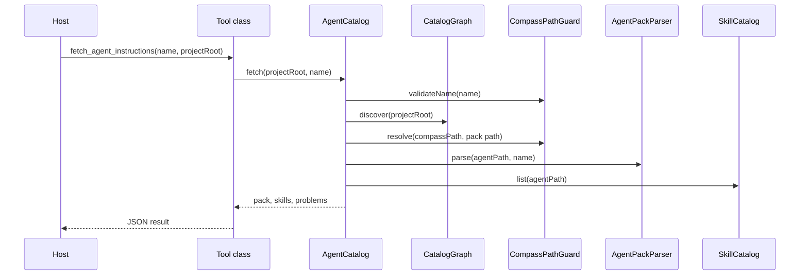

# Pack Discovery and Fetch

A host or agent calls `list_agents` to see which instruction packs exist, then calls `fetch_agent_instructions` to read one pack, and optionally calls `fetch_skill_instructions` to read one of its skills. The design document describes two usage patterns. In the first, an orchestrator lists packs and tells a subagent which pack to fetch. In the second, the running agent lists and picks for itself ([DESIGN.md:106-113](https://github.com/StarCruiseStudios/Agent/blob/main/compass/DESIGN.md#L106-L113)). Both patterns use the same tools.

## Participants

| Participant | Part it plays | Source |
| --- | --- | --- |
| Tool classes | Parse input and convert errors to results | [ListAgentsTool.ts:14-20](https://github.com/StarCruiseStudios/Agent/blob/main/compass/src/tools/ListAgentsTool.ts#L14-L20) |
| `AgentCatalog` | Coordinates every step | [AgentCatalog.ts:33-114](https://github.com/StarCruiseStudios/Agent/blob/main/compass/src/catalog/AgentCatalog.ts#L33-L114) |
| `ProjectRootResolver` | Validates the root | [ProjectRootResolver.ts:12-23](https://github.com/StarCruiseStudios/Agent/blob/main/compass/src/catalog/ProjectRootResolver.ts#L12-L23) |
| `CatalogGraph` | Finds catalog directories and their pack names | [CatalogGraph.ts:16-83](https://github.com/StarCruiseStudios/Agent/blob/main/compass/src/catalog/CatalogGraph.ts#L16-L83) |
| `CompassPathGuard` | Validates names and real paths | [CompassPathGuard.ts:12-32](https://github.com/StarCruiseStudios/Agent/blob/main/compass/src/catalog/CompassPathGuard.ts#L12-L32) |
| `AgentPackParser` | Reads `agent.json` and `instructions.md` | [AgentPackParser.ts:40-52](https://github.com/StarCruiseStudios/Agent/blob/main/compass/src/catalog/AgentPackParser.ts#L40-L52) |
| `SkillCatalog` | Lists and reads skills of the selected pack | [SkillCatalog.ts:80-119](https://github.com/StarCruiseStudios/Agent/blob/main/compass/src/catalog/SkillCatalog.ts#L80-L119) |

These classes belong to the [Compass Server](/wiki/areas/agent-workspace/systems/compass/containers/compass-server/overview.md) container.

## Sequence

Diagram sources:

- The tool calls `catalog.fetch`: [FetchAgentInstructionsTool.ts:21](https://github.com/StarCruiseStudios/Agent/blob/main/compass/src/tools/FetchAgentInstructionsTool.ts#L21).
- `fetch` validates the name, selects the pack, and then lists skills: [AgentCatalog.ts:101-105](https://github.com/StarCruiseStudios/Agent/blob/main/compass/src/catalog/AgentCatalog.ts#L101-L105).
- `select` resolves the root and discovers the graph, then loads the pack: [AgentCatalog.ts:87-99](https://github.com/StarCruiseStudios/Agent/blob/main/compass/src/catalog/AgentCatalog.ts#L87-L99), [AgentCatalog.ts:33-37](https://github.com/StarCruiseStudios/Agent/blob/main/compass/src/catalog/AgentCatalog.ts#L33-L37).
- `load` calls the guard and then the parser: [AgentCatalog.ts:43-51](https://github.com/StarCruiseStudios/Agent/blob/main/compass/src/catalog/AgentCatalog.ts#L43-L51).

The steps for a fetch are:

1. The tool validates the input with a strict schema. A name without a valid root maps to `invalid_project_root`, and any other schema failure maps to `invalid_name` ([FetchAgentInstructionsTool.ts:16-20](https://github.com/StarCruiseStudios/Agent/blob/main/compass/src/tools/FetchAgentInstructionsTool.ts#L16-L20)).
2. `AgentCatalog.fetch` checks the name against the pattern `^[a-z][a-z0-9]*(-[a-z0-9]+)*$` and a 64-character limit before it touches the disk ([AgentCatalog.ts:101-102](https://github.com/StarCruiseStudios/Agent/blob/main/compass/src/catalog/AgentCatalog.ts#L101-L102), [CompassPathGuard.ts:12-16](https://github.com/StarCruiseStudios/Agent/blob/main/compass/src/catalog/CompassPathGuard.ts#L12-L16)).
3. The resolver requires an absolute path that is an accessible directory, and it returns the real path ([ProjectRootResolver.ts:12-22](https://github.com/StarCruiseStudios/Agent/blob/main/compass/src/catalog/ProjectRootResolver.ts#L12-L22)).
4. The graph visits `<root>/.compass` first. For each directory it records the child directory names, skipping names that start with a dot and the file `config.json` ([CatalogGraph.ts:17](https://github.com/StarCruiseStudios/Agent/blob/main/compass/src/catalog/CatalogGraph.ts#L17), [CatalogGraph.ts:50-59](https://github.com/StarCruiseStudios/Agent/blob/main/compass/src/catalog/CatalogGraph.ts#L50-L59)).
5. If the directory has a `config.json`, the graph reads its `directories` array and visits each referenced directory depth first ([CatalogGraph.ts:60-77](https://github.com/StarCruiseStudios/Agent/blob/main/compass/src/catalog/CatalogGraph.ts#L60-L77)). References can use `~`, `$VAR`, `${VAR}`, and `%VAR%`, and relative paths resolve against the directory that holds the config ([resolveCompassReference.ts:5-18](https://github.com/StarCruiseStudios/Agent/blob/main/compass/src/catalog/resolveCompassReference.ts#L5-L18)).
6. `select` returns `catalog_missing` when the project has no `.compass` directory ([AgentCatalog.ts:90](https://github.com/StarCruiseStudios/Agent/blob/main/compass/src/catalog/AgentCatalog.ts#L90)).
7. The first directory that defines a name, compared in lower case, wins. Later definitions of the same name are ignored ([AgentCatalog.ts:53-61](https://github.com/StarCruiseStudios/Agent/blob/main/compass/src/catalog/AgentCatalog.ts#L53-L61), [README.md:107](https://github.com/StarCruiseStudios/Agent/blob/main/compass/README.md#L107)).
8. `select` returns `case_collision` when two directories in the winning catalog differ only by case, and `unknown_agent` when the name is absent ([AgentCatalog.ts:91-95](https://github.com/StarCruiseStudios/Agent/blob/main/compass/src/catalog/AgentCatalog.ts#L91-L95)).
9. The guard resolves real paths and requires the pack to be an immediate child of the catalog. Otherwise it returns `path_escape` ([CompassPathGuard.ts:18-32](https://github.com/StarCruiseStudios/Agent/blob/main/compass/src/catalog/CompassPathGuard.ts#L18-L32)).
10. The parser reads `agent.json`, decodes it as strict UTF-8, validates the schema, and checks that its `name` equals the directory name. It then reads `instructions.md`, enforces a 262144-byte limit, decodes it, and rejects empty text ([AgentPackParser.ts:40-51](https://github.com/StarCruiseStudios/Agent/blob/main/compass/src/catalog/AgentPackParser.ts#L40-L51)).
11. The catalog lists skills for the pack and returns the skill names and descriptions with the pack ([AgentCatalog.ts:104](https://github.com/StarCruiseStudios/Agent/blob/main/compass/src/catalog/AgentCatalog.ts#L104)).

`list_agents` follows steps 3 to 5, 7, 9, and 10 for every winning name. A pack that fails validation does not stop the call. The catalog records it as a problem with a reason, and valid packs still return, sorted by name ([AgentCatalog.ts:63-85](https://github.com/StarCruiseStudios/Agent/blob/main/compass/src/catalog/AgentCatalog.ts#L63-L85)).

`fetch_skill_instructions` selects the agent in the same way and then reads `skills/<skillName>/SKILL.md`. It requires YAML front matter with a `name` that matches the directory and a non-blank `description`, and it requires a non-empty body ([AgentCatalog.ts:107-114](https://github.com/StarCruiseStudios/Agent/blob/main/compass/src/catalog/AgentCatalog.ts#L107-L114), [SkillCatalog.ts:48-63](https://github.com/StarCruiseStudios/Agent/blob/main/compass/src/catalog/SkillCatalog.ts#L48-L63)).

## Data and state

The flow keeps no state between calls. Each operation resolves the root and discovers the graph again ([AgentCatalog.ts:33-37](https://github.com/StarCruiseStudios/Agent/blob/main/compass/src/catalog/AgentCatalog.ts#L33-L37)). A fetch result contains the pack summary (`name`, `description`, `whenToUse`, `tools`, `modelHint`), the real `agentPath`, the `instructions` text, the skills, and the graph problems under `catalogProblems` ([AgentCatalog.ts:97-98](https://github.com/StarCruiseStudios/Agent/blob/main/compass/src/catalog/AgentCatalog.ts#L97-L98), [AgentMetadata.ts:6-29](https://github.com/StarCruiseStudios/Agent/blob/main/compass/src/catalog/AgentMetadata.ts#L6-L29)).

## Failure, retry, and consistency

Every failure becomes a tool result with `isError` set and an `error` code. An exception that is not a `CompassError` is reported as `malformed_pack` ([ToolResultFactory.ts:16-20](https://github.com/StarCruiseStudios/Agent/blob/main/compass/src/tools/ToolResultFactory.ts#L16-L20)). The graph reports these problems and keeps loading other branches.

| Problem | Cause | Source |
| --- | --- | --- |
| `catalog_cycle` | A reference leads back to a directory that is still being visited. The graph skips that edge and records the chain. | [CatalogGraph.ts:43-47](https://github.com/StarCruiseStudios/Agent/blob/main/compass/src/catalog/CatalogGraph.ts#L43-L47) |
| `invalid_config` | `config.json` is not valid UTF-8 JSON that matches the strict schema | [CatalogGraph.ts:62-67](https://github.com/StarCruiseStudios/Agent/blob/main/compass/src/catalog/CatalogGraph.ts#L62-L67) |
| `invalid_reference` | A reference has an unset variable or expands to an empty path | [CatalogGraph.ts:69-74](https://github.com/StarCruiseStudios/Agent/blob/main/compass/src/catalog/CatalogGraph.ts#L69-L74), [resolveCompassReference.ts:12](https://github.com/StarCruiseStudios/Agent/blob/main/compass/src/catalog/resolveCompassReference.ts#L12) |
| `catalog_unreadable` | A referenced directory cannot be read | [CatalogGraph.ts:38](https://github.com/StarCruiseStudios/Agent/blob/main/compass/src/catalog/CatalogGraph.ts#L38) |

A directory that two branches both reference loads once, because the graph records completed directories by real path. On Windows the comparison ignores case ([CatalogGraph.ts:42-48](https://github.com/StarCruiseStudios/Agent/blob/main/compass/src/catalog/CatalogGraph.ts#L42-L48)). The tools do not retry. A caller reads the error code and decides what to do.

## Variations

- **Skills.** Skills are read only after a pack is selected. A bad skill appears under `skillProblems` and does not block the pack ([SkillCatalog.ts:80-94](https://github.com/StarCruiseStudios/Agent/blob/main/compass/src/catalog/SkillCatalog.ts#L80-L94), [README.md:75](https://github.com/StarCruiseStudios/Agent/blob/main/compass/README.md#L75)).
- **Host configuration.** The `compass/Example` folder shows a host setup. Its `AGENTS.md` tells an agent to consult Compass at the start of every task and to pass the absolute `projectRoot` ([Example/AGENTS.md:1-8](https://github.com/StarCruiseStudios/Agent/blob/main/compass/Example/AGENTS.md#L1-L8)). Its Codex configuration launches the command `compass` ([Example/.codex/config.toml:1-4](https://github.com/StarCruiseStudios/Agent/blob/main/compass/Example/.codex/config.toml#L1-L4)).

## Open questions

- Behavior under a real MCP host is not yet documented.

## Related

- [Compass Server](/wiki/areas/agent-workspace/systems/compass/containers/compass-server/overview.md): the container that runs this flow.
- [Compass](/wiki/areas/agent-workspace/systems/compass/overview.md): the system page.
