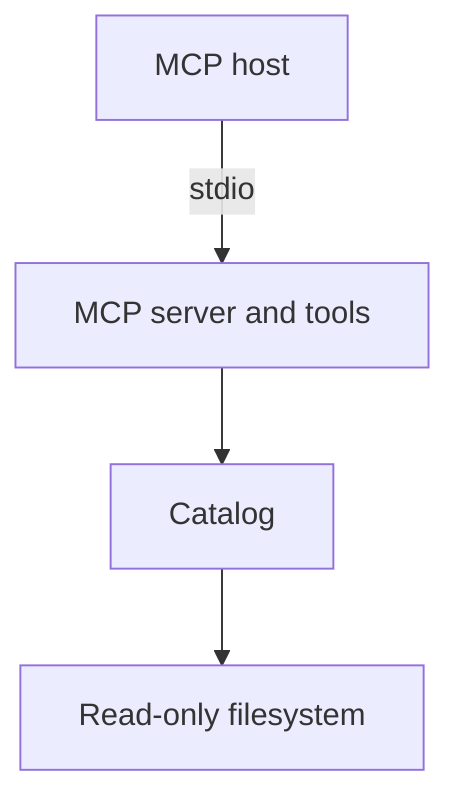

# Compass Server

The Compass server is a Node.js process that speaks the Model Context Protocol (MCP) over standard input and output. It exposes read-only tools that list agent instruction packs, return one pack, and return one skill that belongs to a pack ([CompassMcpServer.ts](https://github.com/StarCruiseStudios/Agent/blob/main/compass/src/server/CompassMcpServer.ts)). It is the only container in the [Compass](/wiki/areas/agent-workspace/systems/compass/overview.md) system.

## Code location

| Repo | Paths | What is there | Source |
| --- | --- | --- | --- |
| `StarCruiseStudios/Agent` | [compass/src/](https://github.com/StarCruiseStudios/Agent/tree/main/compass/src) | TypeScript source, split by responsibility into catalog, composition, filesystem, logging, server, and tools folders | [compass/src/](https://github.com/StarCruiseStudios/Agent/tree/main/compass/src) |
| `StarCruiseStudios/Agent` | [compass/tests/](https://github.com/StarCruiseStudios/Agent/tree/main/compass/tests) | Unit tests, a stdio integration test, and fixture projects | [compass/tests/](https://github.com/StarCruiseStudios/Agent/tree/main/compass/tests) |
| `StarCruiseStudios/Agent` | [compass/package.json](https://github.com/StarCruiseStudios/Agent/blob/main/compass/package.json) | Package definition, command name, and scripts | [package.json](https://github.com/StarCruiseStudios/Agent/blob/main/compass/package.json) |

## Responsibilities

The server reads agent packs from a catalog directory on disk and returns them to the calling host. It does not create or change packs, install them into a host, or start agents. The host chooses and starts the agent, and Compass supplies the instructions ([DESIGN](https://github.com/StarCruiseStudios/Agent/blob/main/compass/DESIGN.md)).

## Components

Small classes receive their collaborators through constructors, and one composition root creates and connects them ([CompassProcess.ts](https://github.com/StarCruiseStudios/Agent/blob/main/compass/src/composition/CompassProcess.ts)).

Diagram sources:

- The composition root serves the MCP server over stdio: [CompassProcess.ts](https://github.com/StarCruiseStudios/Agent/blob/main/compass/src/composition/CompassProcess.ts).
- The tools delegate to the catalog: [AgentCatalog.ts](https://github.com/StarCruiseStudios/Agent/blob/main/compass/src/catalog/AgentCatalog.ts).
- The catalog reads through a filesystem interface: [FileSystem.ts](https://github.com/StarCruiseStudios/Agent/blob/main/compass/src/filesystem/FileSystem.ts).

| Component | Role | Source |
| --- | --- | --- |
| Entry and composition | Starts the process and connects every object | [CompassProcess.ts](https://github.com/StarCruiseStudios/Agent/blob/main/compass/src/composition/CompassProcess.ts) |
| MCP server | Registers the tools with read-only annotations | [CompassMcpServer.ts](https://github.com/StarCruiseStudios/Agent/blob/main/compass/src/server/CompassMcpServer.ts) |
| Tools | Validate input and convert every failure into a tool result | [ToolResultFactory.ts](https://github.com/StarCruiseStudios/Agent/blob/main/compass/src/tools/ToolResultFactory.ts) |
| Catalog | Finds catalog directories, validates names and paths, and parses packs and skills | [AgentCatalog.ts](https://github.com/StarCruiseStudios/Agent/blob/main/compass/src/catalog/AgentCatalog.ts) |
| Filesystem | A small read-only interface and its Node adapter | [FileSystem.ts](https://github.com/StarCruiseStudios/Agent/blob/main/compass/src/filesystem/FileSystem.ts) |
| Logging | Writes diagnostics to stderr so stdout stays a pure MCP stream | [TslogDiagnosticLogger.ts](https://github.com/StarCruiseStudios/Agent/blob/main/compass/src/logging/TslogDiagnosticLogger.ts) |

## Interfaces

The tools list the available packs, fetch one pack with its instructions, and fetch one skill of a pack. Every tool requires an explicit absolute project root, and there is no default from the working directory or environment ([README](https://github.com/StarCruiseStudios/Agent/blob/main/compass/README.md)). Each result is a single JSON object, and failures carry an error code and a one-sentence message ([ToolResultFactory.ts](https://github.com/StarCruiseStudios/Agent/blob/main/compass/src/tools/ToolResultFactory.ts)).

The container owns no datastore. It reads the catalog folder of the project that the caller names, together with any catalogs that the configuration references ([CatalogGraph.ts](https://github.com/StarCruiseStudios/Agent/blob/main/compass/src/catalog/CatalogGraph.ts)).

## Runtime and deployment

The package builds with the TypeScript compiler and runs as a command that an MCP host launches ([package.json](https://github.com/StarCruiseStudios/Agent/blob/main/compass/package.json), [README](https://github.com/StarCruiseStudios/Agent/blob/main/compass/README.md)). The server keeps no cache, so each request reads the catalog again and edits to a pack appear on the next call ([README](https://github.com/StarCruiseStudios/Agent/blob/main/compass/README.md)).

## Key flows and entities

- **Pack discovery and fetch.** A request resolves the project root, discovers catalogs, selects the first definition of each pack name, validates the name and real path, and parses the pack files. See [Pack discovery and fetch](/wiki/areas/agent-workspace/systems/compass/containers/compass-server/flows/pack-discovery-and-fetch.md).
- **Agent pack and skill.** Packs and skills are folders of human-written files. [Compass](/wiki/areas/agent-workspace/systems/compass/overview.md) describes them.

## Design decisions and constraints

- **Untrusted names, trusted root.** The design treats the project root as trusted caller input and the pack name as the untrusted value that must stay inside the catalog. The code validates names before any filesystem access and compares real paths so that a link cannot leave the catalog ([DESIGN](https://github.com/StarCruiseStudios/Agent/blob/main/compass/DESIGN.md), [CompassPathGuard.ts](https://github.com/StarCruiseStudios/Agent/blob/main/compass/src/catalog/CompassPathGuard.ts)).
- **Tools only.** The design avoids MCP resources, because a resource would be a second way to read the same content and hosts differ in whether the model sees resources ([DESIGN](https://github.com/StarCruiseStudios/Agent/blob/main/compass/DESIGN.md)).
- **Read-only and cache-free.** Write tools and caching are explicitly out of scope ([DESIGN](https://github.com/StarCruiseStudios/Agent/blob/main/compass/DESIGN.md)).

## Open questions

- The design document and the code differ on some limits and on the number of tools. The code is the reference for this wiki, and the [exploration backlog](/wiki/exploration-backlog.md) lists the differences.

## Pages in this container

- Flows: [Pack discovery and fetch](/wiki/areas/agent-workspace/systems/compass/containers/compass-server/flows/pack-discovery-and-fetch.md)

## Wider scope

- [Compass](/wiki/areas/agent-workspace/systems/compass/overview.md): the system that this container implements.
- [Agent workspace](/wiki/areas/agent-workspace/overview.md): the area that holds the system.
