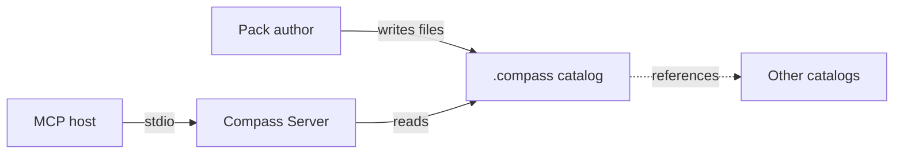

# Compass

Compass is a local MCP server that gives AI agents access to human-written instruction packs. An agent or an orchestrator lists the available packs, selects one, and fetches its instructions at the start of a task ([README](https://github.com/StarCruiseStudios/Agent/blob/main/compass/README.md), [DESIGN](https://github.com/StarCruiseStudios/Agent/blob/main/compass/DESIGN.md)). Compass supplies text only. The host application decides which agent runs and which model it uses ([README](https://github.com/StarCruiseStudios/Agent/blob/main/compass/README.md)).

## Code location

| Repo | Paths | What is there | Source |
| --- | --- | --- | --- |
| `StarCruiseStudios/Agent` | [compass/](https://github.com/StarCruiseStudios/Agent/tree/main/compass) | Source, tests, the design document, and an example project | [compass/](https://github.com/StarCruiseStudios/Agent/tree/main/compass) |

## Responsibilities and boundary

Compass reads, validates, and returns packs and skills. It does not author or edit packs, install them into a host, serve MCP resources or prompts, or start agents ([DESIGN](https://github.com/StarCruiseStudios/Agent/blob/main/compass/DESIGN.md)). Authors write the catalog by hand in a `.compass` folder inside a project ([README](https://github.com/StarCruiseStudios/Agent/blob/main/compass/README.md)).

## Architecture

Diagram sources:

- Authors write packs by hand: [README](https://github.com/StarCruiseStudios/Agent/blob/main/compass/README.md).
- Hosts launch the server over stdio: [DESIGN](https://github.com/StarCruiseStudios/Agent/blob/main/compass/DESIGN.md).
- The server reads the catalog and follows configured references to other catalogs: [CatalogGraph.ts](https://github.com/StarCruiseStudios/Agent/blob/main/compass/src/catalog/CatalogGraph.ts).

| Container | Role | Technology | Source |
| --- | --- | --- | --- |
| [Compass Server](/wiki/areas/agent-workspace/systems/compass/containers/compass-server/overview.md) | Serves read-only MCP tools over stdio | TypeScript on Node.js | [package.json](https://github.com/StarCruiseStudios/Agent/blob/main/compass/package.json) |

## Key flows

[Pack discovery and fetch](/wiki/areas/agent-workspace/systems/compass/containers/compass-server/flows/pack-discovery-and-fetch.md) covers how a caller finds a pack, validates it, and receives its instructions and skills.

## Key entities

- **Agent pack.** A named folder with metadata that describes when to use the pack and a Markdown file of instructions ([AgentPackParser.ts](https://github.com/StarCruiseStudios/Agent/blob/main/compass/src/catalog/AgentPackParser.ts)).
- **Skill.** A reusable procedure that belongs to exactly one pack and is fetched on demand ([SkillCatalog.ts](https://github.com/StarCruiseStudios/Agent/blob/main/compass/src/catalog/SkillCatalog.ts)).
- **Catalog.** The set of packs available to a project, which can extend to catalogs that its configuration references ([README](https://github.com/StarCruiseStudios/Agent/blob/main/compass/README.md)).

## Interfaces and dependencies

Hosts reach Compass through MCP tools over stdio. Compass depends only on the local filesystem ([FileSystem.ts](https://github.com/StarCruiseStudios/Agent/blob/main/compass/src/filesystem/FileSystem.ts)).

## Runtime and deployment

A developer builds the package, links it as a command, and configures an MCP host to launch that command ([README](https://github.com/StarCruiseStudios/Agent/blob/main/compass/README.md)).

## Design decisions and constraints

The design document is the contract for the system, and it keeps the server read-only and cache-free ([DESIGN](https://github.com/StarCruiseStudios/Agent/blob/main/compass/DESIGN.md)). The [Compass Server](/wiki/areas/agent-workspace/systems/compass/containers/compass-server/overview.md) page covers the path safety rules that follow from that contract.

## Pages in this system

- Containers: [Compass Server](/wiki/areas/agent-workspace/systems/compass/containers/compass-server/overview.md)

## Wider scope

- [Agent workspace](/wiki/areas/agent-workspace/overview.md): the area that holds this system.
