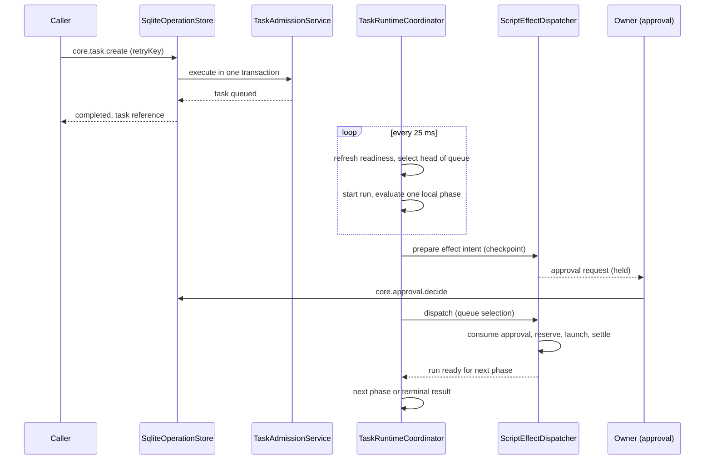

# Task and Run Lifecycle

A caller admits a task into a named queue (a Cerebrate). The service stores it, a scheduler later picks it, and the scheduler starts a run that executes the task's published state machine one safe step at a time. A step can finish the task, park the run to wait for an event, a timer, another task or a human, or prepare an external effect such as a script that may need human approval before it launches. Every change is committed to one SQLite store, so a restart resumes the same work instead of repeating it. This page traces that path in the service code. The people and tools that call the service are summarised on the [Overmind](/wiki/areas/agent-workspace/systems/overmind/overview.md) page.

## Participants

| Participant | Part it plays | Source |
| --- | --- | --- |
| `RuntimeOperationHandler` | Entry for each task action; hands the action to the store as one atomic admission | [RuntimeOperationHandler.ts:12-16](https://github.com/StarCruiseStudios/Overmind/blob/main/apps/overmind-svc/src/tasks/RuntimeOperationHandler.ts#L12-L16) |
| `SqliteOperationStore` | Deduplicates by retry key and commits the action, invocation, and records in one transaction | [SqliteOperationStore.ts:171-186](https://github.com/StarCruiseStudios/Overmind/blob/main/apps/overmind-svc/src/storage/SqliteOperationStore.ts#L171-L186) |
| `TaskAdmissionService` | Creates the queued task record | [TaskAdmissionService.ts:20-33](https://github.com/StarCruiseStudios/Overmind/blob/main/apps/overmind-svc/src/tasks/TaskAdmissionService.ts#L20-L33) |
| `TaskDestinationValidator` | Checks queue authority, state, capacity, pins, and input schema | [TaskDestinationValidator.ts:17-29](https://github.com/StarCruiseStudios/Overmind/blob/main/apps/overmind-svc/src/tasks/TaskDestinationValidator.ts#L17-L29) |
| `TaskRuntimeCoordinator` | Selects tasks, starts runs, commits checkpoints, and recovers on start | [TaskRuntimeCoordinator.ts](https://github.com/StarCruiseStudios/Overmind/blob/main/apps/overmind-svc/src/tasks/TaskRuntimeCoordinator.ts) |
| `ScriptEffectDispatcher` | Prepares and launches script effects under reservations and approvals | [ScriptEffectDispatcher.ts](https://github.com/StarCruiseStudios/Overmind/blob/main/apps/overmind-svc/src/execution/ScriptEffectDispatcher.ts) |
| `ScriptApprovalPermission`, `ApprovalReservation`, `CommunicationAction` | Propose, record, and consume one-use human approvals | [approvals/DOC.md](https://github.com/StarCruiseStudios/Overmind/blob/main/apps/overmind-svc/src/approvals/DOC.md), [CommunicationAction.ts:58-70](https://github.com/StarCruiseStudios/Overmind/blob/main/apps/overmind-svc/src/communication/CommunicationAction.ts#L58-L70) |
| `UtcTriggerScheduler`, `EventAdmissionService`, `TaskCancellationService`, `CerebrateConfigurationService` | Other ways work enters or is controlled | [tasks/](https://github.com/StarCruiseStudios/Overmind/tree/main/apps/overmind-svc/src/tasks) |

The composition root builds the coordinator and the trigger scheduler at service start ([OperationApplication.ts:391-394](https://github.com/StarCruiseStudios/Overmind/blob/main/apps/overmind-svc/src/OperationApplication.ts#L391-L394)).

## Sequence

Diagram sources:

- Admission in one transaction with a retry key: [SqliteOperationStore.ts:171-186](https://github.com/StarCruiseStudios/Overmind/blob/main/apps/overmind-svc/src/storage/SqliteOperationStore.ts#L171-L186), [TaskAdmissionService.ts:20-33](https://github.com/StarCruiseStudios/Overmind/blob/main/apps/overmind-svc/src/tasks/TaskAdmissionService.ts#L20-L33).
- The 25 ms selection loop, refresh, run start and local phase: [TaskRuntimeCoordinator.ts:43](https://github.com/StarCruiseStudios/Overmind/blob/main/apps/overmind-svc/src/tasks/TaskRuntimeCoordinator.ts#L43), [TaskRuntimeCoordinator.ts:52-95](https://github.com/StarCruiseStudios/Overmind/blob/main/apps/overmind-svc/src/tasks/TaskRuntimeCoordinator.ts#L52-L95).
- Effect preparation and the approval request: [TaskRuntimeCoordinator.ts:217-219](https://github.com/StarCruiseStudios/Overmind/blob/main/apps/overmind-svc/src/tasks/TaskRuntimeCoordinator.ts#L217-L219), [ScriptEffectDispatcher.ts:36-46](https://github.com/StarCruiseStudios/Overmind/blob/main/apps/overmind-svc/src/execution/ScriptEffectDispatcher.ts#L36-L46).
- The decision and the later dispatch: [CommunicationAction.ts:58-70](https://github.com/StarCruiseStudios/Overmind/blob/main/apps/overmind-svc/src/communication/CommunicationAction.ts#L58-L70), [ScriptEffectDispatcher.ts:54-104](https://github.com/StarCruiseStudios/Overmind/blob/main/apps/overmind-svc/src/execution/ScriptEffectDispatcher.ts#L54-L104).

## Steps

### 1. Admission

1. The store looks up a prior invocation for the same workspace, principal, operation, and retry key. A match returns the original result, a changed input returns `RETRY_INPUT_CONFLICT`, and an expired retry window is refused ([SqliteOperationStore.ts:171-186](https://github.com/StarCruiseStudios/Overmind/blob/main/apps/overmind-svc/src/storage/SqliteOperationStore.ts#L171-L186)).
2. `TaskDestinationValidator` rejects the task unless the caller can read the queue and holds `core.task.create` for it, the queue is enabled, fewer than 10000 unfinished tasks exist in it, the queue's publication and every pin are available, every state type is supported, and the input validates against the publication's input schema ([TaskDestinationValidator.ts:17-29](https://github.com/StarCruiseStudios/Overmind/blob/main/apps/overmind-svc/src/tasks/TaskDestinationValidator.ts#L17-L29)).
3. `TaskAdmissionService` rejects instructions over 32768 bytes, prerequisites or a parent the caller cannot read, and a parent that already has 100 children or depth 16 ([TaskAdmissionService.ts:20-27](https://github.com/StarCruiseStudios/Overmind/blob/main/apps/overmind-svc/src/tasks/TaskAdmissionService.ts#L20-L27)).
4. It writes a task with status `queued`, the default priority `normal`, a global sequence number, and the queue's current publication id, and increments the parent's child count. No run exists yet ([TaskAdmissionService.ts:28-33](https://github.com/StarCruiseStudios/Overmind/blob/main/apps/overmind-svc/src/tasks/TaskAdmissionService.ts#L28-L33)).

Three other paths reach the same admission. A recurring UTC trigger calls the task admission action as the owner and records a held receipt instead of a task when admission is rejected ([UtcTriggerScheduler.ts:33-47](https://github.com/StarCruiseStudios/Overmind/blob/main/apps/overmind-svc/src/tasks/UtcTriggerScheduler.ts#L33-L47)). An owner retry admits a fresh linked task from a failed or cancelled one, while reassignment and dependency repair change only tasks that have not started ([OPERATIONS.md](https://github.com/StarCruiseStudios/Overmind/blob/main/apps/overmind-svc/OPERATIONS.md), [TaskAdmissionService.ts:28](https://github.com/StarCruiseStudios/Overmind/blob/main/apps/overmind-svc/src/tasks/TaskAdmissionService.ts#L28)). An event submitted to a run is admitted as a pending event record, not a task ([EventAdmissionService.ts:21-33](https://github.com/StarCruiseStudios/Overmind/blob/main/apps/overmind-svc/src/tasks/EventAdmissionService.ts#L21-L33)).

### 2. Readiness and scheduling

1. The coordinator timer calls `pump()` every 25 ms and does nothing when the store is unavailable ([TaskRuntimeCoordinator.ts:43](https://github.com/StarCruiseStudios/Overmind/blob/main/apps/overmind-svc/src/tasks/TaskRuntimeCoordinator.ts#L43), [TaskRuntimeCoordinator.ts:52-53](https://github.com/StarCruiseStudios/Overmind/blob/main/apps/overmind-svc/src/tasks/TaskRuntimeCoordinator.ts#L52-L53)).
2. `refresh()` recomputes each unfinished task's status and reason. A task whose prerequisite failed or was cancelled is `blocked` with `PREREQUISITE_FAILED_REVIEW`, one with an unfinished prerequisite is `PREREQUISITE_PENDING`, one whose admitting principal lost authority is `AUTHORITY_UNAVAILABLE`, and one at the parked-run limit is `PARKED_CAPACITY`. Otherwise it stays `queued` ([TaskRuntimeCoordinator.ts:136-154](https://github.com/StarCruiseStudios/Overmind/blob/main/apps/overmind-svc/src/tasks/TaskRuntimeCoordinator.ts#L136-L154)).
3. For each Cerebrate that is enabled, not paused, not draining, and has no local phase in flight, the coordinator picks one eligible task. Eligible means not terminal, not cancel-requested, all prerequisites succeeded, and the admitting principal still holds `core.task.create` and read access ([TaskRuntimeCoordinator.ts:57-58](https://github.com/StarCruiseStudios/Overmind/blob/main/apps/overmind-svc/src/tasks/TaskRuntimeCoordinator.ts#L57-L58), [TaskRuntimeCoordinator.ts:111-117](https://github.com/StarCruiseStudios/Overmind/blob/main/apps/overmind-svc/src/tasks/TaskRuntimeCoordinator.ts#L111-L117)).
4. Order is priority band (`urgent`, then `normal`, then `background`), then original admission sequence, then id. There is no preemption ([TaskRuntimeCoordinator.ts:99](https://github.com/StarCruiseStudios/Overmind/blob/main/apps/overmind-svc/src/tasks/TaskRuntimeCoordinator.ts#L99)).
5. Inside one checkpoint transaction the coordinator re-checks the dispatch gate and that no run of this Cerebrate is already `executing`, takes the head of the queue, and creates the task's single run at the machine's initial state (or reuses a parked run that is `ready`). The task becomes `running` ([TaskRuntimeCoordinator.ts:75-91](https://github.com/StarCruiseStudios/Overmind/blob/main/apps/overmind-svc/src/tasks/TaskRuntimeCoordinator.ts#L75-L91)). A new run is not created while 100 parked runs already exist for the Cerebrate ([TaskRuntimeCoordinator.ts:86](https://github.com/StarCruiseStudios/Overmind/blob/main/apps/overmind-svc/src/tasks/TaskRuntimeCoordinator.ts#L86)).
6. The same pass picks a held or prepared effect attempt that the readiness policy marks selectable and starts its dispatch ([TaskRuntimeCoordinator.ts:65-73](https://github.com/StarCruiseStudios/Overmind/blob/main/apps/overmind-svc/src/tasks/TaskRuntimeCoordinator.ts#L65-L73), [EffectReadinessPolicy.ts:15-45](https://github.com/StarCruiseStudios/Overmind/blob/main/apps/overmind-svc/src/execution/EffectReadinessPolicy.ts#L15-L45)).

Queue controls act on this loop. Disabling a Cerebrate rejects new admissions and stops selection. Pausing stops selection but admission continues. Draining waits for the executing phase and then marks the queue `drained`, settling the original drain invocation. Resuming requires an enabled queue with no executing run ([TaskDestinationValidator.ts:20](https://github.com/StarCruiseStudios/Overmind/blob/main/apps/overmind-svc/src/tasks/TaskDestinationValidator.ts#L20), [CerebrateConfigurationService.ts:32-37](https://github.com/StarCruiseStudios/Overmind/blob/main/apps/overmind-svc/src/tasks/CerebrateConfigurationService.ts#L32-L37), [TaskRuntimeCoordinator.ts:156-158](https://github.com/StarCruiseStudios/Overmind/blob/main/apps/overmind-svc/src/tasks/TaskRuntimeCoordinator.ts#L156-L158), [OPERATIONS.md](https://github.com/StarCruiseStudios/Overmind/blob/main/apps/overmind-svc/OPERATIONS.md)).

### 3. Executing a phase

1. `execute()` builds an evaluation snapshot from the task input, committed outputs, and the facts recorded for the current wait, then runs the pure phase executor outside any write transaction ([TaskRuntimeCoordinator.ts:198-204](https://github.com/StarCruiseStudios/Overmind/blob/main/apps/overmind-svc/src/tasks/TaskRuntimeCoordinator.ts#L198-L204)).
2. It commits the outcome in a second transaction, and refuses it if the run's status, generation, or entry id no longer match what was selected (`Stale fenced local phase`) ([TaskRuntimeCoordinator.ts:205-207](https://github.com/StarCruiseStudios/Overmind/blob/main/apps/overmind-svc/src/tasks/TaskRuntimeCoordinator.ts#L205-L207)).
3. The run is parked after each phase. It is marked `ready` only when the outcome is a continuation. A wait state sets a deadline from its timeout, and a wait on a child's result records the child task and rejects dependency cycles ([TaskRuntimeCoordinator.ts:209-215](https://github.com/StarCruiseStudios/Overmind/blob/main/apps/overmind-svc/src/tasks/TaskRuntimeCoordinator.ts#L209-L215)).
4. The task becomes `succeeded` with a stored result, or `failed` for failed, over-limit, invalid-input, unavailable, or unsupported-effect outcomes, or `cancelled` if cancel was requested. Otherwise it is `blocked`. Terminal status discards the run's remaining events and timers ([TaskRuntimeCoordinator.ts:216-230](https://github.com/StarCruiseStudios/Overmind/blob/main/apps/overmind-svc/src/tasks/TaskRuntimeCoordinator.ts#L216-L230)).
5. A parked run returns to the queue when a matching fact exists. `refresh()` marks it `ready` for an effect that has finished, an admitted event that matches the wait, a finished child result, or an expired timer, and it is then selected through the ordinary named queue like any other work ([TaskRuntimeCoordinator.ts:126-129](https://github.com/StarCruiseStudios/Overmind/blob/main/apps/overmind-svc/src/tasks/TaskRuntimeCoordinator.ts#L126-L129), [TaskRuntimeCoordinator.ts:141-149](https://github.com/StarCruiseStudios/Overmind/blob/main/apps/overmind-svc/src/tasks/TaskRuntimeCoordinator.ts#L141-L149), [TaskRuntimeCoordinator.ts:175-190](https://github.com/StarCruiseStudios/Overmind/blob/main/apps/overmind-svc/src/tasks/TaskRuntimeCoordinator.ts#L175-L190)).

### 4. Approval and effect dispatch

When a phase yields an effect intent, the coordinator hands it to the communication, memory, or effect component in the same checkpoint, then parks the run and records the attempt's reason as the task's reason ([TaskRuntimeCoordinator.ts:217-219](https://github.com/StarCruiseStudios/Overmind/blob/main/apps/overmind-svc/src/tasks/TaskRuntimeCoordinator.ts#L217-L219)). The rest of this section covers script effects, which are the ones read for this page.

1. **Prepare.** `ScriptEffectDispatcher.prepare` makes no external call. It records an attempt that is `prepared`, or `held` with a reason such as `APPROVAL_REQUIRED`, `CONFIGURATION_UNAVAILABLE`, `POLICY_DENIED`, or `CREDENTIAL_UNAVAILABLE`. For `APPROVAL_REQUIRED` it asks the permission component to propose an approval ([ScriptEffectDispatcher.ts:36-46](https://github.com/StarCruiseStudios/Overmind/blob/main/apps/overmind-svc/src/execution/ScriptEffectDispatcher.ts#L36-L46)).
2. **Propose.** The proposal stores an approval record bound to the exact task, run, entry, state, effect, and a fingerprint of the normalized preview, with a 24-hour expiry, plus an Inbox message to the owner ([ScriptApprovalPermission.ts:40-56](https://github.com/StarCruiseStudios/Overmind/blob/main/apps/overmind-svc/src/approvals/ScriptApprovalPermission.ts#L40-L56)).
3. **Decide.** A human decision is accepted only while the request is pending, current, unexpired, and the task is not cancelled or terminal. An approved decision is recorded. A decision on a machine-declared approval state also marks the run ready. A declined permission for a protected script fails the run and the task with `APPROVAL_DECLINED` ([CommunicationAction.ts:58-70](https://github.com/StarCruiseStudios/Overmind/blob/main/apps/overmind-svc/src/communication/CommunicationAction.ts#L58-L70)). A decision only records consent. Resuming the work is left to scheduling ([approvals/DOC.md](https://github.com/StarCruiseStudios/Overmind/blob/main/apps/overmind-svc/src/approvals/DOC.md)).
4. **Dispatch.** The held `APPROVAL_REQUIRED` and `APPROVAL_PENDING` reasons count as retryable, so queue selection re-dispatches the attempt ([EffectReadinessPolicy.ts:31-36](https://github.com/StarCruiseStudios/Overmind/blob/main/apps/overmind-svc/src/execution/EffectReadinessPolicy.ts#L31-L36)). In one transaction `dispatch` re-checks queue state and the dispatch gate, the admitting principal's authority, the registered script configuration, policy, and connections, and requires no conflicting reservation and fewer than four reserved writers, then consumes the approval and reserves the attempt ([ScriptEffectDispatcher.ts:54-104](https://github.com/StarCruiseStudios/Overmind/blob/main/apps/overmind-svc/src/execution/ScriptEffectDispatcher.ts#L54-L104), [ApprovalReservation.ts:21-32](https://github.com/StarCruiseStudios/Overmind/blob/main/apps/overmind-svc/src/approvals/ApprovalReservation.ts#L21-L32)). Any failed check leaves the attempt `held` with that reason and the task `blocked`.
5. **Launch and settle.** After staging files, the dispatcher re-checks cancellation, configuration, policy, approval, and connection immediately before launch, runs the process, and validates the output file against the pinned schema ([ScriptEffectDispatcher.ts:105-117](https://github.com/StarCruiseStudios/Overmind/blob/main/apps/overmind-svc/src/execution/ScriptEffectDispatcher.ts#L105-L117)). A schema-valid result with exit code 0 settles the attempt as `succeeded`, a process exit failure or invalid output as `failed`, and anything unproven as `uncertain` with its reservation kept. Success or failure marks the run ready for its next phase ([ScriptEffectDispatcher.ts:115-118](https://github.com/StarCruiseStudios/Overmind/blob/main/apps/overmind-svc/src/execution/ScriptEffectDispatcher.ts#L115-L118)).

## Data and state

| Record | State it holds | Source |
| --- | --- | --- |
| Task | `status` is one of `queued`, `running`, `blocked`, `succeeded`, `failed`, `cancelled`; a `reason` code explains it; terminal outcomes never reopen | [RuntimeRecord.ts:131-139](https://github.com/StarCruiseStudios/Overmind/blob/main/apps/overmind-svc/src/tasks/RuntimeRecord.ts#L131-L139) |
| Run | One per task; `executing`, `parked`, or terminal; carries the current entry, outputs, trace, and effect attempts | [RuntimeRecord.ts:242](https://github.com/StarCruiseStudios/Overmind/blob/main/apps/overmind-svc/src/tasks/RuntimeRecord.ts#L242), [TaskRuntimeCoordinator.ts:88](https://github.com/StarCruiseStudios/Overmind/blob/main/apps/overmind-svc/src/tasks/TaskRuntimeCoordinator.ts#L88) |
| Publication pin | The queue's machine and its schemas, captured on the task at admission and used for every later phase | [TaskAdmissionService.ts:28](https://github.com/StarCruiseStudios/Overmind/blob/main/apps/overmind-svc/src/tasks/TaskAdmissionService.ts#L28), [TaskRuntimeCoordinator.ts:87](https://github.com/StarCruiseStudios/Overmind/blob/main/apps/overmind-svc/src/tasks/TaskRuntimeCoordinator.ts#L87) |
| Approval | Bound to one effect and a preview fingerprint; consumed once by one attempt id | [ApprovalReservation.ts:21-32](https://github.com/StarCruiseStudios/Overmind/blob/main/apps/overmind-svc/src/approvals/ApprovalReservation.ts#L21-L32) |

The service accepts a task input and returns an acknowledgment with a task reference and `queued` status. Callers read progress through `core.task.get` and related queries ([TaskAdmissionService.ts:33](https://github.com/StarCruiseStudios/Overmind/blob/main/apps/overmind-svc/src/tasks/TaskAdmissionService.ts#L33)).

## Failure, retry, and consistency

- **Retries and idempotency.** A retry key makes an admission idempotent per principal and operation. Completed results keep a retry window of seven days, and pending work has none ([SqliteOperationStore.ts:171-186](https://github.com/StarCruiseStudios/Overmind/blob/main/apps/overmind-svc/src/storage/SqliteOperationStore.ts#L171-L186)).
- **Cancellation.** If the run is idle, the task and run become `cancelled` at once and pending events and timers are discarded. If a phase is executing or an effect is reserved, the request is `accepted` and finishes at the next safe boundary, either the phase commit or tree cessation. Children and prerequisites are not cancelled ([TaskCancellationService.ts:17-28](https://github.com/StarCruiseStudios/Overmind/blob/main/apps/overmind-svc/src/tasks/TaskCancellationService.ts#L17-L28), [TaskRuntimeCoordinator.ts:133-135](https://github.com/StarCruiseStudios/Overmind/blob/main/apps/overmind-svc/src/tasks/TaskRuntimeCoordinator.ts#L133-L135), [OPERATIONS.md](https://github.com/StarCruiseStudios/Overmind/blob/main/apps/overmind-svc/OPERATIONS.md)).
- **Recovery.** On start, the coordinator walks every run that is not terminal. A run with a pending cancel and no reserved effect is cancelled and its cancel invocation settled. Any other run is parked with ownership retained, or kept `executing` if an effect is still live, and its task becomes `blocked` with `recovered-local-checkpoint`. A script attempt that was `dispatching` becomes `uncertain` with `RESTART_RECONCILIATION_REQUIRED`, keeps its reservation, and is not relaunched ([TaskRuntimeCoordinator.ts:37-44](https://github.com/StarCruiseStudios/Overmind/blob/main/apps/overmind-svc/src/tasks/TaskRuntimeCoordinator.ts#L37-L44), [ScriptEffectDispatcher.ts:50](https://github.com/StarCruiseStudios/Overmind/blob/main/apps/overmind-svc/src/execution/ScriptEffectDispatcher.ts#L50)). Resolving uncertainty needs owner evidence verification through `core.effect.verifyEvidence` ([OPERATIONS.md](https://github.com/StarCruiseStudios/Overmind/blob/main/apps/overmind-svc/OPERATIONS.md)).
- **Fencing.** Each phase result and effect callback carries the run's generation and entry id, and a callback that no longer matches is ignored ([TaskRuntimeCoordinator.ts:207](https://github.com/StarCruiseStudios/Overmind/blob/main/apps/overmind-svc/src/tasks/TaskRuntimeCoordinator.ts#L207), [ScriptEffectDispatcher.ts:136](https://github.com/StarCruiseStudios/Overmind/blob/main/apps/overmind-svc/src/execution/ScriptEffectDispatcher.ts#L136)).
- **Store failure.** An error during selection or a phase commit marks the store degraded and stops admission and selection ([TaskRuntimeCoordinator.ts:94](https://github.com/StarCruiseStudios/Overmind/blob/main/apps/overmind-svc/src/tasks/TaskRuntimeCoordinator.ts#L94), [TaskRuntimeCoordinator.ts:234](https://github.com/StarCruiseStudios/Overmind/blob/main/apps/overmind-svc/src/tasks/TaskRuntimeCoordinator.ts#L234)).
- **Shutdown.** Closing the coordinator stops its timer and does not cancel admitted work ([TaskRuntimeCoordinator.ts:48](https://github.com/StarCruiseStudios/Overmind/blob/main/apps/overmind-svc/src/tasks/TaskRuntimeCoordinator.ts#L48)).

## Variations

- **Typed application and LLM effects.** The same prepare, hold, approve, and dispatch shape is routed to application and LLM dispatchers, and a declared approval state routes to the target's own approval implementation ([tasks/DOC.md](https://github.com/StarCruiseStudios/Overmind/blob/main/apps/overmind-svc/src/tasks/DOC.md), [EffectApprovalRouter.ts:14](https://github.com/StarCruiseStudios/Overmind/blob/main/apps/overmind-svc/src/approvals/EffectApprovalRouter.ts#L14)). Their internals were not read for this page.
- **Human decisions that are not approvals.** Message and user-decision phases go through the communication component, and a human answer only marks the run ready ([DecisionResponseService.ts:24-39](https://github.com/StarCruiseStudios/Overmind/blob/main/apps/overmind-svc/src/communication/DecisionResponseService.ts#L24-L39)).
- **Recurring work.** UTC triggers coalesce missed intervals into one catch-up task per rule ([UtcTriggerScheduler.ts:33-47](https://github.com/StarCruiseStudios/Overmind/blob/main/apps/overmind-svc/src/tasks/UtcTriggerScheduler.ts#L33-L47)).

## Open questions

- How application, LLM, and workflow dispatchers differ from the script dispatcher in reservation, resume, and recovery was not read.
- How peer-originated tasks and file-source admissions are wired into this admission path was not read.
- How the machine evaluator decides each phase outcome is not covered here.

## Wider scope

- [Overmind](/wiki/areas/agent-workspace/systems/overmind/overview.md): the system this container belongs to.
