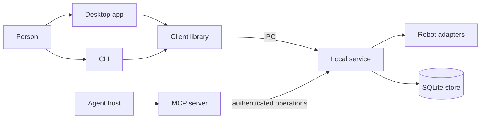

# Overmind

Overmind coordinates work for AI agents on a local machine. It runs named task queues, parks runs, schedules work, and asks a human for decisions and approvals, and it keeps memory of past work ([README](https://github.com/StarCruiseStudios/Overmind/blob/main/README.md)). A person works with it through a desktop app or a command line, and an agent works with it through an MCP server ([README](https://github.com/StarCruiseStudios/Overmind/blob/main/README.md)).

## Code location

| Repo | Paths | What is there | Source |
| --- | --- | --- | --- |
| `StarCruiseStudios/Overmind` | [apps/](https://github.com/StarCruiseStudios/Overmind/tree/main/apps) | The desktop app, command line, local service, and MCP server | [apps/](https://github.com/StarCruiseStudios/Overmind/tree/main/apps) |
| `StarCruiseStudios/Overmind` | [packages/](https://github.com/StarCruiseStudios/Overmind/tree/main/packages) | Shared libraries for the API contracts, client, core logging, and SDK | [packages/](https://github.com/StarCruiseStudios/Overmind/tree/main/packages) |
| `StarCruiseStudios/Overmind` | [extensions/](https://github.com/StarCruiseStudios/Overmind/tree/main/extensions) | Robot adapters for vendor agent CLIs and SDKs | [extensions/](https://github.com/StarCruiseStudios/Overmind/tree/main/extensions) |
| `StarCruiseStudios/Overmind` | [manual/](https://github.com/StarCruiseStudios/Overmind/tree/main/manual) | The user manual as standalone HTML articles | [manual/DOC.md](https://github.com/StarCruiseStudios/Overmind/blob/main/manual/DOC.md) |
| `StarCruiseStudios/Overmind` | [implementation/](https://github.com/StarCruiseStudios/Overmind/tree/main/implementation) | Validation guides for the remaining platform and review work | [implementation/README.md](https://github.com/StarCruiseStudios/Overmind/blob/main/implementation/README.md) |

## Responsibilities and boundary

Overmind owns the durable store of tasks, runs, approvals, and memory, and it governs how registered scripts and configured robots execute ([README](https://github.com/StarCruiseStudios/Overmind/blob/main/README.md)). Robots are adapters that run a vendor agent CLI or SDK, and each vendor has its own adapter package ([extensions/](https://github.com/StarCruiseStudios/Overmind/tree/main/extensions), [overmind-svc README](https://github.com/StarCruiseStudios/Overmind/blob/main/apps/overmind-svc/README.md)).

The project states its current limits. Native process supervision supports Windows only, and macOS validation, a final human review, and live vendor interoperability checks remain pending ([README](https://github.com/StarCruiseStudios/Overmind/blob/main/README.md), [implementation/README.md](https://github.com/StarCruiseStudios/Overmind/blob/main/implementation/README.md)).

## Architecture

Diagram sources:

- The desktop app, CLI, local IPC service, and MCP server: [README](https://github.com/StarCruiseStudios/Overmind/blob/main/README.md).
- The client connects to the shared service or launches it: [README](https://github.com/StarCruiseStudios/Overmind/blob/main/README.md).
- The MCP server discovers operations from the authenticated service: [overmind-mcp README](https://github.com/StarCruiseStudios/Overmind/blob/main/apps/overmind-mcp/README.md).
- The service governs robots and shares a SQLite operations store: [README](https://github.com/StarCruiseStudios/Overmind/blob/main/README.md), [overmind-svc README](https://github.com/StarCruiseStudios/Overmind/blob/main/apps/overmind-svc/README.md).
- The desktop app has a Service menu that starts and stops the shared service: [README](https://github.com/StarCruiseStudios/Overmind/blob/main/README.md).
- The edges from the desktop app and CLI through the client library are inferred from the client's description and the CLI build, which also builds the client: [README](https://github.com/StarCruiseStudios/Overmind/blob/main/README.md).

| Container | Role | Technology | Source |
| --- | --- | --- | --- |
| Desktop app | The primary human interface | React, Vite, and Electron | [README](https://github.com/StarCruiseStudios/Overmind/blob/main/README.md) |
| CLI | Starts and stops the service and shows a terminal view | Node.js with Ink | [README](https://github.com/StarCruiseStudios/Overmind/blob/main/README.md) |
| Local service | Owns tasks, schedules, approvals, memory, and robot execution | Node.js with built-in SQLite | [overmind-svc README](https://github.com/StarCruiseStudios/Overmind/blob/main/apps/overmind-svc/README.md) |
| MCP server | Exposes service operations to agents over stdio | Node.js | [overmind-mcp README](https://github.com/StarCruiseStudios/Overmind/blob/main/apps/overmind-mcp/README.md) |

## Key flows

Task admission, scheduling, approval, and recovery all run inside the local service, and the [service operations guide](https://github.com/StarCruiseStudios/Overmind/blob/main/apps/overmind-svc/OPERATIONS.md) defines the supported operations. No wiki page covers them yet.

## Key entities

- **Cerebrate.** A named queue of durable tasks ([overmind-svc README](https://github.com/StarCruiseStudios/Overmind/blob/main/apps/overmind-svc/README.md)).
- **Robot.** An adapter that runs a vendor agent through its CLI or SDK under governed execution ([README](https://github.com/StarCruiseStudios/Overmind/blob/main/README.md)).

## Interfaces and dependencies

Callers reach the service over a local IPC endpoint that an environment variable can change ([README](https://github.com/StarCruiseStudios/Overmind/blob/main/README.md)). The MCP server needs an explicit agent capability and never reads the owner bootstrap ([overmind-mcp README](https://github.com/StarCruiseStudios/Overmind/blob/main/apps/overmind-mcp/README.md)).

## Runtime and deployment

A developer builds the npm workspace and starts each application from the repository root. The service runs in the foreground, and the desktop app can start it or attach to one that is running ([README](https://github.com/StarCruiseStudios/Overmind/blob/main/README.md)). No installer or background supervisor is supplied ([overmind-svc README](https://github.com/StarCruiseStudios/Overmind/blob/main/apps/overmind-svc/README.md)).

## Design decisions and constraints

The project uses [Armory](/wiki/areas/agent-workspace/systems/armory/overview.md) to bring the [Oracle](/wiki/areas/engineering-toolkits/systems/oracle/overview.md) repository into its workspace so that functionality can move between them. Replacing the desktop app with Oracle is deferred ([README](https://github.com/StarCruiseStudios/Overmind/blob/main/README.md)).

## Open questions

- The manual defines product behavior from target specifications, and its entry articles note which parts the desktop app supports today ([manual/DOC.md](https://github.com/StarCruiseStudios/Overmind/blob/main/manual/DOC.md)). The boundary between target and implemented behavior has not been mapped.

## Pages in this system

No pages exist below this overview yet. The [exploration backlog](/wiki/exploration-backlog.md) lists the planned ones.

## Wider scope

- [Agent workspace](/wiki/areas/agent-workspace/overview.md): the area that holds this system.
- [Armory workspace](/wiki/concepts/armory-workspace.md): how Overmind and Oracle share a workspace.
