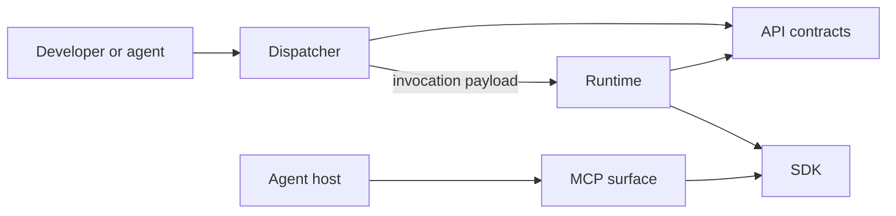

# Spec N' Roll

Spec N' Roll is a toolkit for spec-driven development with AI agents. Teams and agents define work in task-focused specifications, keep those specifications as an immutable record of implementation, and maintain a living application specification that deterministic validation enforces ([README](https://github.com/StarCruiseStudios/SpecNRoll/blob/main/README.md)). The README describes this as the intended scope. The current runtime is a stub that prints the invocation it receives ([README](https://github.com/StarCruiseStudios/SpecNRoll/blob/main/README.md)).

## Code location

| Repo | Paths | What is there | Source |
| --- | --- | --- | --- |
| `StarCruiseStudios/SpecNRoll` | [src/](https://github.com/StarCruiseStudios/SpecNRoll/tree/main/src) | The npm workspace packages | [src/README.md](https://github.com/StarCruiseStudios/SpecNRoll/blob/main/src/README.md) |
| `StarCruiseStudios/SpecNRoll` | [architecture/](https://github.com/StarCruiseStudios/SpecNRoll/tree/main/architecture), [atlas.config.json](https://github.com/StarCruiseStudios/SpecNRoll/blob/main/atlas.config.json) | Generated architecture artifacts and the configuration that drives them | [atlas.config.json](https://github.com/StarCruiseStudios/SpecNRoll/blob/main/atlas.config.json) |
| `StarCruiseStudios/SpecNRoll` | [V0/](https://github.com/StarCruiseStudios/SpecNRoll/tree/main/V0) | A self-contained earlier implementation: its own package, source, tests, specifications, and toolkit documentation (see [V0 folder](#v0-folder)) | [V0/package.json](https://github.com/StarCruiseStudios/SpecNRoll/blob/main/V0/package.json), [V0/docs/README.md](https://github.com/StarCruiseStudios/SpecNRoll/blob/main/V0/docs/README.md) |

## Responsibilities and boundary

The packages split the work by role. A dispatcher resolves the project root and chooses a runtime, a runtime performs command behavior, an API package holds the contracts between them, an SDK holds behavior that several executables share, an MCP package adapts that behavior for agents, and a test package holds shared test support ([README](https://github.com/StarCruiseStudios/SpecNRoll/blob/main/README.md), [src/README.md](https://github.com/StarCruiseStudios/SpecNRoll/blob/main/src/README.md)).

## V0 folder

`V0/` is a separate npm package that is not part of the root workspace: the root workspace globs only `src/*` ([package.json](https://github.com/StarCruiseStudios/SpecNRoll/blob/main/package.json)), while `V0/` has its own `package.json`, lockfile, build, tests, and agent conventions ([V0/package.json](https://github.com/StarCruiseStudios/SpecNRoll/blob/main/V0/package.json), [V0/AGENTS.md](https://github.com/StarCruiseStudios/SpecNRoll/blob/main/V0/AGENTS.md)). It publishes the same executable names (`spec-n-roll`, `snr`) plus a CLI and an MCP server, built from a single package rather than split into dispatcher, runtime, API, SDK, and MCP packages ([V0/package.json](https://github.com/StarCruiseStudios/SpecNRoll/blob/main/V0/package.json), [README](https://github.com/StarCruiseStudios/SpecNRoll/blob/main/README.md)). Its source holds an Ink-based CLI, a dependency-injected application layer, and an MCP server ([V0/src](https://github.com/StarCruiseStudios/SpecNRoll/tree/main/V0/src)).

Unlike the stub runtime, `V0/` documents implemented workflow behavior: slash commands, step initialisation and finalisation, task-spec lifecycle, `init`, `update`, `config agent`, and an extension mechanism for replacing workflow steps and registering hooks ([V0/docs/README.md](https://github.com/StarCruiseStudios/SpecNRoll/blob/main/V0/docs/README.md), [V0/docs/extension-quickstart.md](https://github.com/StarCruiseStudios/SpecNRoll/blob/main/V0/docs/extension-quickstart.md)). The extension documentation therefore describes `V0/` behavior, not `src/`. The docs state that they cover implemented behavior only and mark planned work with `TODO:` ([V0/docs/README.md](https://github.com/StarCruiseStudios/SpecNRoll/blob/main/V0/docs/README.md)).

History: the `V0/` folder was created by a commit that moved the repository's original `docs/` and project files into it ([commit 6b6c919](https://github.com/StarCruiseStudios/SpecNRoll/commit/6b6c919), historical). The `src/` packages were built afterwards around the dispatcher and runtime split, and `V0/` continued to receive changes ([V0 history](https://github.com/StarCruiseStudios/SpecNRoll/commits/main/V0)).

Inference: `V0/` is the earlier, fuller toolkit kept in the repository as reference and working code while `src/` is rebuilt as the successor. The root README, `AGENTS.md`, and `src/README.md` do not mention `V0/`, so this role rests on the folder move, the separate package, and the contrast between its documented features and the stub runtime, not on an author statement ([README](https://github.com/StarCruiseStudios/SpecNRoll/blob/main/README.md), [src/README.md](https://github.com/StarCruiseStudios/SpecNRoll/blob/main/src/README.md)).

## Architecture

Diagram sources:

- The dispatcher launches the runtime and uses the API contracts: [spec-n-roll README](https://github.com/StarCruiseStudios/SpecNRoll/blob/main/src/spec-n-roll/README.md).
- The runtime reads the invocation from the API contracts and delegates behavior to the SDK: [spec-n-roll-runtime README](https://github.com/StarCruiseStudios/SpecNRoll/blob/main/src/spec-n-roll-runtime/README.md).
- The MCP package adapts SDK behavior: [spec-n-roll-mcp README](https://github.com/StarCruiseStudios/SpecNRoll/blob/main/src/spec-n-roll-mcp/README.md).
- The agent host reaching the MCP package is inferred from the package's role as an MCP executable surface: [spec-n-roll-mcp README](https://github.com/StarCruiseStudios/SpecNRoll/blob/main/src/spec-n-roll-mcp/README.md).

| Container | Role | Technology | Source |
| --- | --- | --- | --- |
| Dispatcher | Public `spec-n-roll` and `snr` executables that resolve context and route to a runtime | TypeScript on Node.js | [spec-n-roll README](https://github.com/StarCruiseStudios/SpecNRoll/blob/main/src/spec-n-roll/README.md) |
| Runtime | Child-process executable that performs command behavior | TypeScript on Node.js | [spec-n-roll-runtime README](https://github.com/StarCruiseStudios/SpecNRoll/blob/main/src/spec-n-roll-runtime/README.md) |
| MCP surface | Protocol adapter for agent hosts | TypeScript on Node.js | [spec-n-roll-mcp README](https://github.com/StarCruiseStudios/SpecNRoll/blob/main/src/spec-n-roll-mcp/README.md) |

## Key flows

The dispatcher selects a project-local runtime when it finds a project root, and it selects the globally installed runtime when the caller requests it or no local runtime exists. It then passes the runtime a JSON invocation that holds the arguments, dispatcher metadata, project root, and working directory ([README](https://github.com/StarCruiseStudios/SpecNRoll/blob/main/README.md)).

The `init` command installs agent extensions into a project, for Codex and Cursor ([README](https://github.com/StarCruiseStudios/SpecNRoll/blob/main/README.md)).

## Key entities

- **Task specification.** A bounded unit of work that stays as a record of decisions ([README](https://github.com/StarCruiseStudios/SpecNRoll/blob/main/README.md)).
- **Application specification.** A living description of the application's functionality that validation executes ([README](https://github.com/StarCruiseStudios/SpecNRoll/blob/main/README.md)).

## Interfaces and dependencies

Developers call the dispatcher from the command line, and the MCP package provides the entry point for agent hosts ([README](https://github.com/StarCruiseStudios/SpecNRoll/blob/main/README.md)). The workspace validates its own package dependencies with [Atlas](/wiki/areas/engineering-toolkits/systems/atlas/overview.md), which it declares as a development dependency and runs through `atlas validate` and `atlas generate` scripts ([package.json](https://github.com/StarCruiseStudios/SpecNRoll/blob/main/package.json), [atlas.config.json](https://github.com/StarCruiseStudios/SpecNRoll/blob/main/atlas.config.json)).

## Runtime and deployment

A developer builds the packages in dependency order and runs the dispatcher through npm ([README](https://github.com/StarCruiseStudios/SpecNRoll/blob/main/README.md), [package.json](https://github.com/StarCruiseStudios/SpecNRoll/blob/main/package.json)).

## Design decisions and constraints

The dispatcher stays focused on routing so that runtime packages own command behavior, which lets a global dispatcher work with project-local runtimes ([README](https://github.com/StarCruiseStudios/SpecNRoll/blob/main/README.md), [spec-n-roll-runtime README](https://github.com/StarCruiseStudios/SpecNRoll/blob/main/src/spec-n-roll-runtime/README.md)).

## Open questions

- Whether `V0/` is intended to be ported into `src/`, kept as reference, or retired is not stated by the authors.
- Which of the capabilities in the README exist in `src/` beyond the stub runtime is not confirmed; the fuller behavior is in `V0/`.

## Pages in this system

No pages exist below this overview yet. The [exploration backlog](/wiki/exploration-backlog.md) lists the planned ones.

## Wider scope

- [Agent workspace](/wiki/areas/agent-workspace/overview.md): the area that holds this system.
- [Armory workspace](/wiki/concepts/armory-workspace.md): the repositories that share a workspace with this one.
