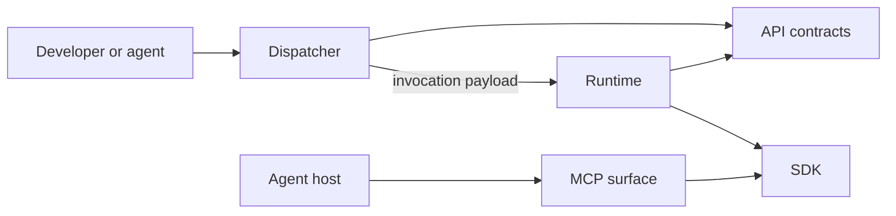

# Spec N' Roll

Spec N' Roll is a toolkit for spec-driven development with AI agents. Teams and agents define work in task-focused specifications, keep those specifications as an immutable record of implementation, and maintain a living application specification that deterministic validation enforces ([README](https://github.com/StarCruiseStudios/SpecNRoll/blob/main/README.md)). The README describes this as the intended scope. The current runtime is a stub that prints the invocation it receives ([README](https://github.com/StarCruiseStudios/SpecNRoll/blob/main/README.md)).

## Code location

| Repo | Paths | What is there | Source |
| --- | --- | --- | --- |
| `StarCruiseStudios/SpecNRoll` | [src/](https://github.com/StarCruiseStudios/SpecNRoll/tree/main/src) | The npm workspace packages | [src/README.md](https://github.com/StarCruiseStudios/SpecNRoll/blob/main/src/README.md) |
| `StarCruiseStudios/SpecNRoll` | [architecture/](https://github.com/StarCruiseStudios/SpecNRoll/tree/main/architecture), [atlas.config.json](https://github.com/StarCruiseStudios/SpecNRoll/blob/main/atlas.config.json) | Generated architecture artifacts and the configuration that drives them | [atlas.config.json](https://github.com/StarCruiseStudios/SpecNRoll/blob/main/atlas.config.json) |
| `StarCruiseStudios/SpecNRoll` | [V0/](https://github.com/StarCruiseStudios/SpecNRoll/tree/main/V0) | A separate project folder with its own package, documentation, and specifications | [V0/package.json](https://github.com/StarCruiseStudios/SpecNRoll/blob/main/V0/package.json) |

## Responsibilities and boundary

The packages split the work by role. A dispatcher resolves the project root and chooses a runtime, a runtime performs command behavior, an API package holds the contracts between them, an SDK holds behavior that several executables share, an MCP package adapts that behavior for agents, and a test package holds shared test support ([README](https://github.com/StarCruiseStudios/SpecNRoll/blob/main/README.md), [src/README.md](https://github.com/StarCruiseStudios/SpecNRoll/blob/main/src/README.md)).

## Architecture

Diagram sources:

- The dispatcher launches the runtime and uses the API contracts: [spec-n-roll README](https://github.com/StarCruiseStudios/SpecNRoll/blob/main/src/spec-n-roll/README.md).
- The runtime reads the invocation from the API contracts and delegates behavior to the SDK: [spec-n-roll-runtime README](https://github.com/StarCruiseStudios/SpecNRoll/blob/main/src/spec-n-roll-runtime/README.md).
- The MCP package adapts SDK behavior: [spec-n-roll-mcp README](https://github.com/StarCruiseStudios/SpecNRoll/blob/main/src/spec-n-roll-mcp/README.md).
- The agent host reaching the MCP package is inferred from the package's role as an MCP executable surface: [spec-n-roll-mcp README](https://github.com/StarCruiseStudios/SpecNRoll/blob/main/src/spec-n-roll-mcp/README.md).

| Container | Role | Technology | Source |
| --- | --- | --- | --- |
| Dispatcher | Public `spec-n-roll` and `snr` executables that resolve context and route to a runtime | TypeScript on Node.js | [spec-n-roll README](https://github.com/StarCruiseStudios/SpecNRoll/blob/main/src/spec-n-roll/README.md) |
| Runtime | Child-process executable that performs command behavior | TypeScript on Node.js | [spec-n-roll-runtime README](https://github.com/StarCruiseStudios/SpecNRoll/blob/main/src/spec-n-roll-runtime/README.md) |
| MCP surface | Protocol adapter for agent hosts | TypeScript on Node.js | [spec-n-roll-mcp README](https://github.com/StarCruiseStudios/SpecNRoll/blob/main/src/spec-n-roll-mcp/README.md) |

## Key flows

The dispatcher selects a project-local runtime when it finds a project root, and it selects the globally installed runtime when the caller requests it or no local runtime exists. It then passes the runtime a JSON invocation that holds the arguments, dispatcher metadata, project root, and working directory ([README](https://github.com/StarCruiseStudios/SpecNRoll/blob/main/README.md)).

The `init` command installs agent extensions into a project, for Codex and Cursor ([README](https://github.com/StarCruiseStudios/SpecNRoll/blob/main/README.md)).

## Key entities

- **Task specification.** A bounded unit of work that stays as a record of decisions ([README](https://github.com/StarCruiseStudios/SpecNRoll/blob/main/README.md)).
- **Application specification.** A living description of the application's functionality that validation executes ([README](https://github.com/StarCruiseStudios/SpecNRoll/blob/main/README.md)).

## Interfaces and dependencies

Developers call the dispatcher from the command line, and the MCP package provides the entry point for agent hosts ([README](https://github.com/StarCruiseStudios/SpecNRoll/blob/main/README.md)). The workspace validates its own package dependencies with [Atlas](/wiki/areas/engineering-toolkits/systems/atlas/overview.md), which it declares as a development dependency and runs through `atlas validate` and `atlas generate` scripts ([package.json](https://github.com/StarCruiseStudios/SpecNRoll/blob/main/package.json), [atlas.config.json](https://github.com/StarCruiseStudios/SpecNRoll/blob/main/atlas.config.json)).

## Runtime and deployment

A developer builds the packages in dependency order and runs the dispatcher through npm ([README](https://github.com/StarCruiseStudios/SpecNRoll/blob/main/README.md), [package.json](https://github.com/StarCruiseStudios/SpecNRoll/blob/main/package.json)).

## Design decisions and constraints

The dispatcher stays focused on routing so that runtime packages own command behavior, which lets a global dispatcher work with project-local runtimes ([README](https://github.com/StarCruiseStudios/SpecNRoll/blob/main/README.md), [spec-n-roll-runtime README](https://github.com/StarCruiseStudios/SpecNRoll/blob/main/src/spec-n-roll-runtime/README.md)).

## Open questions

- The relationship between the `V0` folder and the current packages is not stated in the files read.
- Which of the capabilities in the README exist beyond the stub runtime is not confirmed.

## Pages in this system

No pages exist below this overview yet. The [exploration backlog](/wiki/exploration-backlog.md) lists the planned ones.

## Wider scope

- [Agent workspace](/wiki/areas/agent-workspace/overview.md): the area that holds this system.
- [Armory workspace](/wiki/concepts/armory-workspace.md): the repositories that share a workspace with this one.
