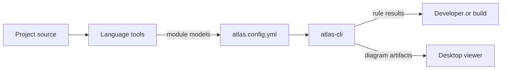

# Atlas

Atlas is a toolkit for understanding and enforcing the architecture of a software project. It evaluates declared dependency rules against source code and fails with actionable diagnostics when a package, layer, or module breaks them. It also generates architecture diagrams and dependency matrices, and shows them in a local desktop viewer ([README](https://github.com/StarCruiseStudios/Atlas/blob/main/README.md)).

## Code location

| Repo | Paths | What is there | Source |
| --- | --- | --- | --- |
| `StarCruiseStudios/Atlas` | [src/atlas-cli/](https://github.com/StarCruiseStudios/Atlas/tree/main/src/atlas-cli) | The language-neutral command line that validates rules and generates artifacts | [DOC.md](https://github.com/StarCruiseStudios/Atlas/blob/main/src/atlas-cli/DOC.md) |
| `StarCruiseStudios/Atlas` | [src/atlas/](https://github.com/StarCruiseStudios/Atlas/tree/main/src/atlas) | The Electron desktop viewer | [DOC.md](https://github.com/StarCruiseStudios/Atlas/blob/main/src/atlas/DOC.md) |
| `StarCruiseStudios/Atlas` | [src/tools/](https://github.com/StarCruiseStudios/Atlas/tree/main/src/tools) | Language-specific model generators and build tool integrations | [DOC.md](https://github.com/StarCruiseStudios/Atlas/blob/main/src/tools/DOC.md) |
| `StarCruiseStudios/Atlas` | [docs/](https://github.com/StarCruiseStudios/Atlas/tree/main/docs), [examples/](https://github.com/StarCruiseStudios/Atlas/tree/main/examples) | An explanation of the output and a sample project for each supported language | [understanding-atlas.md](https://github.com/StarCruiseStudios/Atlas/blob/main/docs/understanding-atlas.md) |

## Responsibilities and boundary

Atlas is language-neutral at its core. Each language tool analyzes source in its own ecosystem and writes a portable module model, and the command line validates rules and builds diagrams from those models without knowing which language produced them ([README](https://github.com/StarCruiseStudios/Atlas/blob/main/README.md), [understanding-atlas.md](https://github.com/StarCruiseStudios/Atlas/blob/main/docs/understanding-atlas.md)). A language generator owns the mapping from source to model, and the configuration selects which generated models take part in a run ([understanding-atlas.md](https://github.com/StarCruiseStudios/Atlas/blob/main/docs/understanding-atlas.md)).

Atlas performs static analysis. An arrow in a diagram means Atlas found a source-level fact, and it does not mean that the dependency is used at run time ([understanding-atlas.md](https://github.com/StarCruiseStudios/Atlas/blob/main/docs/understanding-atlas.md)). Diagram exclusions, hidden connections, and saved positions change presentation only and do not change validation ([understanding-atlas.md](https://github.com/StarCruiseStudios/Atlas/blob/main/docs/understanding-atlas.md)).

## Architecture

Diagram sources:

- Language tools turn source into module models, and the configuration lists the models for a run: [README](https://github.com/StarCruiseStudios/Atlas/blob/main/README.md), [understanding-atlas.md](https://github.com/StarCruiseStudios/Atlas/blob/main/docs/understanding-atlas.md).
- The command line validates rules and writes artifact data for the desktop application: [atlas-cli DOC.md](https://github.com/StarCruiseStudios/Atlas/blob/main/src/atlas-cli/DOC.md).
- The desktop application is a presentation adapter over the viewer that the command line hosts: [atlas DOC.md](https://github.com/StarCruiseStudios/Atlas/blob/main/src/atlas/DOC.md).

| Container | Role | Technology | Source |
| --- | --- | --- | --- |
| Command line | Validates rules, generates diagrams and layouts, and hosts the browser viewer | Node.js | [atlas-cli DOC.md](https://github.com/StarCruiseStudios/Atlas/blob/main/src/atlas-cli/DOC.md) |
| Desktop viewer | Shows the generated landscape and exports images | Electron with a sandboxed React renderer | [atlas DOC.md](https://github.com/StarCruiseStudios/Atlas/blob/main/src/atlas/DOC.md), [src DOC.md](https://github.com/StarCruiseStudios/Atlas/blob/main/src/DOC.md) |
| Language tools | Produce module models for TypeScript, Kotlin, Ruby, and C# projects | Per language, with Gradle, Rake, MSBuild, and npm integrations | [tools DOC.md](https://github.com/StarCruiseStudios/Atlas/blob/main/src/tools/DOC.md) |

## Key flows

A project generates a module model for each analyzed package, lists the models in its `atlas.config.yml`, then runs validation and generation, and optionally opens the viewer ([README](https://github.com/StarCruiseStudios/Atlas/blob/main/README.md)). The desktop viewer starts the same local artifact server that the command line uses and loads its landscape in a sandboxed window ([atlas DOC.md](https://github.com/StarCruiseStudios/Atlas/blob/main/src/atlas/DOC.md)).

## Key entities

- **Module model.** The portable description of one module's declarations and dependencies ([README](https://github.com/StarCruiseStudios/Atlas/blob/main/README.md)).
- **Rule.** A declared architectural constraint, such as no cycles or a layering direction, evaluated during validation and generation ([README](https://github.com/StarCruiseStudios/Atlas/blob/main/README.md)).
- **Diagram and layout.** A rendered graph view with its matrix and persisted node positions. Layout is presentation and not policy ([README](https://github.com/StarCruiseStudios/Atlas/blob/main/README.md)).

## Interfaces and dependencies

Callers use the `atlas-cli` and `atlas` commands and one root configuration file ([atlas-cli DOC.md](https://github.com/StarCruiseStudios/Atlas/blob/main/src/atlas-cli/DOC.md)). Other projects consume Atlas through npm packages, a Gradle plugin, Ruby gems, or an MSBuild integration ([README](https://github.com/StarCruiseStudios/Atlas/blob/main/README.md), [tools DOC.md](https://github.com/StarCruiseStudios/Atlas/blob/main/src/tools/DOC.md)). [Spec N' Roll](/wiki/areas/agent-workspace/systems/spec-n-roll/overview.md) is one consumer.

## Runtime and deployment

The repository is an npm workspace that also builds the Kotlin, Ruby, and C# tools and their examples, each through its own toolchain ([package.json](https://github.com/StarCruiseStudios/Atlas/blob/main/package.json)).

## Design decisions and constraints

The repository instructions require an object-oriented design in which classes and interfaces replace top-level functions ([AGENTS.md](https://github.com/StarCruiseStudios/Atlas/blob/main/AGENTS.md)).

## Open questions

- The internals of the rule engine, the graph model, and the viewer have not been read.

## Pages in this system

No pages exist below this overview yet. The [exploration backlog](/wiki/exploration-backlog.md) lists the planned ones.

## Wider scope

- [Engineering toolkits](/wiki/areas/engineering-toolkits/overview.md): the area that holds this system.
- [Armory workspace](/wiki/concepts/armory-workspace.md): the repositories that share a workspace with this one.
