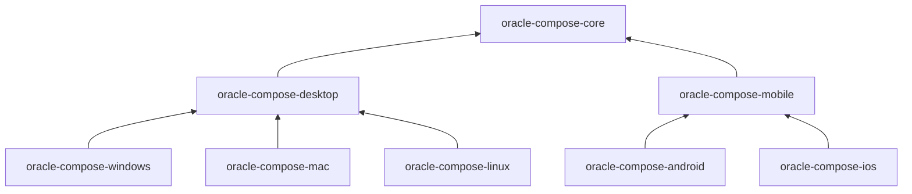

# Oracle Kotlin Toolkit

Oracle Compose is an independent Kotlin and Gradle build with eight libraries, shared example fixtures, and desktop, Android, and iOS hosts. It supplies reusable presentation, process-local coordination, and explicit native service adapters. Applications own domain data, authentication, external effects, and durable persistence ([kotlin/README.md](https://github.com/StarCruiseStudios/Oracle/blob/main/kotlin/README.md)). It is a container of the [Oracle](/wiki/areas/engineering-toolkits/systems/oracle/overview.md) system.

## Code location

| Repo | Paths | What is there | Source |
| --- | --- | --- | --- |
| `StarCruiseStudios/Oracle` | [kotlin/lib/](https://github.com/StarCruiseStudios/Oracle/tree/main/kotlin/lib) | The Compose libraries | [settings.gradle.kts](https://github.com/StarCruiseStudios/Oracle/blob/main/kotlin/settings.gradle.kts) |
| `StarCruiseStudios/Oracle` | [kotlin/example/](https://github.com/StarCruiseStudios/Oracle/tree/main/kotlin/example) | A shared example library and one host per platform | [settings.gradle.kts](https://github.com/StarCruiseStudios/Oracle/blob/main/kotlin/settings.gradle.kts) |
| `StarCruiseStudios/Oracle` | [kotlin/Docs/](https://github.com/StarCruiseStudios/Oracle/tree/main/kotlin/Docs) | Usage guides | [kotlin/README.md](https://github.com/StarCruiseStudios/Oracle/blob/main/kotlin/README.md) |
| `StarCruiseStudios/Oracle` | [kotlin/build-logic/](https://github.com/StarCruiseStudios/Oracle/tree/main/kotlin/build-logic) | Shared Gradle build logic | [settings.gradle.kts](https://github.com/StarCruiseStudios/Oracle/blob/main/kotlin/settings.gradle.kts) |

## Responsibilities

The libraries provide presentation and process-local coordination. Native adapters supply file pickers, resource access, app storage, sharing, clipboard, external links, lifecycle, notifications, permissions, capability discovery, and a diagnostic sink, each as a separate narrow interface instead of one platform service class ([PLATFORM-SERVICES.md](https://github.com/StarCruiseStudios/Oracle/blob/main/kotlin/Docs/PLATFORM-SERVICES.md)). Capability discovery grants no authority to perform an effect, and operations require explicit application admission ([PLATFORM-SERVICES.md](https://github.com/StarCruiseStudios/Oracle/blob/main/kotlin/Docs/PLATFORM-SERVICES.md)).

## Components

Diagram sources: every edge is a direct library dependency listed in the module table of [ARCHITECTURE.md](https://github.com/StarCruiseStudios/Oracle/blob/main/kotlin/Docs/ARCHITECTURE.md).

| Library | Targets | Responsibility | Source |
| --- | --- | --- | --- |
| `oracle-compose-core` | Desktop JVM, Android, iOS | Runtime, logging contracts, semantic theme, small controls, and service ports | [ARCHITECTURE.md](https://github.com/StarCruiseStudios/Oracle/blob/main/kotlin/Docs/ARCHITECTURE.md) |
| `oracle-compose-desktop` | Desktop JVM | Desktop UI and common window coordination | [ARCHITECTURE.md](https://github.com/StarCruiseStudios/Oracle/blob/main/kotlin/Docs/ARCHITECTURE.md) |
| `oracle-compose-mobile` | Android, iOS | Touch UI, navigation, and common mobile lifetime | [ARCHITECTURE.md](https://github.com/StarCruiseStudios/Oracle/blob/main/kotlin/Docs/ARCHITECTURE.md) |
| `oracle-compose-windows`, `-mac`, `-linux` | Desktop JVM | Operating system adapters on top of the desktop library | [ARCHITECTURE.md](https://github.com/StarCruiseStudios/Oracle/blob/main/kotlin/Docs/ARCHITECTURE.md) |
| `oracle-compose-android`, `-ios` | Android, iOS | Platform adapters on top of the mobile library | [ARCHITECTURE.md](https://github.com/StarCruiseStudios/Oracle/blob/main/kotlin/Docs/ARCHITECTURE.md) |

The desktop operating system modules are JVM libraries, not Kotlin/Native targets. Their factories validate the running operating system before adapter startup, and a desktop application selects exactly one adapter set ([ARCHITECTURE.md](https://github.com/StarCruiseStudios/Oracle/blob/main/kotlin/Docs/ARCHITECTURE.md)).

## Interfaces

Controllers and services use narrow client-owned ports with constructor injection for logging, value isolation, identity, clocks, schedulers, sources, and effects. Asynchronous work uses coroutine `suspend` operations and sealed outcomes for expected refusal ([ARCHITECTURE.md](https://github.com/StarCruiseStudios/Oracle/blob/main/kotlin/Docs/ARCHITECTURE.md)). `ObservableValue<T>` exposes `snapshot()` and a passive, nonreplaying `subscribe`, and the architecture rejects replacing it with a replaying `StateFlow` ([ARCHITECTURE.md](https://github.com/StarCruiseStudios/Oracle/blob/main/kotlin/Docs/ARCHITECTURE.md)). Each library records its public API in an `api` folder, and the build checks it through Kotlin ABI tasks ([kotlin/README.md](https://github.com/StarCruiseStudios/Oracle/blob/main/kotlin/README.md)).

## Runtime and deployment

The build uses the JDK selected by `JAVA_HOME` or the `PATH`, an existing Android SDK, and the Gradle wrapper. JVM output stays compatible with Java 17 ([kotlin/README.md](https://github.com/StarCruiseStudios/Oracle/blob/main/kotlin/README.md)). The settings file includes the iOS example only on macOS or when the `oracle.apple` property is `true` ([settings.gradle.kts](https://github.com/StarCruiseStudios/Oracle/blob/main/kotlin/settings.gradle.kts)). The verification tasks split into a shared check, a desktop check per operating system, Android checks, and an Apple check, and the documentation states that host tests do not establish device behavior or accessibility ([kotlin/README.md](https://github.com/StarCruiseStudios/Oracle/blob/main/kotlin/README.md)).

## Key flows and entities

- **Subscribe, then read.** Views subscribe before reading a snapshot, close subscriptions when they detach, and leave controllers at application-session scope ([kotlin/README.md](https://github.com/StarCruiseStudios/Oracle/blob/main/kotlin/README.md)).
- **Platform operations.** Operations return a `PlatformOutcome` that distinguishes success, cancellation, denial, unavailability, invalid input, and failure ([PLATFORM-SERVICES.md](https://github.com/StarCruiseStudios/Oracle/blob/main/kotlin/Docs/PLATFORM-SERVICES.md)).
- **Resource handles.** A `ResourceHandle` is an opaque adapter-owned identity and never exposes a raw path, Android Uri, or Apple URL ([PLATFORM-SERVICES.md](https://github.com/StarCruiseStudios/Oracle/blob/main/kotlin/Docs/PLATFORM-SERVICES.md)).

## Design decisions and constraints

- The supported graphical theme is dark, and light requests keep the dark palette ([kotlin/README.md](https://github.com/StarCruiseStudios/Oracle/blob/main/kotlin/README.md)).
- `expect` and `actual` declarations are reserved for low-level platform bindings and do not form a service locator ([ARCHITECTURE.md](https://github.com/StarCruiseStudios/Oracle/blob/main/kotlin/Docs/ARCHITECTURE.md)).
- Core runtime packages must not import Compose, Android, JVM filesystem, or Apple types ([ARCHITECTURE.md](https://github.com/StarCruiseStudios/Oracle/blob/main/kotlin/Docs/ARCHITECTURE.md)).
- Dependencies are locked, and API dumps are updated only after a deliberate review ([kotlin/README.md](https://github.com/StarCruiseStudios/Oracle/blob/main/kotlin/README.md)).

## Open questions

- Library source, the native adapters, and the example hosts were not read. The guides in `kotlin/Docs` for desktop, mobile, events, and help were read only through the README index.

## Pages in this container

No component, flow, entity, or concept pages exist yet. The [exploration backlog](/wiki/exploration-backlog.md) lists the planned ones.

## Wider scope

- [Oracle](/wiki/areas/engineering-toolkits/systems/oracle/overview.md): the system that holds this container.
- [TypeScript toolkit](/wiki/areas/engineering-toolkits/systems/oracle/containers/typescript-toolkit/overview.md): the sibling toolkit. Both document observation, draft, action, event, job, and state machine primitives.
- [Style guide](/wiki/areas/engineering-toolkits/systems/oracle/containers/style-guide/overview.md): the specification this toolkit implements.
