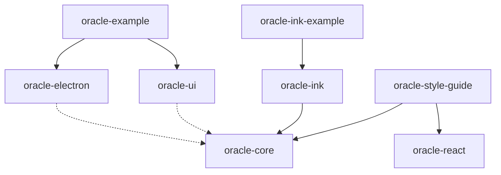

# Oracle TypeScript Toolkit

The TypeScript toolkit is an npm workspace for building React and Electron desktop applications, and it also holds a terminal shell built on Ink. It provides a reusable shell, build defaults, and communication and logging adapters, while each application owns its pages, its communication contract, its Electron startup, and its dependency composition ([ts/README.md](https://github.com/StarCruiseStudios/Oracle/blob/main/ts/README.md)). It is a container of the [Oracle](/wiki/areas/engineering-toolkits/systems/oracle/overview.md) system.

## Code location

| Repo | Paths | What is there | Source |
| --- | --- | --- | --- |
| `StarCruiseStudios/Oracle` | [ts/packages/](https://github.com/StarCruiseStudios/Oracle/tree/main/ts/packages) | Library packages | [package.json](https://github.com/StarCruiseStudios/Oracle/blob/main/ts/package.json) |
| `StarCruiseStudios/Oracle` | [ts/apps/](https://github.com/StarCruiseStudios/Oracle/tree/main/ts/apps) | Example applications and the style guide reader | [package.json](https://github.com/StarCruiseStudios/Oracle/blob/main/ts/package.json) |
| `StarCruiseStudios/Oracle` | [ts/Docs/](https://github.com/StarCruiseStudios/Oracle/tree/main/ts/Docs) | Toolkit reference and proposed capability specifications | [Docs/README.md](https://github.com/StarCruiseStudios/Oracle/blob/main/ts/Docs/README.md) |

The workspace root declares `packages/*` and `apps/*` as npm workspaces ([package.json](https://github.com/StarCruiseStudios/Oracle/blob/main/ts/package.json)). The style guide reader in `ts/apps/oracle-style-guide` is described on the [style guide](/wiki/areas/engineering-toolkits/systems/oracle/containers/style-guide/overview.md) page.

## Responsibilities

The toolkit supplies presentation shells, process-local runtime primitives, typed IPC and logging adapters, and Electron Vite defaults. It does not supply an application's pages, labels, IPC operations, or domain behavior ([Docs/README.md](https://github.com/StarCruiseStudios/Oracle/blob/main/ts/Docs/README.md)). The runtime primitives clone values they admit, commit state before notifying observers, and fence stale generations. They do not cancel external application effects or preserve recovery across renderer restarts ([Packages.md](https://github.com/StarCruiseStudios/Oracle/blob/main/ts/Docs/Packages.md)).

## Components

Diagram sources:

- `oracle-ink` uses the logging of `oracle-core`: [oracle-ink DOC.md](https://github.com/StarCruiseStudios/Oracle/blob/main/ts/packages/oracle-ink/src/DOC.md).
- The example applications wire the packages together: [ts/README.md](https://github.com/StarCruiseStudios/Oracle/blob/main/ts/README.md).
- The style guide reader renders through Oracle React and builds `oracle-core` and `oracle-react` first: [oracle-style-guide README](https://github.com/StarCruiseStudios/Oracle/blob/main/ts/apps/oracle-style-guide/README.md).
- The dashed edges are inferred from the build order, which builds `oracle-core` before `oracle-electron` and `oracle-ui`: [package.json](https://github.com/StarCruiseStudios/Oracle/blob/main/ts/package.json).

| Component | Role | Source |
| --- | --- | --- |
| `oracle-core` | Logger contract, log records, and a bounded observable buffer, plus runtime subpaths for observations, drafts, actions, events, jobs, scheduling, and state machines. It has no Electron or React dependency. | [ts/README.md](https://github.com/StarCruiseStudios/Oracle/blob/main/ts/README.md), [Packages.md](https://github.com/StarCruiseStudios/Oracle/blob/main/ts/Docs/Packages.md) |
| `oracle-electron` | Interface-driven IPC proxies, handler registration, Electron transports, an optional guarded transport, connection health observation, offline help, a tslog adapter, and Electron Vite defaults. | [Packages.md](https://github.com/StarCruiseStudios/Oracle/blob/main/ts/Docs/Packages.md) |
| `oracle-ui` | React shell, navigation, action menu, status bar, log drawer, dark theme, and reusable controls, layouts, collections, forms, inspection views, and action feedback. | [Packages.md](https://github.com/StarCruiseStudios/Oracle/blob/main/ts/Docs/Packages.md) |
| `oracle-ink` | Ink terminal shell with keyboard navigation, action menu, status line, and log panel. | [ts/README.md](https://github.com/StarCruiseStudios/Oracle/blob/main/ts/README.md) |
| `oracle-react` | Desktop and mobile React presentation library implemented from the Markdown style guide, with Neon and Iridium themes. | [oracle-react README](https://github.com/StarCruiseStudios/Oracle/blob/main/ts/packages/oracle-react/README.md) |
| `oracle-example` | Small Electron application that wires the packages together and serves as the template for new applications. | [ts/README.md](https://github.com/StarCruiseStudios/Oracle/blob/main/ts/README.md), [SETUP.md](https://github.com/StarCruiseStudios/Oracle/blob/main/ts/SETUP.md) |
| `oracle-ink-example` | Minimal Ink command-line application that demonstrates `oracle-ink` with buffered logging. | [ts/README.md](https://github.com/StarCruiseStudios/Oracle/blob/main/ts/README.md) |

The workspace `package.json` also lists `oracle-style-guide` among the built workspaces ([package.json](https://github.com/StarCruiseStudios/Oracle/blob/main/ts/package.json)). Each package exposes named subpath exports, and consumers import from those subpaths instead of reaching into `src/` or `dist/` ([Packages.md](https://github.com/StarCruiseStudios/Oracle/blob/main/ts/Docs/Packages.md)).

## Interfaces

**IPC.** An application declares renderer-to-main operations and main-to-renderer events as TypeScript interfaces, and a class in the receiving process implements each one. Method names are the channel names, and the contract is a compile-time check that does not validate payloads at runtime. The main process serves requests through `MainIpcRegistrar` and publishes events through `MainEventPublisher`. A toolkit preload exposes generic `invoke` and `subscribe` helpers on `window.oracle`, and the renderer calls `OracleApi.create` ([IPC-and-Logging.md](https://github.com/StarCruiseStudios/Oracle/blob/main/ts/Docs/IPC-and-Logging.md)).

**Guarded IPC.** The original `ElectronMainPort` is unguarded. An application can opt in to `GuardedElectronMainPort`, which requires a sender policy and a decoder for every request method before business code runs ([IPC-and-Logging.md](https://github.com/StarCruiseStudios/Oracle/blob/main/ts/Docs/IPC-and-Logging.md)).

**Logging.** `Logger` and `LoggerFactory` are contracts in `oracle-core/logging`. `BufferedLogFactory` keeps entries in memory for the log drawer, `AggregateLogFactory` fans messages out to several factories, and `TslogLogFactory` writes categorized output with optional file output. The application chooses the log file location ([IPC-and-Logging.md](https://github.com/StarCruiseStudios/Oracle/blob/main/ts/Docs/IPC-and-Logging.md)).

**Shell.** An application passes a logger factory, an identity, ordered pages, and optionally actions, status content, and a log source to `OracleShell`, and overrides colors through CSS variables on `.oracle-shell` ([ts/README.md](https://github.com/StarCruiseStudios/Oracle/blob/main/ts/README.md)).

## Runtime and deployment

The toolkit requires Node 22.12 or later with npm. The workspace scripts build every package in dependency order and provide typecheck, test, and package-check commands, and the example applications start with `npm run dev -w <workspace>` ([ts/README.md](https://github.com/StarCruiseStudios/Oracle/blob/main/ts/README.md)). `OracleViteConfig` from `oracle-electron/vite` supplies the Electron Vite settings for the main, preload, and renderer builds ([Packages.md](https://github.com/StarCruiseStudios/Oracle/blob/main/ts/Docs/Packages.md)). The packages are not published to npm. A separate application consumes them through local `file:` dependencies and requires the Oracle checkout to stay at the linked path ([Packages.md](https://github.com/StarCruiseStudios/Oracle/blob/main/ts/Docs/Packages.md)).

## Key flows and entities

- **Creating an application.** Copy `oracle-example`, replace the package versions with relative `file:` paths, and rename the example identifiers ([SETUP.md](https://github.com/StarCruiseStudios/Oracle/blob/main/ts/SETUP.md)).
- **Request and event round trip.** The renderer calls a proxy method, the registrar dispatches it to the handler class in main, and main publishes events back through a web contents port ([IPC-and-Logging.md](https://github.com/StarCruiseStudios/Oracle/blob/main/ts/Docs/IPC-and-Logging.md)).
- **Session primitives.** Observation, draft, and action sessions hold application-owned values while views attach and detach ([Packages.md](https://github.com/StarCruiseStudios/Oracle/blob/main/ts/Docs/Packages.md)).

## Design decisions and constraints

- Source files follow the repository conventions for one top-level export per file, no barrel files, path aliases, and a `DOC.md` in each `src/` subdirectory ([AGENTS.md](https://github.com/StarCruiseStudios/Oracle/blob/main/AGENTS.md)).
- The terminal implementation follows the HTML style guide terminal and glyph pages, keeps flat cell surfaces, and restores the terminal on exit ([oracle-ink DOC.md](https://github.com/StarCruiseStudios/Oracle/blob/main/ts/packages/oracle-ink/src/DOC.md)).
- The capability specifications in `ts/Docs/Specifications` describe proposed additions and are not shipped APIs ([Docs/README.md](https://github.com/StarCruiseStudios/Oracle/blob/main/ts/Docs/README.md)).

## Open questions

- The package source, including the shell composition and the runtime primitives, has not been read. The statements above come from the toolkit documentation.
- The shell behavior in `UI.md` and the build defaults in `Tooling.md` are not summarized.

## Pages in this container

No component, flow, entity, or concept pages exist yet. The [exploration backlog](/wiki/exploration-backlog.md) lists the planned ones.

## Wider scope

- [Oracle](/wiki/areas/engineering-toolkits/systems/oracle/overview.md): the system that holds this container.
- [Kotlin toolkit](/wiki/areas/engineering-toolkits/systems/oracle/containers/kotlin-toolkit/overview.md): the sibling toolkit that shares the same runtime concepts.
- [Style guide](/wiki/areas/engineering-toolkits/systems/oracle/containers/style-guide/overview.md): the specification this toolkit implements.
