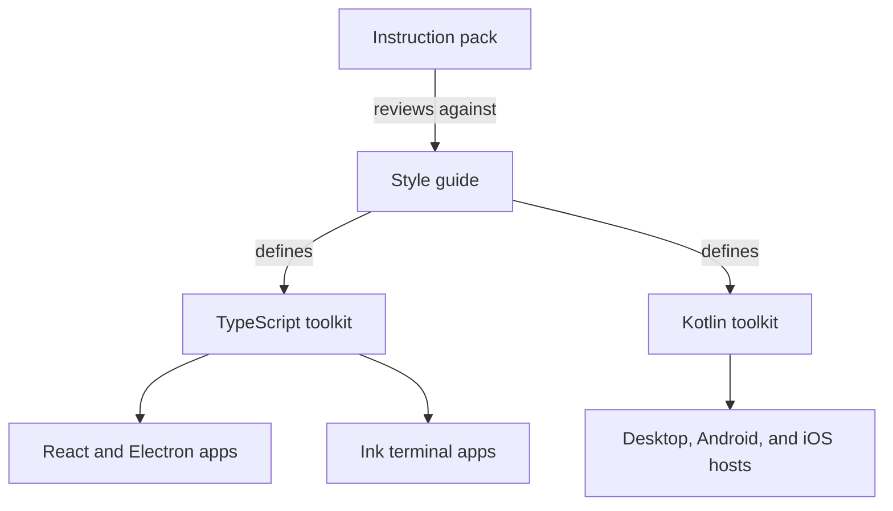

# Oracle

Oracle is a set of user interface toolkits and a style guide for desktop, mobile, and terminal applications. The repository holds two toolkits, one in TypeScript for React and Electron applications and one in Kotlin for Compose Multiplatform applications ([README](https://github.com/StarCruiseStudios/Oracle/blob/main/README.md)). A style guide defines the shared look and behavior, and an instruction pack lets an agent review interface work against it ([instructions.md](https://github.com/StarCruiseStudios/Oracle/blob/main/.compass/oracle-style-guide/instructions.md)).

## Code location

| Repo | Paths | What is there | Source |
| --- | --- | --- | --- |
| `StarCruiseStudios/Oracle` | [ts/](https://github.com/StarCruiseStudios/Oracle/tree/main/ts) | An npm workspace with packages, example applications, and a style guide application | [ts/README.md](https://github.com/StarCruiseStudios/Oracle/blob/main/ts/README.md) |
| `StarCruiseStudios/Oracle` | [kotlin/](https://github.com/StarCruiseStudios/Oracle/tree/main/kotlin) | A Gradle build with Compose libraries, examples, and platform hosts | [kotlin/README.md](https://github.com/StarCruiseStudios/Oracle/blob/main/kotlin/README.md) |
| `StarCruiseStudios/Oracle` | [style_guide/](https://github.com/StarCruiseStudios/Oracle/tree/main/style_guide), [style_guide_v2/](https://github.com/StarCruiseStudios/Oracle/tree/main/style_guide_v2) | The style guide as HTML pages and as Markdown pages | [instructions.md](https://github.com/StarCruiseStudios/Oracle/blob/main/.compass/oracle-style-guide/instructions.md), [style_guide_v2/](https://github.com/StarCruiseStudios/Oracle/tree/main/style_guide_v2) |
| `StarCruiseStudios/Oracle` | [.compass/oracle-style-guide/](https://github.com/StarCruiseStudios/Oracle/tree/main/.compass/oracle-style-guide) | An agent instruction pack with desktop, mobile, and terminal skills | [agent.json](https://github.com/StarCruiseStudios/Oracle/blob/main/.compass/oracle-style-guide/agent.json) |

## Responsibilities and boundary

The TypeScript toolkit supplies a reusable application shell, build defaults, and adapters for communication and logging. Each application owns its pages, its communication contract, its startup, and its dependency composition ([ts/README.md](https://github.com/StarCruiseStudios/Oracle/blob/main/ts/README.md)). The Kotlin toolkit supplies presentation, process-local coordination, and native service adapters, while applications own domain data, authentication, external effects, and durable storage ([kotlin/README.md](https://github.com/StarCruiseStudios/Oracle/blob/main/kotlin/README.md)).

The style guide pack names `style_guide/` as the only authority for review findings and design decisions, and states that existing code does not define the specification ([instructions.md](https://github.com/StarCruiseStudios/Oracle/blob/main/.compass/oracle-style-guide/instructions.md)).

## Architecture

Diagram sources:

- The pack reviews and designs interface work against the style guide, and the guide covers desktop, mobile, and terminal: [instructions.md](https://github.com/StarCruiseStudios/Oracle/blob/main/.compass/oracle-style-guide/instructions.md).
- The TypeScript toolkit serves React and Electron applications and includes an Ink terminal shell: [ts/README.md](https://github.com/StarCruiseStudios/Oracle/blob/main/ts/README.md).
- The Kotlin toolkit has desktop, Android, and iOS hosts: [kotlin/README.md](https://github.com/StarCruiseStudios/Oracle/blob/main/kotlin/README.md).
- The guide defining both toolkits is inferred from the pack naming `ts/packages` and `kotlin/lib` as code that must comply with the guide: [instructions.md](https://github.com/StarCruiseStudios/Oracle/blob/main/.compass/oracle-style-guide/instructions.md).

| Container | Role | Technology | Source |
| --- | --- | --- | --- |
| TypeScript toolkit | Shell, communication, logging, and terminal packages with example apps | React, Electron, and Ink in an npm workspace | [ts/README.md](https://github.com/StarCruiseStudios/Oracle/blob/main/ts/README.md) |
| Kotlin toolkit | Compose libraries for desktop and mobile with native service adapters | Kotlin and Gradle | [kotlin/README.md](https://github.com/StarCruiseStudios/Oracle/blob/main/kotlin/README.md) |
| Style guide | Reference pages for principles, color, layout, components, and patterns | HTML and Markdown | [instructions.md](https://github.com/StarCruiseStudios/Oracle/blob/main/.compass/oracle-style-guide/instructions.md), [style_guide_v2/](https://github.com/StarCruiseStudios/Oracle/tree/main/style_guide_v2) |

## Key flows

Agents use the instruction pack to review, design, and change interface code. The pack tells the agent to read the relevant guide pages first and to report gaps in the guide instead of editing it ([instructions.md](https://github.com/StarCruiseStudios/Oracle/blob/main/.compass/oracle-style-guide/instructions.md)).

## Key entities

- **Style guide.** The authority for interface decisions, organized by topic pages for color, shape, typography, layout, and motion, and by component pages ([instructions.md](https://github.com/StarCruiseStudios/Oracle/blob/main/.compass/oracle-style-guide/instructions.md)).
- **Instruction pack.** A Compass-format folder that holds agent metadata, instructions, and skills ([agent.json](https://github.com/StarCruiseStudios/Oracle/blob/main/.compass/oracle-style-guide/agent.json)).

## Interfaces and dependencies

Applications consume the TypeScript packages through npm and the Kotlin libraries through Gradle. A separate application can use the TypeScript toolkit by following its setup guide ([ts/README.md](https://github.com/StarCruiseStudios/Oracle/blob/main/ts/README.md)). The Oracle `armory.json` lists no repositories ([armory.json](https://github.com/StarCruiseStudios/Oracle/blob/main/armory.json)), and [Overmind](/wiki/areas/agent-workspace/systems/overmind/overview.md) includes the Oracle checkout in its workspace ([Overmind README](https://github.com/StarCruiseStudios/Overmind/blob/main/README.md)).

## Runtime and deployment

Each toolkit builds with its own toolchain from its own folder, which are npm for TypeScript and Gradle for Kotlin ([README](https://github.com/StarCruiseStudios/Oracle/blob/main/README.md)).

## Design decisions and constraints

The supported graphical theme for the Kotlin toolkit is dark ([kotlin/README.md](https://github.com/StarCruiseStudios/Oracle/blob/main/kotlin/README.md)).

## Open questions

- The relationship between `style_guide/` and `style_guide_v2/` is not stated in the files read. The pack names the first as the authority.
- The package APIs of both toolkits and the contents of the skills have not been read.

## Pages in this system

No pages exist below this overview yet. The [exploration backlog](/wiki/exploration-backlog.md) lists the planned ones.

## Wider scope

- [Engineering toolkits](/wiki/areas/engineering-toolkits/overview.md): the area that holds this system.
- [Armory workspace](/wiki/concepts/armory-workspace.md): how Oracle is shared with Overmind and the Agent repository.
