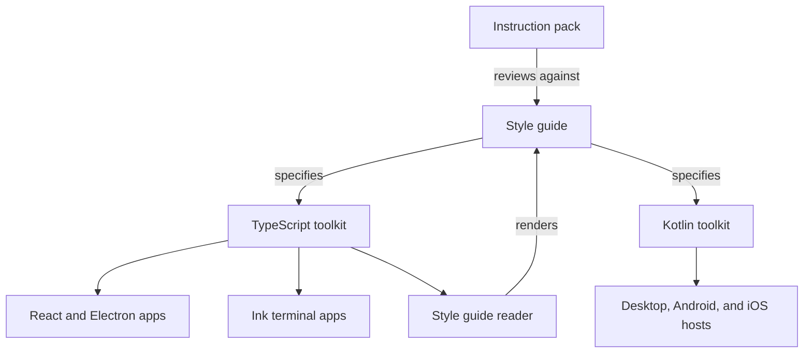

# Oracle

Oracle is a set of user interface toolkits and a style guide for desktop, mobile, and terminal applications. The repository holds two toolkits, one in TypeScript for React, Electron, and Ink applications and one in Kotlin for Compose Multiplatform applications ([README](https://github.com/StarCruiseStudios/Oracle/blob/main/README.md)). A style guide defines the shared look and behavior, and an instruction pack lets an agent review and design interface work against it ([instructions.md](https://github.com/StarCruiseStudios/Oracle/blob/main/.compass/oracle-style-guide/instructions.md)).

## Code location

| Repo | Paths | What is there | Source |
| --- | --- | --- | --- |
| `StarCruiseStudios/Oracle` | [ts/](https://github.com/StarCruiseStudios/Oracle/tree/main/ts) | An npm workspace with library packages, example applications, and the style guide reader application | [ts/README.md](https://github.com/StarCruiseStudios/Oracle/blob/main/ts/README.md) |
| `StarCruiseStudios/Oracle` | [kotlin/](https://github.com/StarCruiseStudios/Oracle/tree/main/kotlin) | A Gradle build with Compose libraries, examples, and platform hosts | [kotlin/README.md](https://github.com/StarCruiseStudios/Oracle/blob/main/kotlin/README.md) |
| `StarCruiseStudios/Oracle` | [style_guide/](https://github.com/StarCruiseStudios/Oracle/tree/main/style_guide), [style_guide_v2/](https://github.com/StarCruiseStudios/Oracle/tree/main/style_guide_v2) | The style guide as HTML pages and as Markdown pages | [instructions.md](https://github.com/StarCruiseStudios/Oracle/blob/main/.compass/oracle-style-guide/instructions.md), [style_guide_v2/](https://github.com/StarCruiseStudios/Oracle/tree/main/style_guide_v2) |
| `StarCruiseStudios/Oracle` | [.compass/oracle-style-guide/](https://github.com/StarCruiseStudios/Oracle/tree/main/.compass/oracle-style-guide), [.agents/skills/](https://github.com/StarCruiseStudios/Oracle/tree/main/.agents/skills) | The agent instruction pack with desktop, mobile, and terminal skills, and matching repository-level agent skills | [agent.json](https://github.com/StarCruiseStudios/Oracle/blob/main/.compass/oracle-style-guide/agent.json), [desktop SKILL.md](https://github.com/StarCruiseStudios/Oracle/blob/main/.agents/skills/oracle-developer-ui-desktop/SKILL.md) |
| `StarCruiseStudios/Oracle` | [AGENTS.md](https://github.com/StarCruiseStudios/Oracle/blob/main/AGENTS.md), [.docs/](https://github.com/StarCruiseStudios/Oracle/tree/main/.docs) | Coding conventions for contributors and the template for directory documentation | [AGENTS.md](https://github.com/StarCruiseStudios/Oracle/blob/main/AGENTS.md) |

## Responsibilities and boundary

The TypeScript toolkit supplies a reusable application shell, build defaults, and adapters for communication and logging. Each application owns its pages, its communication contract, its startup, and its dependency composition ([ts/README.md](https://github.com/StarCruiseStudios/Oracle/blob/main/ts/README.md)). The Kotlin toolkit supplies presentation, process-local coordination, and native service adapters, while applications own domain data, authentication, external effects, and durable storage ([kotlin/README.md](https://github.com/StarCruiseStudios/Oracle/blob/main/kotlin/README.md)). Both toolkits therefore stop at the same line: they provide reusable presentation and process-local behavior, and they leave domain meaning and durable guarantees to the application.

The instruction pack names `style_guide/` as the only authority for review findings and design decisions, and states that existing code does not define the specification ([instructions.md](https://github.com/StarCruiseStudios/Oracle/blob/main/.compass/oracle-style-guide/instructions.md)).

## Architecture

Diagram sources:

- The pack reviews and designs interface work against the style guide, and names `ts/packages` and `kotlin/lib` as code that must comply with it: [instructions.md](https://github.com/StarCruiseStudios/Oracle/blob/main/.compass/oracle-style-guide/instructions.md).
- The TypeScript toolkit serves React and Electron applications and includes an Ink terminal shell: [ts/README.md](https://github.com/StarCruiseStudios/Oracle/blob/main/ts/README.md).
- The style guide reader renders the Markdown guide through Oracle React: [oracle-style-guide README](https://github.com/StarCruiseStudios/Oracle/blob/main/ts/apps/oracle-style-guide/README.md).
- The Kotlin toolkit has desktop, Android, and iOS hosts: [kotlin/README.md](https://github.com/StarCruiseStudios/Oracle/blob/main/kotlin/README.md).

| Container | Role | Technology | Source |
| --- | --- | --- | --- |
| [TypeScript toolkit](/wiki/areas/engineering-toolkits/systems/oracle/containers/typescript-toolkit/overview.md) | Runtime, shell, communication, logging, graphical, and terminal packages with example apps | React, Electron, and Ink in an npm workspace | [ts/README.md](https://github.com/StarCruiseStudios/Oracle/blob/main/ts/README.md) |
| [Kotlin toolkit](/wiki/areas/engineering-toolkits/systems/oracle/containers/kotlin-toolkit/overview.md) | Compose libraries for desktop and mobile with native service adapters | Kotlin and Gradle | [kotlin/README.md](https://github.com/StarCruiseStudios/Oracle/blob/main/kotlin/README.md) |
| [Style guide](/wiki/areas/engineering-toolkits/systems/oracle/containers/style-guide/overview.md) | Reference pages, a reader application, and the agent instruction pack | HTML, Markdown, and agent instructions | [instructions.md](https://github.com/StarCruiseStudios/Oracle/blob/main/.compass/oracle-style-guide/instructions.md), [style_guide_v2/](https://github.com/StarCruiseStudios/Oracle/tree/main/style_guide_v2) |

## Key flows

Agents use the instruction pack to review, design, and change interface code. The pack tells the agent to read the relevant guide pages first, to fetch the skill for each affected platform, and to report gaps in the guide instead of editing it ([instructions.md](https://github.com/StarCruiseStudios/Oracle/blob/main/.compass/oracle-style-guide/instructions.md)).

Developers build an application by composing toolkit pieces. In the TypeScript toolkit, the application declares request and event interfaces, implements them in classes in the receiving process, and passes an injected logger factory to the shell ([IPC-and-Logging.md](https://github.com/StarCruiseStudios/Oracle/blob/main/ts/Docs/IPC-and-Logging.md)). A new Electron application starts as a copy of the maintained example with local `file:` dependencies on the Oracle packages ([SETUP.md](https://github.com/StarCruiseStudios/Oracle/blob/main/ts/SETUP.md)).

## Key entities

- **Style guide.** The authority for interface decisions, organized by topic pages for color, shape, typography, layout, and motion, and by component pages ([instructions.md](https://github.com/StarCruiseStudios/Oracle/blob/main/.compass/oracle-style-guide/instructions.md)).
- **Instruction pack.** A Compass-format folder that holds agent metadata, instructions, and one skill per platform ([agent.json](https://github.com/StarCruiseStudios/Oracle/blob/main/.compass/oracle-style-guide/agent.json)).
- **Observation, draft, and action sessions.** Process-local state primitives that clone admitted values, commit before notifying observers, and fence stale generations. Both toolkits provide them, and neither grants authority over external effects ([Packages.md](https://github.com/StarCruiseStudios/Oracle/blob/main/ts/Docs/Packages.md), [ARCHITECTURE.md](https://github.com/StarCruiseStudios/Oracle/blob/main/kotlin/Docs/ARCHITECTURE.md)).

## Interfaces and dependencies

Applications consume the TypeScript packages through npm workspace links or local `file:` dependencies, and Oracle does not currently publish them to npm ([Packages.md](https://github.com/StarCruiseStudios/Oracle/blob/main/ts/Docs/Packages.md)). Applications consume the Kotlin libraries through Gradle ([kotlin/README.md](https://github.com/StarCruiseStudios/Oracle/blob/main/kotlin/README.md)). The Oracle `armory.json` lists no repositories ([armory.json](https://github.com/StarCruiseStudios/Oracle/blob/main/armory.json)), and [Overmind](/wiki/areas/agent-workspace/systems/overmind/overview.md) includes the Oracle checkout in its workspace ([Overmind README](https://github.com/StarCruiseStudios/Overmind/blob/main/README.md)). The repository configures Codex with the Compass MCP server ([config.toml](https://github.com/StarCruiseStudios/Oracle/blob/main/.codex/config.toml)).

## Runtime and deployment

Each toolkit builds with its own toolchain from its own folder, which are npm for TypeScript and Gradle for Kotlin ([README](https://github.com/StarCruiseStudios/Oracle/blob/main/README.md)). The two builds are independent, and the Kotlin build states that runtime npm dependencies stay unchanged ([ARCHITECTURE.md](https://github.com/StarCruiseStudios/Oracle/blob/main/kotlin/Docs/ARCHITECTURE.md)).
## Design decisions and constraints

- **Interface-driven, constructor-injected design.** Contributors follow SOLID principles, model application logic with classes and interfaces, and inject dependencies through constructors or explicit composition roots ([AGENTS.md](https://github.com/StarCruiseStudios/Oracle/blob/main/AGENTS.md)).
- **Logging through an abstraction.** Application and library code must not call `console.*` directly and receives an injected logger ([AGENTS.md](https://github.com/StarCruiseStudios/Oracle/blob/main/AGENTS.md)).
- **Documented directories.** Each `src/` subdirectory carries a `DOC.md`, and rule exceptions are recorded in source comments or an `AGENT_EXCEPTION.md` file ([AGENTS.md](https://github.com/StarCruiseStudios/Oracle/blob/main/AGENTS.md)).
- **Dark theme only for Kotlin graphics.** The supported graphical theme for the Kotlin toolkit is dark, and light requests keep the dark palette ([kotlin/README.md](https://github.com/StarCruiseStudios/Oracle/blob/main/kotlin/README.md)). The instruction pack likewise states that light and custom themes are not specified ([instructions.md](https://github.com/StarCruiseStudios/Oracle/blob/main/.compass/oracle-style-guide/instructions.md)).
- **Discovery is not authority.** Checking a capability, subscribing, or opening a view does not start work or grant permission to perform an effect ([kotlin/README.md](https://github.com/StarCruiseStudios/Oracle/blob/main/kotlin/README.md), [Packages.md](https://github.com/StarCruiseStudios/Oracle/blob/main/ts/Docs/Packages.md)).

## Open questions

- The style guide exists as HTML pages in `style_guide/` and as Markdown pages in `style_guide_v2/`. The pack names the first as the authority, while Oracle React is described as implemented from the second ([instructions.md](https://github.com/StarCruiseStudios/Oracle/blob/main/.compass/oracle-style-guide/instructions.md), [oracle-react README](https://github.com/StarCruiseStudios/Oracle/blob/main/ts/packages/oracle-react/README.md)). No file read states whether the second replaces the first.
- `oracle-ui` supplies the React shell, and `oracle-react` is a separate library that its plan defines with no dependency on `oracle-ui` ([README](https://github.com/StarCruiseStudios/Oracle/blob/main/ts/README.md), [01-oracle-react.md](https://github.com/StarCruiseStudios/Oracle/blob/main/style_guide_v2/plans/01-oracle-react.md)). Whether `oracle-react` is meant to replace `oracle-ui` is not stated.

## Pages in this system

- [TypeScript toolkit](/wiki/areas/engineering-toolkits/systems/oracle/containers/typescript-toolkit/overview.md)
- [Kotlin toolkit](/wiki/areas/engineering-toolkits/systems/oracle/containers/kotlin-toolkit/overview.md)
- [Style guide](/wiki/areas/engineering-toolkits/systems/oracle/containers/style-guide/overview.md)

The [system listing](/wiki/areas/engineering-toolkits/systems/oracle/index.md) and the [exploration backlog](/wiki/exploration-backlog.md) show the current and planned pages.

## Wider scope

- [Engineering toolkits](/wiki/areas/engineering-toolkits/overview.md): the area that holds this system.
- [Armory workspace](/wiki/concepts/armory-workspace.md): how Oracle is shared with Overmind and the Agent repository.
