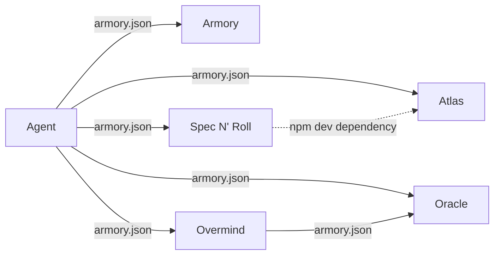

# Armory workspace

The Agent repository is one of several repositories that its owner develops together. [Armory](/wiki/areas/agent-workspace/systems/armory/overview.md) joins them: a project lists the other repositories in an `armory.json` file, and Armory checks them out side by side and generates one editor workspace that opens all of them ([README](https://github.com/StarCruiseStudios/Armory/blob/main/README.md)). The Agent repository lists five such repositories ([armory.json](https://github.com/StarCruiseStudios/Agent/blob/main/armory.json)).

## How it is realised

Each repository can carry its own `armory.json`. When Armory runs a command, it also runs the command for the configuration of every dependency and skips any configuration it has already processed, so a repository that appears twice in the tree is handled once ([README](https://github.com/StarCruiseStudios/Armory/blob/main/README.md), [armory.ts:932-941](https://github.com/StarCruiseStudios/Armory/blob/main/armory.ts#L932-L941)).

The configuration in the Agent repository names the workspace `Agent` and lists Armory, Atlas, Oracle, Overmind, and Spec N' Roll ([armory.json](https://github.com/StarCruiseStudios/Agent/blob/main/armory.json)). The generated workspace file maps each of them to a folder beside the Agent folder, and adds Armory tasks that run the script from the Agent folder ([Agent.armory.code-workspace](https://github.com/StarCruiseStudios/Agent/blob/main/Agent.armory.code-workspace)).

Diagram sources:

- Agent lists five repositories: [armory.json](https://github.com/StarCruiseStudios/Agent/blob/main/armory.json).
- Overmind lists Oracle: [armory.json](https://github.com/StarCruiseStudios/Overmind/blob/main/armory.json). The Overmind documentation states the purpose, which is to migrate functionality between the two: [README](https://github.com/StarCruiseStudios/Overmind/blob/main/README.md).
- Oracle lists no repositories: [armory.json](https://github.com/StarCruiseStudios/Oracle/blob/main/armory.json).
- Spec N' Roll declares the Atlas package as a development dependency and runs it for architecture checks: [package.json](https://github.com/StarCruiseStudios/SpecNRoll/blob/main/package.json). This edge is not an Armory link, so it is drawn dashed.

## Where it applies

- [Armory](/wiki/areas/agent-workspace/systems/armory/overview.md) implements the mechanism.
- [Overmind](/wiki/areas/agent-workspace/systems/overmind/overview.md) uses it to bring [Oracle](/wiki/areas/engineering-toolkits/systems/oracle/overview.md) into its own workspace.
- [Spec N' Roll](/wiki/areas/agent-workspace/systems/spec-n-roll/overview.md) depends on [Atlas](/wiki/areas/engineering-toolkits/systems/atlas/overview.md) through npm and does not use Armory to reach it, as far as the files read show.
- The Agent repository's own tools, [Compass](/wiki/areas/agent-workspace/systems/compass/overview.md), [Codex Commander](/wiki/areas/agent-workspace/systems/codex-commander/overview.md), and the [Skills Library](/wiki/areas/agent-workspace/systems/skills-library/overview.md), share the workspace with the five repositories.

## Working with it

Armory clones with a fast-forward-only pull, so a developer commits or preserves local work in a dependency before running a sync ([README](https://github.com/StarCruiseStudios/Overmind/blob/main/README.md)). The downloaded script and the generated workspace file are recreated by Armory commands, so a project tracks only `armory.json` ([README](https://github.com/StarCruiseStudios/Overmind/blob/main/README.md)).

Compass reads an instruction pack catalog from a `.compass` folder inside a project ([README](https://github.com/StarCruiseStudios/Agent/blob/main/compass/README.md)), and Oracle contains one at [.compass/oracle-style-guide](https://github.com/StarCruiseStudios/Oracle/tree/main/.compass/oracle-style-guide). Inferred from these two facts: a Compass server pointed at the Oracle checkout can serve that pack. No file read states that the two are connected.

## Open questions

- The Agent repository's `.gitignore` handling of the downloaded script and the generated workspace file was not confirmed.
- Whether any tool configures Compass to use the Oracle pack is not stated in the files read.

## Related

- [Agent workspace](/wiki/areas/agent-workspace/overview.md): the area that holds the Agent tools and the workspace tooling.
- [Engineering toolkits](/wiki/areas/engineering-toolkits/overview.md): the area that holds Atlas and Oracle.
